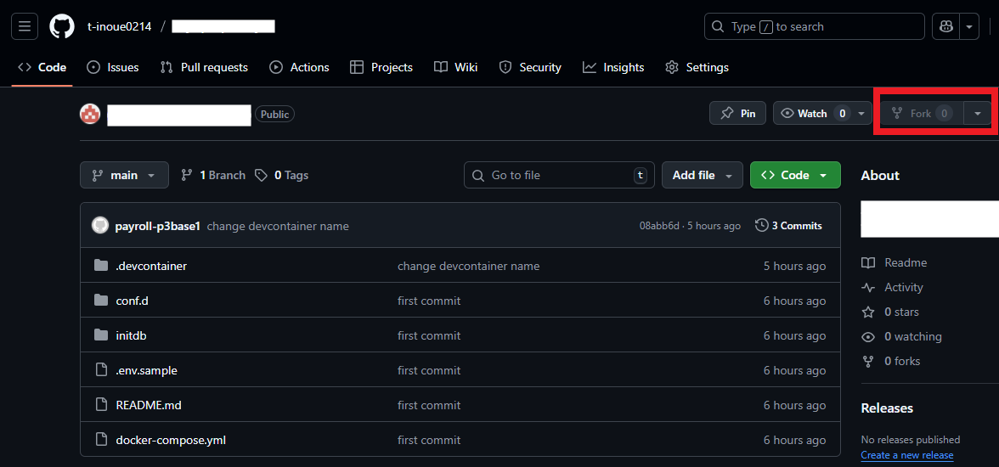
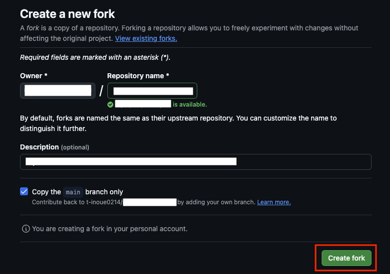
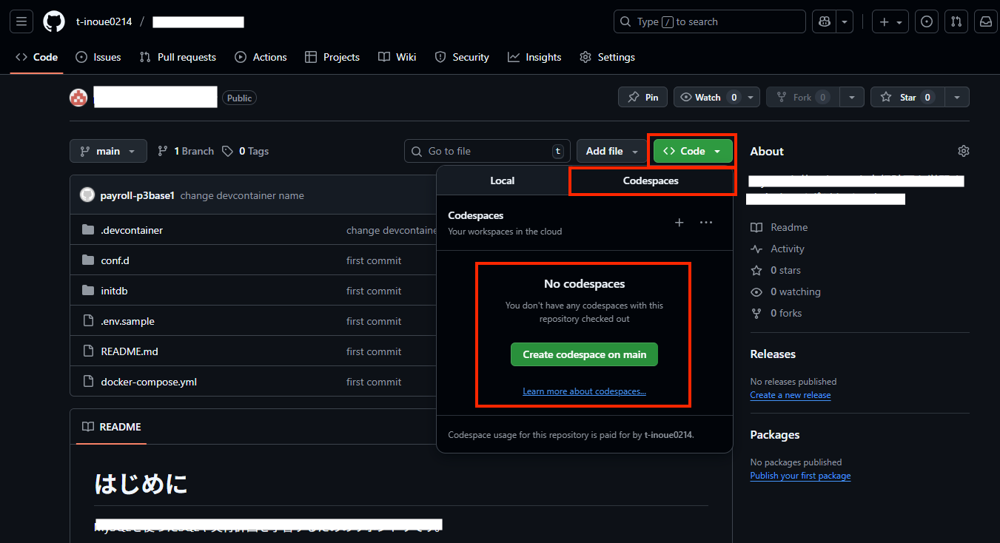
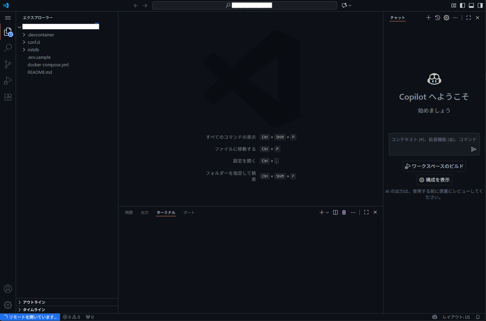

# starter-web-async

環境構築不要、ブラウザだけで学べる、Webサービスの非同期処理（ジョブキュー・定期バッチ・Pub/Sub・ワークフロー）の実践講座へようこそ。

このリポジトリは、**GitHub Codespaces** を使って、Java の基礎とビルドの基礎を終えた学習者が、Webサービスの非同期処理を実体験を通じて学べるように作っています。時間のかかる処理をバックグラウンドで進める **ジョブキュー** を土台に、定期バッチ、Pub/Sub、ワークフローへと広げます。ECサイトの「注文確定」を題材に、同期呼び出しの限界を体験するところから始め、ack、再配達、デッドレターキュー、冪等性、順序までを、自分の手で1つずつ組み上げます。ブローカーには RabbitMQ を使います。

> **⚠️ 学習上の重要ルール**
> [RabbitMQ Documentation](https://www.rabbitmq.com/docs) と [RabbitMQ Java Client API Guide](https://www.rabbitmq.com/client-libraries/java-api-guide)、[Java SE Platform API仕様](https://docs.oracle.com/en/java/javase/21/docs/api/index.html) の情報が「最新かつ正確」な一次情報です。
> ここで記載した内容や、もし AI から回答を得た場合であっても、**必ず公式ドキュメントの記載を確認しながら実装する癖** をつけてください。

---

## 📋 0. このリポジトリを始める前に

このリポジトリは、以下の2つのリポジトリを完了した人を対象にしています。

1. **[starter-java-first-steps](https://github.com/t-inoue0214/starter-java-first-steps)** — 全16章を完了していること（特に第10〜13章の実践編で、ファイル・DB・スレッド・HTTPの基礎に触れていること）
2. **[starter-java-build-tools](https://github.com/t-inoue0214/starter-java-build-tools)** — 全8章を完了していること（Mavenでのビルド・依存関係の扱いに慣れていること）

非同期処理・メッセージブローカー・AMQP については、前提知識は不要です。用語は初めて出てきたところで説明します。

## 💻 1. 開発環境 (Development Environment)

この勉強会では **GitHub Codespaces** を使用します。

面倒な環境構築は不要です。ブラウザさえあれば、すぐに学習を始められます。

1. **GitHubにログイン** してください（アカウントがない場合は作成してください）。

1. このリポジトリをフォークするため、右上の`fork`をクリックする。

    

1. `Create fork`ボタンをクリックして、フォーク（自分のアカウントにコピーして新しいリポジトリを作成）する。

    

1. `Codespace`を起動するため、`Code`タブに移動し、右上にある緑色の`code`のプルダウンメニューを開き、`Codespace`タブを開き、`Create codespace on main`をクリックする。

    

1. `Codespace`の生成にはしばらく時間がかかるため、しばらく待つ。

    

1. `VSCode`が起動するが、画面左下が`リモートを開いています...`の間は待つ。

    

1. 画面左下が`Codespace`になった場合は、`Codespace`が起動完了しました

    

Codespaces の起動時に、開発コンテナに入っている RabbitMQ も自動で起動します（`broker.sh`）。

### Codespaces利用上の注意

- `Github`の`Codespaces`を利用する。`Codespaces`は設定によってはコストがかかるため、[Codespace の利用上の注意](./CODE_SPACES_SERVICE.md) はよく確認すること。
- コストをかけないためにも、セキュリティの意味でも、使い終わったら [停止方法](./CODE_SPACES_SERVICE.md#3-停止方法) に従って停止することを推奨する。

---

## 🚀 2. 学習の始め方

1. **Codespaces を起動**
    - フォーク済みの自分のリポジトリで、`Code` タブ → `Codespaces` タブ → `Create codespace on main` をクリックする。
1. **環境の準備を待つ**
    - ブラウザでVS Codeが起動する。初回はJavaのセットアップと RabbitMQ のインストールのために数分かかる。
1. **学習スタート**
    - `chapters/README.md` を開き、章の一覧から `00-overview.md`（これから学ぶものを知る）を開く。
    - 各章の指示に従い、`src/main/java/com/example/async/` 以下のコードを開いて読み、`./run.sh` で実行する。
    - `./run.sh <クラス名>` で実行し、章に書かれた結果と同じになるかを確かめる。

---

## 📚 3. この講座で学ぶこと

本編は、以下の6つのパートに分かれています（全21章＋準備の第0章）。詳細な章一覧・読むファイル・ゴールは **[chapters/README.md](./chapters/README.md)** を参照してください。

| Part | 内容 |
| :--- | :--- |
| A. 非同期処理の地図と準備 (01-06) | 同期呼び出しの限界、ファイル・DB・UDP などの代替案、非同期処理の地図（5つのパターン）、設計の考え方、製品の全体像、AMQP |
| B. ジョブキュー (07-13) | HTTP でのポーリングの限界、`amqp-client` と `DefaultConsumer`、ワーカーの分担、消失・重複・毒メッセージの基本の対処 |
| C. 定期バッチ (14) | 時刻がジョブを積む。スケジューラーの二重投入と滞留 |
| D. Pub/Sub (15-19) | Pub/Sub とは、用語（キュー・イベントバス）の整理、fanout、topic、メッセージ設計、順序 |
| E. ワークフロー (20) | ジョブの連鎖と、途中で失敗したときに起きること |
| F. まとめ (21) | 製品ごとの機能の対応表、設計チェックリスト、次に学ぶテーマ（Saga・Outbox など） |

---

## ⚙️ 4. 技術スタック (Tech Stack)

| 要素 | 採用技術 |
| --- | --- |
| 言語 | Java 21 |
| ビルド | Maven 3.x |
| メッセージブローカー | RabbitMQ 4（Debian 13 の標準パッケージ、`broker.sh` で操作） |
| プロトコル | AMQP 0-9-1（Java クライアント）、HTTP（管理 API） |
| AMQP クライアント | `com.rabbitmq:amqp-client`（第8章で追加） |
| ログ出力 | `slf4j-simple`（`amqp-client` のログ用、第8章で追加） |
| JSON | 配布済みの `SimpleJson`（フラットな JSON のみ） |

この講座は以下の環境で動作するように設定されています（自動構築されます）。

- **OS:** Debian GNU/Linux 13 (Trixie)
- **Java:** OpenJDK 21
- **エディタ:** VS Code (Codespaces) 上に Java / Maven 用の拡張機能を事前インストール済み

### コーディング制約

- **Java**: `var` は使用しない。`List<String> list = ...` のようにクラス名を常に明示する
- フレームワーク（Spring など）は使わない。ライブラリは上の表にあるものだけを使う

### 環境変数

| 変数名 | デフォルト | 説明 |
| --- | --- | --- |
| `RABBITMQ_HOST` | `localhost` | RabbitMQ のホスト名 |
| `RABBITMQ_PORT` | `5672` | AMQP のポート |
| `RABBITMQ_USER` | `app` | ユーザー名 |
| `RABBITMQ_PASSWORD` | `app` | パスワード |
| `RABBITMQ_VHOST` | `/` | 仮想ホスト |

---

## 🔨 5. 実行方法

```bash
# RabbitMQ の起動・停止（Codespaces の起動時には自動で起動します）
./broker.sh start
./broker.sh stop

# Java プログラムの実行（com.example.async. は省略可）
./run.sh p2p.HelloConsumer
./run.sh p2p.HelloProducer 3
```

RabbitMQ の管理画面は、VS Code の「ポート」タブで 15672 番を開き、ユーザー名 `app`、パスワード `app` でログインします。

全章のコードは `src/main/java/com/example/async/` 以下に、章ごとのパッケージに分けて置いてあります。

---

## 📝 重視する思想

このリポジトリでは、「実際に手を動かしてみる」ことを何より重視しています。

エンジニアの技術は、資料を読むだけで覚えたり、理解したりすることは難しいものです。

例えば、自動車教習所の教本を完璧に暗記したとしても、それだけで実際に車を運転できるようにはなりません。

ハンドルを握り、アクセルを踏むという「実体験」がなければ、運転技術は身につきません。

ソフトウェア技術も同じです。

技術的な仕組みを知ることも大切ですが、実際に実行した経験こそが現場で役立ちます。

読むだけで終わらせず、ぜひご自身の手で実行してみてください。メッセージの消失・重複・順番の入れ替わりといったトラブルは、自分の手で起こしてみたときに一番よく理解できます。
