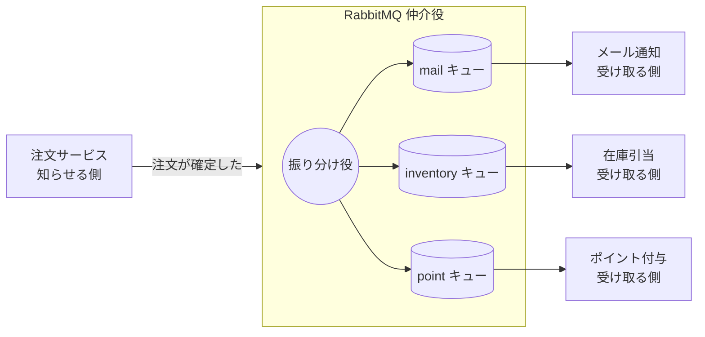
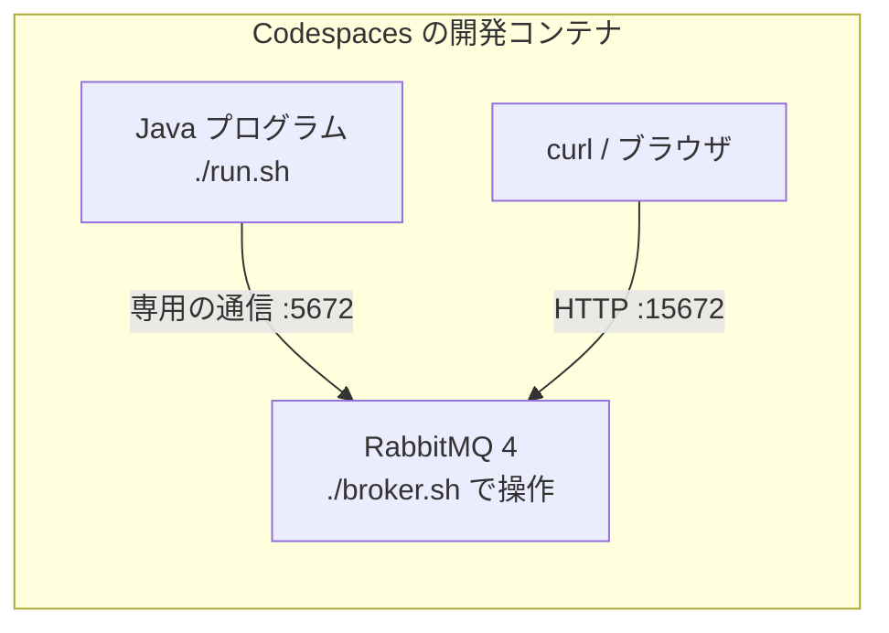

# 第0章: これから学ぶものを知る

## この章のゴール

この講座で作るものの全体像をつかみ、RabbitMQ が起動していること、管理画面を開けること、`./run.sh` で Java プログラムを実行できることを確認します。

## Why: なぜこれを学ぶのか

Webサービスの機能は、1回のリクエストの中ですべてを終わらせられるとは限りません。注文を確定したら、確認メールの送信・在庫の引当・ポイントの付与・データの集計用システムへの送信といった「注文のあとにやる処理」がどんどん増えていきます。

これらを1つずつ順番に呼び出して、終わるのを待っていると、どこか1つが遅いだけで注文画面も遅くなります。どこか1つが落ちれば、注文そのものも失敗します。この問題を解くのが **非同期処理** です。時間のかかる処理や「あとでよい処理」を、ユーザーの待ち時間の外側で進めます。

非同期処理にはいくつかのやり方がありますが、どれも「やることを一度**行列（キュー）**に並べておき、**働き手（ワーカー）**が順番に取り出して片付ける」という同じ土台から作れます。それぞれのやり方の名前は、第3章で整理します。この講座では、メッセージを仲介してくれる無料のソフトウェア **RabbitMQ** を手元で動かし、この土台となる考え方を体験しながら学びます。クラウドにも似たサービスがありますが、中で何が起きているかを知らないと、「処理が消えた」「2回実行された」「順番が入れ替わった」といった現場のトラブルに対処できません。

## 前提

次の2つのリポジトリを完了していることを前提にしています。

- [starter-java-first-steps](https://github.com/t-inoue0214/starter-java-first-steps)（特に第10〜13章：ファイル、JDBC、スレッド、HTTPクライアント）
- [starter-java-build-tools](https://github.com/t-inoue0214/starter-java-build-tools)（Maven の依存関係）

## ステップ1: この講座で作るものを知る

題材は、ECサイトの「注文確定」と、そこから派生する時間のかかる処理（領収書の PDF 作成、売上の集計など）です。最初に作るのは、重い処理を行列（キュー）に並べて、働き手（ワーカー）に任せる仕組みです。そこから、「1つの出来事を複数の相手に知らせる仕組み」や「処理を順番につなげる仕組み」へと広げます。完成形の一部は、次のような姿です。今は細かい名前を覚える必要はありません。「注文サービスが知らせると、メール・在庫・ポイントの3つに届く」という流れだけ見てください。



講座は次の流れで進みます。

| Part | 内容 |
| :--- | :--- |
| A（1〜6章） | 「順番に呼んで待つ」やり方の困りごとと代わりの方法を試し、非同期処理の地図・設計の判断・製品・通信ルールの考え方を学ぶ |
| B（7〜13章） | ジョブキュー（やることを行列に並べて働き手に任せる仕組み）を作る。消失・重複・処理できないメッセージも体験する |
| C（14章） | 定期バッチ。決まった時刻に仕事を行列へ並べる形を作り、二重に並べてしまう問題を体験する |
| D（15〜19章） | Pub/Sub。1つの出来事を複数の相手に届け、メッセージの作り方を設計し、順番の乱れを体験する |
| E（20章） | ワークフロー。処理を順番につなげ、途中で失敗すると何が起きるかを体験する |
| F（21章） | 全体をまとめ、次に学ぶとよいテーマを知る |

講座の途中で用語の意味を忘れたときは、[用語集](./glossary.md) に戻ってきてください。

**Why**: 先に完成形を見ておくと、各章で作る小さなプログラムが全体のどこに当たるのかを見失わずに済みます。

## ステップ2: 開発環境の構成を知る

Codespaces を起動すると、Java 21 と Maven の入った開発用の環境（開発コンテナ）が立ち上がります。RabbitMQ はこの環境の中にあらかじめインストールされていて、起動時に自動で立ち上がります。



| ポート | 用途 |
| :--- | :--- |
| 5672 | Java プログラムが RabbitMQ と話すための窓口（AMQP という通信ルールを使う。第6章で説明） |
| 15672 | ブラウザで開く管理画面と、curl などで操作できる管理用の窓口 |

RabbitMQ のインストールは `.devcontainer/install-rabbitmq.sh`、起動と停止は `broker.sh` が担当しています。`broker.sh` は、起動のたびに学習用ユーザー `app`（パスワード `app`）がなければ作ります。

**Why**: RabbitMQ の既定ユーザー `guest` は、同じマシンの中（localhost）からの接続に限られます。Codespaces ではブラウザから 15672 番ポートを開くため、転送された接続は localhost からとは見なされず、`guest` ではログインできません。そこで学習用ユーザー `app` を作っています。

**💼 現場Tip**: 本番では、RabbitMQ を Docker などのコンテナ（アプリを動かす環境を箱にまとめたもの）で動かすのが一般的です。この講座で開発用の環境に直接インストールしているのは、学習環境を単純にするためです。RabbitMQ の種類やバージョンが同じなら、アプリのコードは動かし方に関係なく同じです。

## ステップ3: RabbitMQ が起動しているか確かめる

ターミナルで次のコマンドを実行します。

```bash
./broker.sh status
```

`RabbitMQ は起動しています` と表示されれば起動しています。停止していれば、次のコマンドで起動します。

```bash
./broker.sh start
```

講座の中で使う RabbitMQ の操作は次のとおりです。

| 操作 | コマンド |
| :--- | :--- |
| 起動 | `./broker.sh start` |
| 停止 | `./broker.sh stop` |
| 再起動 | `./broker.sh restart` |
| 状態の確認 | `./broker.sh status` |
| ログを見る | `./broker.sh logs` |
| キューもメッセージも全部消して作り直す | `./broker.sh reset` |

**⚠️ よくある失敗・誤解**: 起動直後は RabbitMQ の準備に10秒ほどかかります。`./broker.sh start` は準備が終わるまで待ってから戻りますが、Codespaces の起動直後は、自動起動がまだ途中の場合があります。`Connection refused` になったら、少し待ってから再実行してください。

## ステップ4: 管理画面を開く

VS Code の「ポート」タブで 15672 番の「ブラウザーで開く」をクリックします。ログイン画面が出たら、ユーザー名 `app`、パスワード `app` でログインします。

上部のタブは次のとおりです。この講座では何度も開くので、場所を覚えておきましょう。今は意味がわからなくても大丈夫です。各タブの言葉は、第6章までに順に説明します。

| タブ | 見るもの |
| :--- | :--- |
| Overview | RabbitMQ 全体のメッセージ数の推移 |
| Connections | つながっているプログラム |
| Channels | 1本の接続の中の、メッセージをやり取りする通り道 |
| Exchanges | メッセージの振り分け役 |
| Queues and Streams | メッセージがたまる場所（キュー）と、その件数 |

**💼 現場Tip**: 本番環境の管理画面は、強いパスワードと通信の暗号化で守り、社内ネットワークからしか開けないようにするのが普通です。管理画面からはキューの削除やメッセージの破棄もできるため、権限は必要最小限にします。

## ステップ5: run.sh で Java プログラムを実行する

この講座では、メインクラスを指定して Java プログラムを起動する場面がたくさんあります。毎回 `mvn` の長いコマンドを打たなくて済むよう、`run.sh` を用意しています。

```bash
./run.sh <パッケージ以下のクラス名> [引数...]
# 例: com.example.async.p2p.HelloConsumer を起動する
./run.sh p2p.HelloConsumer
```

中では、次の2つを行っています。

1. `mvn -q compile dependency:build-classpath` でコンパイルし、依存ライブラリの一覧を `target/classpath.txt` に書き出す
2. `java -cp target/classes:<依存ライブラリ> <メインクラス>` で起動する（`-cp` はクラスの置き場所の指定）

**Why**: この講座では、送信側と受信側を **別々のターミナルで同時に** 動かす場面がたくさんあります。`mvn exec:java` でも起動できますが、Maven の出力が混ざって読みにくくなります。`java` コマンドで直接起動すると、プログラムの出力だけを見られます。

ターミナルは VS Code の「ターミナル」パネルの `+` で増やせます。分割ボタンで横に並べると、送信側と受信側を同時に見られて便利です。

## ステップ6: コードの置き場所を確認する

この講座のコードは、すべて `src/main/java/com/example/async/` 以下に、章ごとのパッケージに分けて置いてあります。各章では、図表と抜粋で考え方をつかんでから、リンク先のコードを開いて読み、`./run.sh` で動かします。

`common/` には、どの章でも使う次のクラスが置いてあります。

| クラス | 役割 |
| :--- | :--- |
| `Console` | 時刻とスレッド名つきでログを出す `log`、重い処理の代わりに待つ `sleep` |
| `SimpleJson` | 入れ子のない単純な JSON の組み立てと読み取り（第18章から使う） |
| `RabbitConnection` | RabbitMQ への接続をまとめたもの（第8章で読む） |

**Why**: メッセージのやり取りでは「いつ」「どのスレッドで」受け取ったかが重要な情報になります。`Console.log` はすべての出力に `[09:00:00.123][pool-1-thread-4]` のような情報を付けます。

## 動作確認

次の3つを確認できたら、この章は完了です。

1. `./broker.sh status` で `RabbitMQ は起動しています` と表示される
2. 管理画面に `app` / `app` でログインでき、Overview タブが表示される
3. 管理画面の Queues and Streams タブを開くと、まだキューが1つもない

## もっと良くしてみよう

### 理解確認

1. 既定ユーザー `guest` を使わず、`app` ユーザーを作っているのはなぜでしょうか。
2. 5672 番ポートと 15672 番ポートは、それぞれ何に使うのでしょうか。
3. `run.sh` が `mvn exec:java` ではなく `java` コマンドで起動しているのはなぜでしょうか。

### 発展改善クイズ

1. `broker.sh` にはユーザー名とパスワードが直接書かれています。本番環境でこのまま使うと何が問題になるか、どう直すとよいか考えてみましょう。
2. RabbitMQ は今1台だけで動いています。このコンテナが壊れたとき、Webサービスにどのような影響が出るでしょうか。

---

| | [全章目次](./README.md) | [第1章: 同期呼び出しの限界を体験する →](./01-sync-call-limits.md) |
| - | :-: | --: |
