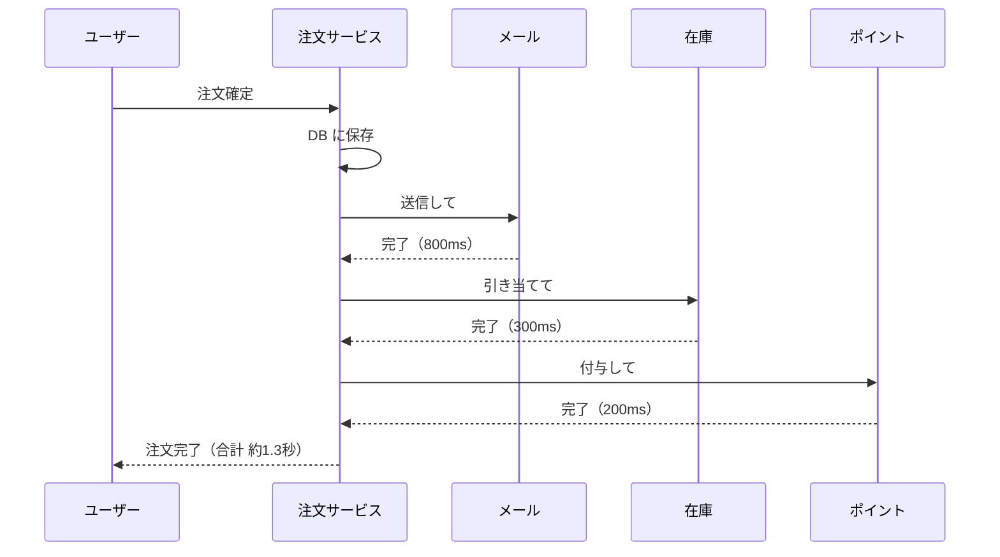
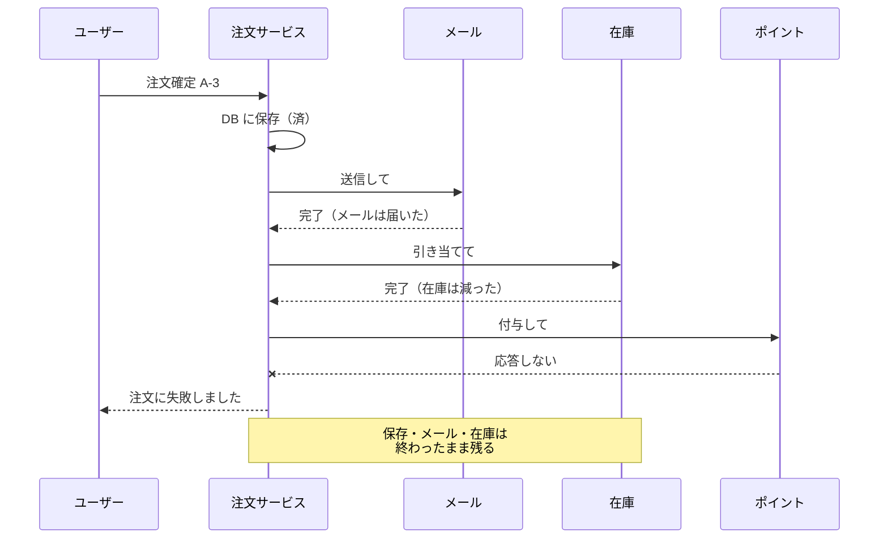
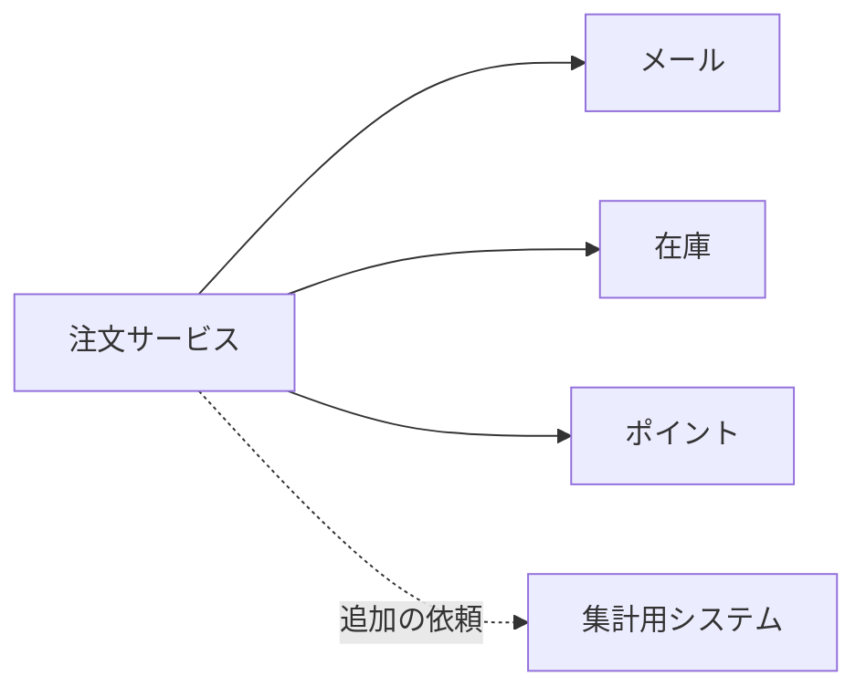

# 第1章: 同期呼び出しの限界を体験する

## この章のゴール

注文確定のあとの処理（メール・在庫・ポイント）を、1つ終わるのを待ってから次を呼ぶ形（同期呼び出し）で順番に実行するプログラムを書き、「遅さ」「障害の波及」「変更のしにくさ」という3つの問題を体験します。

## Why: なぜこれを学ぶのか

非同期処理は「なんとなく今どきだから」使うものではありません。「呼んで、終わるまで待つ」やり方（同期呼び出し）で困ったことが起きたときに、その困りごとを解くための道具です。困りごとを自分で体験しておくと、後の章で「なぜ間に仲介役を挟むのか」「なぜ受け取り完了の通知が必要なのか」が腑に落ちます。

この章では RabbitMQ をまだ使いません。素の Java だけで、よくある「最初の実装」を書いてみます。

## 前提

第0章で、RabbitMQ の起動と `./run.sh` の使い方を確認済みです。

## ステップ1: 同期呼び出しで注文を確定するプログラムを読む

[SyncOrderApp.java](../src/main/java/com/example/async/sync/SyncOrderApp.java) を開きます。中心となる部分を抜粋します。メール送信は800ミリ秒かかり、ポイントサービスは30%の確率で障害を起こす、という想定で `Console.sleep` と乱数を使って再現しています。

<!-- code: src/main/java/com/example/async/sync/SyncOrderApp.java#placeOrder,grantPoint -->
```java
// 注文確定。あとに続く3つのサービスを同期的に（終わるまで待ちながら）順に呼ぶ
private static void placeOrder(String orderId) {
    // 注文をDBに保存した、という想定
    Console.log("注文 " + orderId + " をDBに保存");
    // 確認メールを送る（外部のメール配信サービス。遅い）
    sendMail(orderId);
    // 在庫を引き当てる
    reserveInventory(orderId);
    // ポイントを付与する（ときどき障害が起きる）
    grantPoint(orderId);
}

// （中略）

// ポイントサービスの呼び出しを模したもの。30% の確率で障害になる
private static void grantPoint(String orderId) {
    Console.sleep(200);
    if (RANDOM.nextInt(100) < 30) {
        throw new IllegalStateException("ポイントサービスが応答しません");
    }
    Console.log("  ポイント付与 完了 " + orderId);
}
```

**Why**: `placeOrder` は「DB に保存 → メール → 在庫 → ポイント」を順番に呼び、すべて終わるまで戻ってきません。これが **同期呼び出し** です。Webサービスでは、`placeOrder` が終わるまでユーザーのブラウザに「注文完了」画面が返らない、という意味になります。乱数のシードを固定しているのは、何度実行しても同じ注文で失敗が起きるようにして、結果を比べやすくするためです。

## ステップ2: 実行して所要時間を見る

```bash
./run.sh sync.SyncOrderApp
```

次のような出力になります（時刻は実行するたびに変わります）。

```text
[09:15:08.508][main] 注文 A-1 をDBに保存
[09:15:09.313][main]   メール送信 完了 A-1
[09:15:09.615][main]   在庫引当 完了 A-1
[09:15:09.820][main]   ポイント付与 完了 A-1
[09:15:09.821][main] 注文 A-1 確定 OK（1336ms）
...
[09:15:11.145][main] 注文 A-3 をDBに保存
...
[09:15:12.458][main] 注文 A-3 確定 NG（1313ms）: ポイントサービスが応答しません
...
[09:15:15.069][main] 注文 A-5 確定 NG（1305ms）: ポイントサービスが応答しません
```

1件の注文確定に約1.3秒かかっています。内訳はメール800ミリ秒・在庫300ミリ秒・ポイント200ミリ秒の合計です。

呼び出しの流れを時間の順に並べると、次のようになります。注文サービスは、呼び出し先の応答を待ってから次を呼びます。



**Why**: 順番に呼んで待つ形では、**応答時間は呼び出し先の応答時間の合計** になります。ユーザーが待たされているのは「注文を保存する」ためではなく、ユーザーにとっては後でもよいメール送信のためです。

**🔍 確認・実験してみよう**: メール送信の待ち時間を 800 から 5000 に変えて実行すると、注文確定1件の時間はどうなるでしょうか。動かす前に予想してから確認してみましょう。

## ステップ3: 障害が注文に波及することを確かめる

出力の A-3 と A-5 に注目します。

- 「注文 A-3 をDBに保存」は表示されている
- 「メール送信 完了 A-3」「在庫引当 完了 A-3」も表示されている
- しかし最後のポイント付与で失敗し、注文確定は NG になった

ユーザーの画面には「注文に失敗しました」と表示されるはずです。それなのに、DB には注文があり、確認メールは届き、在庫も引き当てられています。

A-3 で起きたことを図にすると、次のとおりです。最後の1つが失敗しただけで、注文全体が失敗の扱いになります。それまでに終わった処理は、終わったまま残ります。



**Why**: ポイント付与は、注文の成否を左右するほど重要な処理ではないはずです。それでも同期呼び出しでは、**一番弱い呼び出し先の障害が、呼び出し元全体の障害になります**。これを障害の連鎖と呼びます。

**⚠️ よくある失敗・誤解**: 「失敗したらリトライすればよい」と考えて、`placeOrder` 全体をやり直すコードを足したくなります。しかしメール送信と在庫引当はすでに成功しているので、全体をやり直すとメールが2通届き、在庫が二重に引き当てられます。どこまで成功したかを覚えておかないと、安全にやり直せません。この「やり直すと二重になる」問題は、第12章で正面から扱います。

## ステップ4: 機能追加のしにくさを考える

マーケティング部門から「注文が入ったら、集計用のシステムにもデータを送ってほしい」という依頼が来たとします。このプログラムに対応するには、`placeOrder` に `sendToAnalytics(orderId)` を1行足すことになります。

**Why**: 一見簡単ですが、次のような問題を抱えています。

- 注文サービスのコードを変更し、テストし、本番環境に入れ直す（デプロイ）必要がある
- 集計用のシステムが遅ければ注文確定がまた遅くなり、落ちれば注文がまた失敗する
- 注文サービスは「注文が入ったら誰に知らせるか」をすべて知っていなければならない

このように、呼び出し元が呼び出し先を直接知っている状態を **密結合** と呼びます。

図にすると、注文サービスからすべての連携先へ矢印が伸びています。連携先が1つ増えるたびに、注文サービスの矢印も1本増えます。



**💼 現場Tip**: B2B の Webサービスでは、「この顧客企業の注文だけ、社内の基幹システムにもデータを送ってほしい」のような連携の追加依頼が頻繁に来ます。連携先が増えるたびに注文サービスを改修していると、注文サービスのチームは全連携先の都合で振り回されます。

## 動作確認

`./run.sh sync.SyncOrderApp` を実行し、次の2点を確認できたら完了です。

1. 1件の注文確定に約1.3秒かかっている
2. A-3 と A-5 で、DB 保存・メール・在庫が終わっているのに、注文確定が NG になっている

## もっと良くしてみよう

### 理解確認

1. 同期呼び出しで、注文確定の応答時間が「呼び出し先の合計」になるのはなぜでしょうか。
2. A-3 で、ユーザーに「失敗」と表示されたのに確認メールが届いてしまうのはなぜでしょうか。
3. 集計用システムへの連携を追加するとき、注文サービスのどこを変更する必要があるでしょうか。

### 発展改善クイズ

1. メール送信・在庫引当・ポイント付与をスレッドで並行に呼べば、応答時間は短くなります。それでも解決しない問題は何でしょうか。
2. 「注文を保存した」ということだけを記録しておき、メールやポイントは後で誰かが処理する、という仕組みを作るには何が必要でしょうか。次の章へ進む前に考えてみましょう。

---

| [← 第0章: これから学ぶものを知る](./00-overview.md) | [全章目次](./README.md) | [第2章: 同期の代わりの選択肢を試す →](./02-async-alternatives.md) |
| - | :-: | --: |
