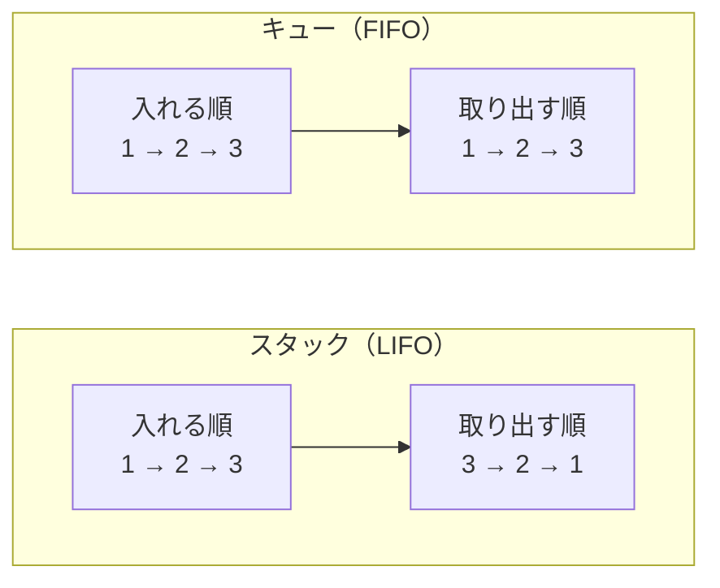
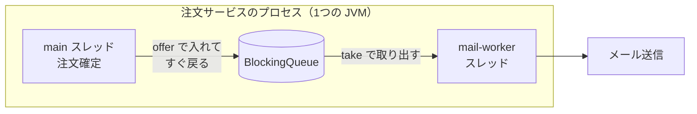
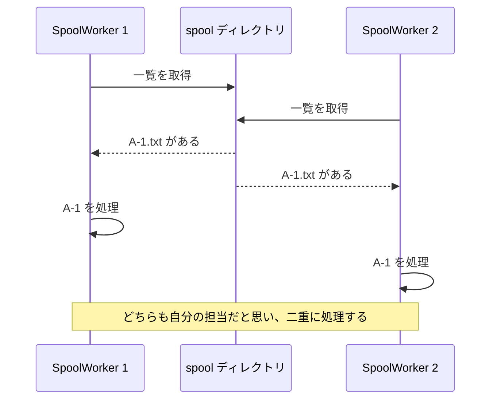
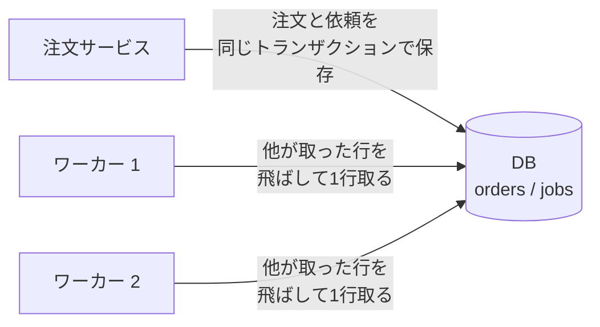
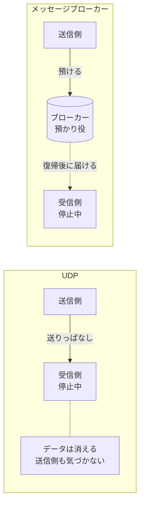

# 第2章: 同期の代わりの選択肢を試す

## この章のゴール

第1章の問題（遅さ・障害の波及・変更のしにくさ）に対して、専用のソフトウェアを使わない解決策を試します。メモリ上のキューとファイルは実際に動かし、データベースと UDP は図と表で比べます。それぞれがどこで行き詰まるかを知り、スタックとキューの違いも押さえます。

## Why: なぜこれを学ぶのか

第1章の困りごとの解決策は、専用のソフトウェアでなければならないわけではありません。「あとでよい処理を後回しにしたい」だけなら、ファイルに書き出して別のプログラムに拾わせる方法でも、一見できそうです。実際、小さなシステムではそれで十分なことも多くあります。

大切なのは、「専用のソフトウェアが必要だ」と最初から決めつけないことです。自分で試して、足りないところが見えたときに初めて、メッセージを預かって仲介するソフトウェア（メッセージブローカー。この講座で使う RabbitMQ がその1つです）の価値が実感できます。

## 前提

第1章で、同期呼び出しの3つの問題を体験しました。RabbitMQ はまだ使いません。この章で使うコードは、`src/main/java/com/example/async/inmemory/` と `spool/` にあります。

## ステップ1: 解決したいことを書き出す

第1章の問題から、満たしたい要件を5つに整理します。以後、各案をこの5つで採点します。

| 番号 | 要件 | 第1章の問題との対応 |
| :--- | :--- | :--- |
| R1 | 注文の応答が、後続処理を待たずに速く返る | 遅さ |
| R2 | 後続処理が落ちていても、注文は成功する | 障害の波及 |
| R3 | 後続処理の前にプログラムが落ちても、依頼が消えない | （新しく気づく問題） |
| R4 | 失敗した依頼をやり直せる。ただし二重に実行しない | 第1章のコラム |
| R5 | 連携先が増えても、注文サービスの改修が小さく済む | 変更のしにくさ |

**Why**: R3 は、第1章では見えていなかった要件です。後続処理を「後回し」にした瞬間、「後回しにした依頼をどこに置いておくか」という新しい問題が生まれます。

## ステップ2: スタックとキューの違いを知る

後回しにした依頼は、どこかに順番に並べて置きます。このとき、データ構造としての **スタック** と **キュー** のどちらを使うかで、取り出す順番が変わります。

[StackAndQueueDemo.java](../src/main/java/com/example/async/inmemory/StackAndQueueDemo.java) を開き、同じ順番で3件入れて取り出していることを確かめてから実行します。

```bash
./run.sh inmemory.StackAndQueueDemo
```

```text
[12:38:49.886][main] スタック: A-3 → A-2 → A-1
[12:38:49.887][main] キュー  : A-1 → A-2 → A-3
```



| 名前 | 取り出す順番 | 略称 | たとえ |
| :--- | :--- | :--- | :--- |
| スタック | 最後に入れたものから | LIFO（後入れ先出し） | 積み重ねた皿。上から取る |
| キュー | 最初に入れたものから | FIFO（先入れ先出し） | レジの行列。先に並んだ人から |

**Why**: 後続処理の依頼は、受け付けた順に処理するのが自然です。スタックにすると、新しい依頼が次々と来る間、古い依頼はいつまでも取り出されません。そのため依頼の置き場にはキューを使います。メッセージングの世界で「キュー」と呼ぶのは、この先入れ先出しの置き場のことです。

**⚠️ よくある失敗・誤解**: 後の章で「キューは順序を保証する」と聞いても、**処理が終わる順番** まで保証されるわけではありません。置き場の中の順序と、複数のワーカーが処理する順序は別の話です。第19章で体験します。

## ステップ3: 案1　メモリ上のキューと別スレッド

最初に思いつく案です。依頼を `BlockingQueue`（スレッド間で安全に受け渡せるキュー）に入れ、別スレッドの **ワーカー**（依頼を取り出して実際に処理する働き手）に処理させます。



コードは [InMemoryQueueApp.java](../src/main/java/com/example/async/inmemory/InMemoryQueueApp.java) です。注文の側は `QUEUE.offer(...)` で入れるだけ、ワーカーの側は `QUEUE.take()` で取り出して800ミリ秒かけてメールを送ります。まず通常どおり実行します。

```bash
./run.sh inmemory.InMemoryQueueApp
```

```text
[12:44:11.883][main] 注文 A-1 確定 OK（6ms）
[12:44:11.889][main] 注文 A-2 確定 OK（0ms）
...
[12:44:11.889][main] 注文 A-5 確定 OK（0ms）
[12:44:12.683][mail-worker]   メール送信 完了 A-1
...
[12:44:14.285][mail-worker]   メール送信 完了 A-5
```

注文の確定は0〜6ミリ秒で返ります。第1章の1.3秒と比べて、R1（速さ）は解決しました。次に、引数 `crash` を付けて、途中でプロセスが強制終了した場合を再現します。

```bash
./run.sh inmemory.InMemoryQueueApp crash
```

```text
[12:44:14.408][main] 注文 A-5 確定 OK（0ms）
[12:44:15.174][mail-worker]   メール送信 完了 A-1
[12:44:15.914][main] まだキューに残っている件数: 3。ここでプロセスが強制終了したとします
```

メールが送られたのは A-1 だけです。残りの依頼は、プロセスと一緒に消えました。しかもお客さまの画面には「注文完了」と表示されています。

**Why**: メモリ上のキューは、プロセスが終わると消えます。デプロイのたびの再起動、メモリ不足による強制終了、サーバーの障害など、プロセスが突然終わる原因はいくらでもあります。これが R3 を満たせない理由です。

| 要件 | 評価 | 理由 |
| :--- | :--- | :--- |
| R1 速さ | ○ | キューに入れるだけで戻れる |
| R2 障害の分離 | ○ | メールが遅くても落ちても、注文は成功する |
| R3 消えない | × | プロセスと一緒に消える |
| R4 やり直し | × | 失敗した依頼を覚えておく場所がない |
| R5 連携先の追加 | × | ワーカーも同じプロセスの中。追加には注文サービスの改修が必要 |

**💼 現場Tip**: `BlockingQueue` や `ExecutorService` は、1つのプロセスの中で処理を分担するのにとても有用です。ただし「プロセスが落ちても消えてはいけない依頼」には向きません。道具の向き不向きを見分けましょう。

## ステップ4: 案2　ファイルに書き出して別のプログラムに拾わせる

消えないようにするには、ディスクに書けばよさそうです。依頼を1件1ファイルとして書き出し、別のプログラム（ワーカー）がディレクトリを見に行って拾います。

| クラス | 役割 |
| :--- | :--- |
| [SpoolOrderApp.java](../src/main/java/com/example/async/spool/SpoolOrderApp.java) | 注文を受けるたびに、`data/spool/` へ依頼ファイルを書き出す |
| [SpoolWorker.java](../src/main/java/com/example/async/spool/SpoolWorker.java) | 1秒ごとにディレクトリを見に行き、見つけたファイルを処理して削除する |

ワーカーの中心部分は次のとおりです。「一覧を取る → 処理する → 消す」を繰り返すだけです。

<!-- code: src/main/java/com/example/async/spool/SpoolWorker.java#main -->
```java
/**
 * Ctrl+C で止めるまで、ディレクトリを見に行き続ける。
 *
 * @param args [0] ワーカー名（省略時は worker）
 * @throws Exception ファイル操作に失敗した場合
 */
public static void main(String[] args) throws Exception {
    String name = args.length > 0 ? args[0] : "worker";
    Files.createDirectories(SpoolOrderApp.SPOOL_DIR);
    Console.log(name + " 起動。" + SpoolOrderApp.SPOOL_DIR + " を1秒ごとに見に行きます");
    while (true) {
        for (Path file : listRequests()) {
            // メール送信の代わり
            Console.sleep(800);
            Console.log(name + " 処理: " + file.getFileName());
            // 処理が終わったらファイルを消して「済み」にする
            Files.deleteIfExists(file);
        }
        Thread.sleep(1000);
    }
}
```

依頼を書き出してから、ワーカーを起動します。

```bash
./run.sh spool.SpoolOrderApp
./run.sh spool.SpoolWorker w1
```

```text
[12:44:52.001][main] w1 起動。data/spool を1秒ごとに見に行きます
[12:44:52.814][main] w1 処理: A9890-1.txt
...
```

ワーカーの起動前に注文が入っても、依頼はファイルとして残ります。R3 は満たせました。では、ワーカーを2つのターミナルで同時に起動して、処理を速くしようとするとどうなるでしょうか。

```bash
./run.sh spool.SpoolOrderApp
# ターミナル1
./run.sh spool.SpoolWorker w1
# ターミナル2
./run.sh spool.SpoolWorker w2
```

```text
w1 処理: A9890-1.txt
w2 処理: A9890-1.txt
w1 処理: A9890-2.txt
w2 処理: A9890-2.txt
...
```

**同じ依頼を2つのワーカーが両方とも処理しました。** メールが2通届き、ポイントは二重に付与されます。



**Why**: 2つのワーカーは、ほぼ同時にディレクトリの一覧を取得し、同じファイルを見つけます。ファイルの置き場には、「取り出した人だけに渡す」機能がないのです。ファイル方式には、ほかにも次のような問題があります。

| 問題 | 内容 |
| :--- | :--- |
| 書きかけを読む | 書き込み中のファイルをワーカーが拾い、中身が途中で切れている |
| 削除前に落ちる | 処理は終わったのにファイルを消す前に落ち、再起動後にもう一度処理される |
| 失敗の扱い | 何度やっても失敗するファイルが、毎回の一覧に残り続ける |
| 複数のサーバー | 注文サービスとワーカーが別のサーバーにあると、ディスクを共有する仕組みが要る |
| 空振り | 依頼がなくても、1秒ごとにディレクトリを見に行く（このように定期的に見に行く方法を、ポーリングと呼びます） |

これらを1つずつ解決すると、結局は次のような仕組みを自作することになります。取り出した人にだけ渡す。「処理が終わりました」という返事が来るまで預かる。返事が来なければ別の人に渡す。失敗が続けば別の場所へ移す。それはまさに、メッセージブローカーです。

**💼 現場Tip**: 共有ディレクトリにファイルを置いて連携する方式は、古くからの業務システムで今も使われています。「置き終えたら、最後に `.done` のような合図のファイルを置く」「処理中のファイルは別のディレクトリに移動してから処理する」といった工夫で、問題の多くを避けています。

## ステップ5: 案3と案4を図で比べる

残りの2つの案は、コードを動かさずに図と表で比べます。

**案3 データベースのジョブテーブル**: すでに使っているデータベースに `jobs` テーブルを作り、依頼を1行ずつ書きます。ワーカーは、未処理の行を「他のワーカーが取った行を飛ばして」1行ずつ取り出します（SQL の `SELECT ... FOR UPDATE SKIP LOCKED`）。案2の「取り出した人にだけ渡す」問題を、データベースのロックの機能で解決しています。



**案4 UDP で知らせる**: UDP は、相手との接続を作らずにデータを送りっぱなしにできる、軽い通信方法（プロトコル）です。送る側は、受け取る側が動いているかどうかを確かめません。受け取る側が止まっていても、送る側は **エラーを出さずに** 送り終え、データは誰にも届かずに消えます。



| 要件 | 案3 ジョブテーブル | 案4 UDP |
| :--- | :--- | :--- |
| R1 速さ | ○ 行を1つ追加するだけ | ○ 送りっぱなしで戻れる |
| R2 障害の分離 | ○ 後続処理が落ちていても、行は残る | ○ 送る側は失敗しない |
| R3 消えない | ○ データベースに保存される | × 受け取る側が止まっていれば消える |
| R4 やり直し | ○ 状態と試行回数を列で管理できる | × 届いたかどうかもわからない |
| R5 連携先の追加 | △ 連携先ごとにテーブルや列が要る | ○ 送り先を足すだけ |

**💼 現場Tip**: 件数が少なく、受け手が1種類なら、**ジョブテーブルは十分に実用的な選択肢** です。サーバーが増えず、トランザクションも使えます。一方 UDP が選ばれるのは、性能を測る数値や動画の配信のように、**少し消えても困らず、速さを優先したいデータ** です。注文確定のように、1件も落とせない通知には向きません。

## ステップ6: 比較して結論を出す

| 案 | R1 速さ | R2 障害の分離 | R3 消えない | R4 やり直し | R5 連携先の追加 | 向いている場面 |
| :--- | :---: | :---: | :---: | :---: | :---: | :--- |
| 同期呼び出し（第1章） | × | × | - | - | × | 結果をすぐに使いたい処理 |
| 案1 メモリ上のキュー | ○ | ○ | × | × | × | 落ちても困らない、プロセス内の分担 |
| 案2 ファイル | ○ | ○ | ○ | △ | △ | 既存のバッチ連携、単純な受け渡し |
| 案3 DB のジョブテーブル | ○ | ○ | ○ | ○ | △ | 小規模で、受け手が1種類 |
| 案4 UDP | ○ | ○ | × | × | ○ | 消えてもよい計測値やログ |
| メッセージブローカー | ○ | ○ | ○ | ○ | ○ | 次の章から学ぶ |

**Why**: どの案も、要件の一部を満たします。しかしすべてを満たそうとすると、「依頼を預かる」「1件ずつ渡す」「処理完了を確認する」「失敗したらやり直す」「複数の相手に配る」を、自分で作ることになります。メッセージブローカーは、これらを専用の製品として引き受けたものです。

メッセージブローカーを入れると、運用するサーバーが1つ増えます。そのため「小さな規模ならジョブテーブルで十分」という判断も、正しい選択になりえます。次の章では、メッセージブローカーを使った非同期処理に、どんな種類があるのかを整理します。

## 動作確認

次の3点を確認できたら完了です。

1. `StackAndQueueDemo` で、スタックとキューの取り出し順が逆になった
2. `InMemoryQueueApp crash` で、プロセスの強制終了により依頼が消えた
3. 2つの `SpoolWorker` が、同じ依頼ファイルを両方とも処理した

## もっと良くしてみよう

### 理解確認

1. 後続処理の依頼の置き場に、スタックではなくキューを使うのはなぜでしょうか。
2. メモリ上のキューが、プロセスの強制終了で消えるのはなぜでしょうか。
3. UDP で送った通知が届かなくても、送信側がエラーにならないのはなぜでしょうか。

### 発展改善クイズ

1. ファイル方式で、2つのワーカーが同じファイルを処理しないようにするには、どんな工夫が考えられるでしょうか。ファイルの移動（rename）が1つの操作として行われることを手がかりにしてみましょう。
2. ジョブテーブルの方式で、ワーカーが処理の途中で落ちると、「処理中」のまま残る行が出ます。この行を、あとで安全にやり直すにはどうすればよいでしょうか。

---

| [← 第1章: 同期呼び出しの限界を体験する](./01-sync-call-limits.md) | [全章目次](./README.md) | [第3章: Webサービスの非同期処理の地図 →](./03-async-map.md) |
| - | :-: | --: |
