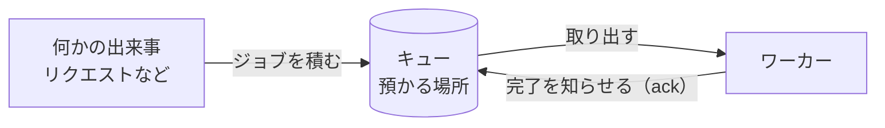
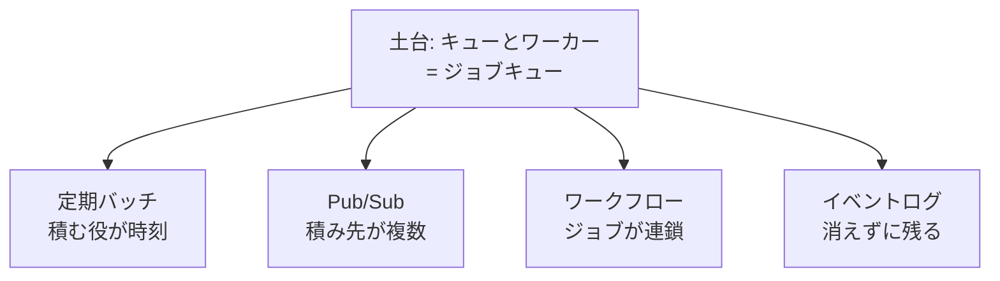

# 第3章: Webサービスの非同期処理の地図

## この章のゴール

Webサービスの非同期処理には、「ジョブキュー」「定期バッチ」「Pub/Sub」「ワークフロー」「イベントログ」といった種類があることを知ります。これらが別々の仕組みではなく、**1つの土台（キューとワーカー）に何が1つ増えたか** で整理できることを理解します。この講座の全体の地図として使います。

## Why: なぜこれを学ぶのか

「非同期処理」と調べると、似た言葉がたくさん出てきます。バックグラウンドジョブ、タスクキュー、メッセージキュー、バッチ、Pub/Sub、ワークフローなどです。バラバラに覚えようとすると、どれも別の難しい仕組みに見えて、混乱します。

実は、これらの多くは1つの土台の変形です。土台を先に作り、「何が1つ増えたか」で整理すると、新しい言葉に出会っても「あの土台の、この部分が違うものだ」と位置付けられます。この講座は、その地図に沿って進みます。

## 前提

第1章で同期呼び出しの問題を体験し、第2章でメモリ上のキュー・ファイル・DB・UDP という代わりの方法の限界を試しました。この章では、新しい言葉がたくさん出てきます。1回で覚えようとせず、「地図の見方」をつかむつもりで読んでください。

## ステップ1: 土台は「キューとワーカー」

第2章の試行錯誤を経て、非同期処理の土台は次の形になりました。

| 部品 | 役割 |
| :--- | :--- |
| キュー | 「やること」を預かる行列。プロセスが落ちても消えない場所にある |
| ワーカー | 「やること」を取り出して処理する働き手。台数を増やせる |
| ack（アック） | 「処理が終わりました」という知らせ。知らせが来なければ、別のワーカーにやり直させる |

ここでは「やること」を **ジョブ** と呼びます（領収書 PDF を1つ作る、など）。この形が、いちばん基本の **ジョブキュー** です。Webサーバーは「ジョブを積む」だけで、すぐユーザーに応答できます。

## ステップ2: 5つのパターンを「土台の変形」で整理する

| パターン | 土台に何が増えたか | 起きること | Web サービスでの例 |
| :--- | :--- | :--- | :--- |
| ① ジョブキュー | （土台そのもの） | 積まれたジョブを、ちょうど1つのワーカーが処理する | 領収書 PDF の作成、画像の縮小、メール送信 |
| ② 定期バッチ | ジョブを積む役が **時刻** になる | 決まった時刻や間隔で、ジョブが自動的に積まれる | 毎晩の売上集計、月末の請求書発行、古いデータの削除 |
| ③ Pub/Sub | ジョブの積み先が **複数** になる | 1つの出来事が、「知らせてほしい」と登録している全員に、別々のジョブとして届く | 注文確定を、メール・在庫・ポイントの全員に知らせる |
| ④ ワークフロー | ジョブが **連鎖** する | 1つのジョブが終わると、次のジョブが積まれる。失敗したら取り消す手順もある | 注文確定 → 決済 → 在庫 → 発送 |
| ⑤ イベントログ | キューが **消えずに残る** | 起きたことを記録として残し、あとから何度でも読み直せる | 行動履歴の蓄積、集計用のデータ置き場、過去分の再計算 |

**Why**: 5つのパターンは、**組み合わせて使う** のが普通です。互いを排除する関係ではありません。たとえば注文確定を、Pub/Sub で複数のサービスへ知らせます（③）。受け取った各サービスは、重い処理をジョブキューへ任せます（①）。途中の後続は連鎖させます（④）。毎晩の集計は定期バッチの担当です（②）。すべての出来事は、あとで分析できるように記録として残します（⑤）。

## ステップ3: 「何がきっかけで動くか」と「誰が受け取るか」で見分ける

パターンを見分けるときは、2つの問いが役に立ちます。

| 問い | 答えの選択肢 |
| :--- | :--- |
| 何がきっかけで動くか | リクエストや出来事（①③④）／時刻（②） |
| 誰が受け取るか | ちょうど1人（①）／登録している全員（③）／次の手順（④）／あとから読みたい人（⑤） |

**⚠️ よくある失敗・誤解**: 「バックグラウンドで処理する仕組みは、すべて Pub/Sub だ」という理解は、よく見かける混同です。時間のかかる処理をワーカーに任せるのは **ジョブキュー** で、1つの出来事を複数の相手に知らせるのが **Pub/Sub** です。2つは別の問題を解く別の道具です（混ざって見えるのは自然なことです）。第15章で、この違いを整理します。

## ステップ4: 現場の道具との対応

5つのパターンには、それぞれ世の中で使われている道具やクラウドのサービスがあります。どのパターンにどんな製品があるかは、第5章で全体像を、第21章で対応表を見ます。

**💼 現場Tip**: 新しい案件で非同期処理を任されたら、まず「すでにそのプロジェクトで使っている道具」を確認しましょう。多くのフレームワークがジョブキューを標準で持っています。メッセージの仲介役（ブローカー）を新しく導入するのは、最後の手段です。

## ステップ5: この講座の進み方

この地図に沿って、次の順に進みます。

| Part | パターン | 章 | 深さ |
| :--- | :--- | :--- | :--- |
| A | 地図と準備 | 第1〜6章 | 同期の限界、設計の考え方、製品、AMQP |
| B | ① ジョブキュー | 第7〜13章 | **深く**。作って動かし、消失・重複・失敗を体験する |
| C | ② 定期バッチ | 第14章 | 作って動かす。ジョブキューの変形として |
| D | ③ Pub/Sub | 第15〜19章 | **深く**。配り方の2つの型・メッセージ設計・順序 |
| E | ④ ワークフロー | 第20章 | 作って動かす。連鎖が途中で失敗する様子まで |
| F | まとめ | 第21章 | 製品ごとの対応表、設計チェックリスト、次に学ぶテーマ |
| - | ⑤ イベントログ | 第5章 | 紹介にとどめる（考え方を地図の中で説明する） |

**Why**: ジョブキューと Pub/Sub は、現場でもっとも頻繁に触れるので深く扱います。定期バッチとワークフローは、土台の変形として、短く作って動かします。イベントログは、環境を増やさずに済むよう、考え方の紹介にとどめます。

## 動作確認

この章ではプログラムを実行しません。次の3つを、何も見ずに説明できるか確認してください。

1. 非同期処理の土台となる、3つの部品（キュー・ワーカー・ack）
2. 5つのパターンそれぞれが、土台に何を足したものか
3. 「バックグラウンド処理はすべて Pub/Sub」が、よくある混同である理由

## もっと良くしてみよう

### 理解確認

1. 「毎晩2時に売上を集計する」は、5つのうちどのパターンでしょうか。土台に何が増えているでしょうか。
2. 「注文確定をメール・在庫・ポイントの全員に知らせる」と「領収書 PDF を作る」は、別のパターンです。何が違うのでしょうか。
3. イベントログが、ジョブキューと違うのはどこでしょうか。

### 発展改善クイズ

1. あなたが使っているサービス（または想像するサービス）で、非同期に動いている機能を3つ挙げ、5つのパターンのどれに当たるか分類してみましょう。
2. 注文確定の流れ全体を、5つのパターンをすべて使って描くとしたら、どのような図になるでしょうか。

---

| [← 第2章: 同期の代わりの選択肢を試す](./02-async-alternatives.md) | [全章目次](./README.md) | [第4章: 設計の考え方　同期にするか、非同期にするか →](./04-design-thinking.md) |
| - | :-: | --: |
