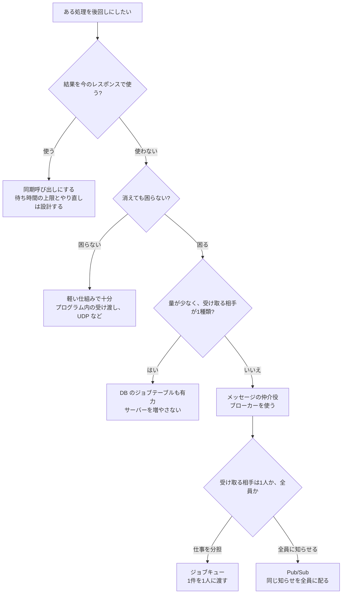

# 第4章: 設計の考え方　同期にするか、非同期にするか

## この章のゴール

ある機能を同期と非同期のどちらにするか、根拠を示して判断できるようになります。この章では「最初の問い」と「非同期にするなら確かめる3つのこと」に絞って考えます。もっと細かい設計の観点（7つの質問と設計メモ）は、必要な道具をすべて学んだあとの第21章で扱います。

## Why: なぜこれを学ぶのか

「非同期のほうが今どきだから」「みんな有名な製品を使っているから」という理由で選ぶと、必ず後で困ります。何でも非同期にした結果、処理の流れが追えず、障害調査に何日もかかる例は珍しくありません。反対に、すべてを同期で作り続けると、第1章のように遅さと障害の波及に悩まされます。

新卒のエンジニアでも、設計レビューで「なぜ非同期にしたのですか」と聞かれる場面は必ず来ます。そのときに答えられるよう、判断の型を持っておきましょう。この章はコードを書かず、考え方を身に付ける章です。

## 前提

第1章で同期の問題を体験し、第2章でさまざまな代わりの方法を試し、第3章で非同期処理の地図を見ました。

## ステップ1: 最初の問い　その結果を、今のレスポンスで使うか

最初に確認するのは、たった1つの問いです。

> **この処理の結果を、ユーザーへの今のレスポンスに使うか。**

| 答え | 判断 | 例 |
| :--- | :--- | :--- |
| 使う | **同期** | カード決済の成否、在庫があるかの確認、パスワードが正しいか |
| 使わない | **非同期の候補** | 確認メールの送信、ポイント付与、集計用システムへのデータ送信 |

**Why**: 結果をすぐ使うのに非同期にすると、ユーザーは「完了したのか」を知るために、画面を何度も更新することになります。この「結果を何度も確認しに行く」仕組みを作るくらいなら、最初から同期にしたほうが単純です。

**⚠️ よくある失敗・誤解**: 「非同期にすれば速くなる」と考えがちですが、速くなるのは **ユーザーへの応答** だけです。処理全体にかかる時間は、むしろ増えることがあります。メッセージの仲介役（ブローカー）を経由する分の時間が加わるためです。

## ステップ2: 非同期にするなら、まず3つを確かめる

非同期の候補になった処理には、まず次の3つを確かめます。どれも、この先の章で実際に体験する内容です。

| 確かめること | 答えによって変わること | 体験する章 |
| :--- | :--- | :--- |
| 遅れてもよいか。どのくらいまでか | 数秒以内に処理したいのか、夜にまとめて処理してもよいのかが決まる | 第9章・第14章 |
| 消えたら困るか | 困るなら、再起動しても消えない設定と、「処理が終わった」と確かめる仕組みが要る | 第11章 |
| 2回実行されたら困るか | 困るなら、同じ依頼が2回届いても、結果が1回分になるように作る | 第12章 |

**Why**: 2つめと3つめは、特に大切です。実は「消えないようにする」と「2回届くことがある」は表裏一体です。消えないように届け直す仕組みを入れると、そのぶん同じものを2回受け取る場合が出てくるからです。第11〜12章で、この関係を手を動かして確かめます。

## ステップ3: 判断フローで整理する

ステップ1と2の流れを、1枚の図にまとめます。

**💼 現場Tip**: 図の「DB のジョブテーブルも有力」を軽く見ないでください。新しいソフトウェアを導入すると、構築・監視・障害対応・バージョンアップの責任が増えます。要件を満たす最も単純な仕組みを選ぶのが、経験を積んだエンジニアの判断です。

## ステップ4: よくある題材に当てはめる

注文確定まわりの機能を、判断フローに当てはめてみます。

| 機能 | 同期か非同期か | 理由 |
| :--- | :--- | :--- |
| クレジットカードの決済 | 同期 | 成否をすぐ画面に返す必要がある |
| 在庫の引当 | **要件による** | 在庫切れを即座に伝えるなら同期。受け付けてから後で確定する運用なら非同期にし、確定できなかったときの取り消しを用意する |
| 確認メール | 非同期（ジョブキュー） | 分単位の遅れは許される。ただし2通届くと困る |
| ポイント付与 | 非同期（Pub/Sub） | 遅れてもよいが、消えると困り、二重に付いても困る |
| 集計用システムへのデータ送信 | 非同期（Pub/Sub） | 受け取る相手が増えやすい |
| 領収書 PDF の作成 | 非同期（ジョブキュー） | 重い処理。ワーカーの台数で処理能力を調整する |
| 管理画面のリアルタイム表示 | 非同期（見ている間だけ受け取る） | 見ている間だけ届けばよく、消えても困らない |
| パスワードリセットの受付 | 受付は同期、メール送信は非同期 | 入力の確認は即答する。メールは後でよいが、有効期限が短いので遅れすぎないようにする |

**Why**: 同じ「注文確定のあとの処理」でも、機能ごとに答えが違います。「注文確定のあとはまとめて非同期」と一括りにせず、**1機能ずつ** 判断します。

## ステップ5: 結果整合性をユーザーにどう見せるか

非同期にすると、注文を完了した直後は、まだポイントが付いていない瞬間が生まれます。このように、少し遅れて全体がそろう状態を **結果整合性** と呼びます。設計は技術だけでなく、画面の見せ方にも及びます。

| 工夫 | 例 |
| :--- | :--- |
| 受け付けたことを伝える | 「ご注文を受け付けました。確認メールは数分以内にお送りします」 |
| 処理中の状態を見せる | ポイント欄に「付与処理中」と表示する |
| 受付番号を渡す | 後から状況を問い合わせられる |
| 完了までの目安を示す | 「通常、5分以内に反映されます」 |
| 遅れたときの連絡先を示す | 24時間たっても届かない場合のお問い合わせ先 |

**💼 現場Tip**: 非同期の機能は、問い合わせ対応の手順書も一緒に作ります。「ポイントが付いていない」と言われたとき、サポート担当者が確認できる画面や、調べる手順がないと、開発者が毎回呼ばれることになります。

この章の判断の型は、講座を進めるにつれて細かくなります。失敗したときの行き先、順番、受け取る相手の数といった観点は、それぞれの章で体験したあと、第21章で「7つの質問」と「設計メモ」にまとめ直します。

## 動作確認

この章ではプログラムを実行しません。次の3つを説明できれば完了です。

1. 処理を非同期にしてよいかを判断する、最初の問い
2. 非同期にするなら確かめる3つのことと、それぞれの答えで何が変わるか
3. 結果整合性とは何か。ユーザーにどう見せるとよいか

## もっと良くしてみよう

### 理解確認

1. 「ログイン時のパスワード確認」を非同期にしないのは、どの問いによるでしょうか。
2. ポイント付与とセール時のお知らせメールで、「消えたら困るか」の答えはどう違うでしょうか。
3. 在庫の引当が、同期と非同期のどちらにもなりうるのはなぜでしょうか。

### 発展改善クイズ

1. 「会員登録から1時間以内の人に、割引クーポンを1枚だけ配る」機能を、最初の問いと3つの確認に当てはめてみましょう。2枚配られると何が起きるかも考えてみましょう。
2. ステップ4の表のうち、あなたの会社（または想像する会社）の業務で、非同期にすると逆に困る機能はありますか。その理由も考えてみましょう。

---

| [← 第3章: Webサービスの非同期処理の地図](./03-async-map.md) | [全章目次](./README.md) | [第5章: メッセージング製品の全体像 →](./05-messaging-products.md) |
| - | :-: | --: |
