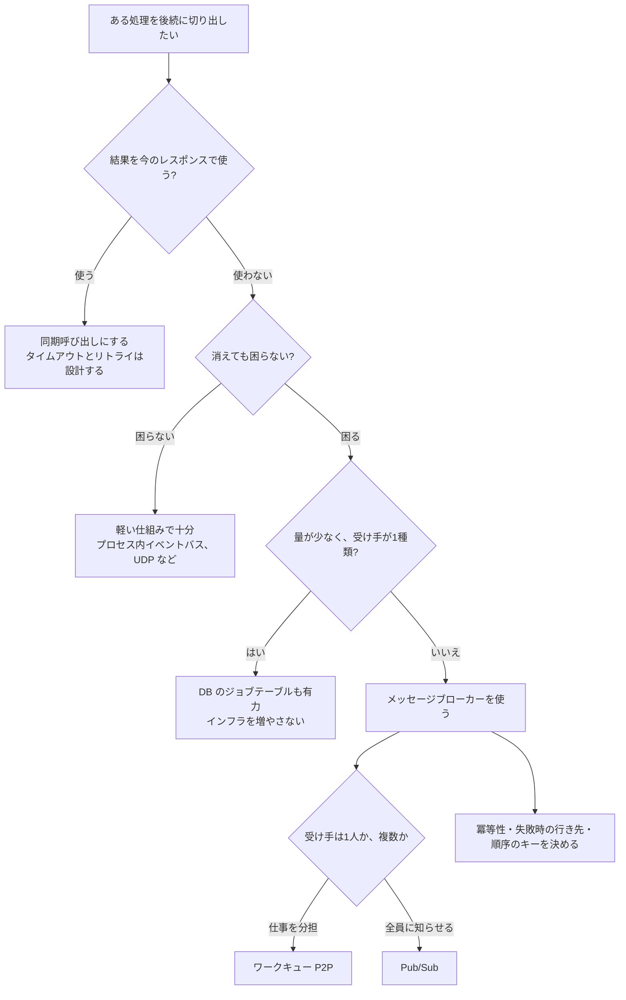

# 第4章: 設計の考え方　同期にするか、非同期にするか

## この章のゴール

ある機能を同期と非同期のどちらにするか、根拠を示して判断できるようになります。非同期なら何を決めておくべきかも、整理できるようになります。7つの質問と判断フローを使って考え、その結果を設計メモへ書き出します。

## Why: なぜこれを学ぶのか

「非同期のほうが今どきだから」「みんな Kafka を使っているから」という理由で選ぶと、必ず後で困ります。何でも非同期にした結果、処理の流れが追えず、障害調査に何日もかかる例は珍しくありません。反対に、すべてを同期で作り続けると、第1章のように遅さと障害の波及に悩まされます。

新卒のエンジニアでも、設計レビューで「なぜ非同期にしたのですか」と聞かれる場面は必ず来ます。そのときに答えられるよう、判断の型を持っておきましょう。この章はコードを書かず、考え方を身に付ける章です。

## 前提

第1章で同期の問題を体験し、第2章でさまざまな代替案を試しました。第15章と第16章で、Pub/Sub と周辺の用語を学びました。

## ステップ1: 最初の問い　その結果を、今のレスポンスで使うか

最初に確認するのは、たった1つの問いです。

> **この処理の結果を、ユーザーへの今のレスポンスに使うか。**

| 答え | 判断 | 例 |
| :--- | :--- | :--- |
| 使う | **同期** | カード決済の成否、在庫があるかの確認、パスワードが正しいか |
| 使わない | **非同期の候補** | 確認メールの送信、ポイント付与、分析基盤への連携 |

**Why**: 結果をすぐ使うのに非同期にすると、ユーザーは「完了したのか」を知るために、画面を何度も更新することになります。この「結果を取りに行く」仕組みを作るくらいなら、最初から同期にしたほうが単純です。

**⚠️ よくある失敗・誤解**: 「非同期にすれば速くなる」と考えがちですが、速くなるのは **ユーザーへの応答** だけです。処理全体にかかる時間は、むしろ増えることがあります。ブローカーを経由する分の時間が加わるためです。

## ステップ2: 非同期にする候補への7つの質問

非同期の候補になった処理には、次の7つの質問をします。答えによって、決めるべき設計が変わります。

| 番号 | 質問 | 答えによる設計の変化 | 学ぶ章 |
| :--- | :--- | :--- | :--- |
| Q1 | 遅れてもよいか。どのくらいまで | 秒単位ならリアルタイムな受信、時間単位ならバッチでもよい | 第9章 |
| Q2 | 失敗したら誰がどうするか | 自動で再試行するか、人が調べて直すか。再試行の上限と、行き着く先 | 第13章 |
| Q3 | 消えたら困るか | 困るなら、永続化・手動 ack・送信側の確認が要る | 第11章 |
| Q4 | 2回実行されても困るか | 困るなら、受け手を冪等にする | 第12章 |
| Q5 | 順番は重要か。何の単位でか | 注文ごと、顧客ごとなど、キーごとの順序を設計する | 第20章 |
| Q6 | 受け手は誰で、何人か。増えるか | 1人ならP2P、複数やこれから増えるならPub/Sub。イベントかコマンドか | 第11〜13章 |
| Q7 | 量とピークはどのくらいか。過去を読み直したいか | 量が多く再処理もするなら、ログ型も候補になる | 第5章 |

**Why**: Q3 と Q4 は、特に大切です。第1章からここまで見てきたように、「消えないようにする」と「重複する」は表裏一体です。この2つの答えを曖昧にしたまま作ると、障害が起きてからデータの修正に追われます。

## ステップ3: 判断フローで整理する

ステップ1と2の流れを、1枚の図にまとめます。

**💼 現場Tip**: 図の「DB のジョブテーブルも有力」を軽く見ないでください。新しいミドルウェアを導入すると、構築・監視・障害対応・バージョンアップの責任が増えます。要件を満たす最も単純な仕組みを選ぶのが、経験を積んだエンジニアの判断です。

## ステップ4: よくある題材に当てはめる

注文確定まわりの機能を、判断フローに当てはめてみます。

| 機能 | 同期か非同期か | 理由と設計のポイント |
| :--- | :--- | :--- |
| クレジットカードの決済 | 同期 | 成否をすぐ画面に返す必要がある。タイムアウト時の二重決済を防ぐため、冪等キーを使う |
| 在庫の引当 | **要件による** | 在庫切れを即座に伝えるなら同期。受け付けてから後で確定する運用なら非同期にし、確定できなかったときの取り消しを用意する |
| 確認メール | 非同期（Pub/Sub または P2P） | 分単位の遅れは許される。2通届くと困るので冪等にする |
| ポイント付与 | 非同期（Pub/Sub） | 消えると困り、二重付与も困る。冪等性が最重要 |
| 分析基盤へのデータ連携 | 非同期（Pub/Sub、量が多ければログ型） | 受け手が増えやすい。過去の読み直しも欲しい |
| 領収書 PDF の作成 | 非同期（ワークキュー） | 重い処理。ワーカーの台数で処理能力を調整する |
| 検索インデックスの更新 | 非同期（Pub/Sub） | 最新の状態に追い付けばよい。順序が崩れても、バージョン番号で古いものを捨てられる |
| 管理画面のリアルタイム表示 | 非同期（一時的な購読） | 見ている間だけ届けばよく、消えても困らない |
| パスワードリセットの受付 | 受付は同期、メール送信は非同期 | 入力の確認は即答する。メールは後でよいが、有効期限が短いので遅れすぎないようにする |
| 監査ログの記録 | 非同期（消えない設計） | 消えると法的に問題になりうる。永続化・確認・重複排除をすべて固める |

**Why**: 同じ「注文確定の後続処理」でも、機能ごとに答えが違います。「注文確定の後続はまとめて非同期」と一括りにせず、**1機能ずつ** 判断します。

## ステップ5: よくあるアンチパターンを知る

| アンチパターン | 何が問題か |
| :--- | :--- |
| すべてを非同期にする | 処理の流れが追いにくくなり、障害調査と結果整合性の管理が重くなる |
| 結果をすぐ使うのに非同期にする | 結果を取りに行くためのポーリングが生まれ、同期より複雑になる |
| リクエストとレスポンスをキューで再現する（キューを使った RPC） | 同期呼び出しの複雑な代用品になる。同期で足りるなら同期にする |
| 受け手の仕事を指示するコマンドを、イベントと呼ぶ | 発行側が受け手を知ることになり、疎結合の利点が消える（第15章） |
| ブローカーを入れたのに、受け手が冪等でない | 重複の度に、データが壊れる（第12章） |
| 失敗したメッセージの行き先を決めていない | 1件の失敗が、後続のすべてを止める（第13章） |
| 誰も DLQ やキューの滞留を見ていない | 障害が静かに進行し、お客さまの問い合わせで初めて気づく |

## ステップ6: 結果整合性をユーザーにどう見せるか

非同期にすると、注文を完了した直後は、まだポイントが付いていない瞬間が生まれます。これを **結果整合性（eventual consistency）** と呼びます。設計は技術だけでなく、画面の見せ方にも及びます。

| 工夫 | 例 |
| :--- | :--- |
| 受け付けたことを伝える | 「ご注文を受け付けました。確認メールは数分以内にお送りします」 |
| 処理中の状態を見せる | ポイント欄に「付与処理中」と表示する |
| 受付番号を渡す | 後から状況を問い合わせられる |
| 完了までの目安を示す | 「通常、5分以内に反映されます」 |
| 遅れたときの連絡先を示す | 24時間たっても届かない場合のお問い合わせ先 |

**💼 現場Tip**: 非同期の機能は、問い合わせ対応の手順書も一緒に作ります。「ポイントが付いていない」と言われたとき、サポート担当者が確認できる画面や、調べる手順がないと、開発者が毎回呼ばれることになります。

## ステップ7: 設計メモにまとめる

非同期の連携を1つ設計するたびに、次の項目を埋めた設計メモを残します。第24章で、このメモの形を再び使います。

| 項目 | 記入例（ポイント付与） |
| :--- | :--- |
| イベントまたはコマンド | イベント `order.placed`（過去形） |
| 発行元 | 注文サービス |
| 受け手 | ポイントサービス（今後、分析基盤が増える見込み） |
| 許容する遅延 | 5分以内 |
| 消えた場合の影響 | お客さまの損失。永続化と手動 ack、送信側の確認が必要 |
| 重複した場合の影響 | ポイントの二重付与。メッセージIDで冪等にする |
| 順序 | 不要（注文ごとに独立） |
| 失敗時の扱い | 3回まで再試行し、だめなら DLQ。DLQ は担当者に通知 |
| 量とピーク | 通常は毎秒10件、セール時は毎秒300件 |
| 監視する項目 | キューの滞留件数、DLQ の件数、処理の遅延時間 |

## 演習: 次の3つの機能を7つの質問で分析する

答えはここには書きません。ステップ2の質問とステップ7の設計メモを使って、自分で分析してみましょう。

1. **クーポンの配布**: 会員登録から1時間以内の人に、割引クーポンを1枚だけ配る。
2. **在庫が一定数を下回ったら発注する**: 倉庫の在庫が減ったとき、仕入れ先に発注メールを送る。
3. **ユーザー登録後のウェルカムメール**: 登録直後に送る。送信に失敗したら、再度送りたい。

分析のヒントは次のとおりです。

- 1.のクーポンは、2枚配られると何が起きるでしょうか。
- 2.の発注は、1回の在庫減少で何通の発注メールが送られると困るでしょうか。在庫が連続して減るとどうなるでしょうか。
- 3.のウェルカムメールは、ユーザー登録が失敗してロールバックされたとき、すでに送ってしまったメールをどう扱えばよいでしょうか。

## 動作確認

この章ではプログラムを実行しません。次の3つを説明できれば完了です。

1. 処理を非同期にしてよいかを判断する、最初の問い
2. 非同期にする候補に対する、7つの質問のうち3つ以上と、答えによる設計の変化
3. 「全部を非同期にする」ことが、アンチパターンになる理由

## もっと良くしてみよう

### 理解確認

1. 「ログイン時のパスワード確認」を非同期にしないのは、7つの質問のうち、どの考え方によるでしょうか。
2. ポイント付与とセール時のお知らせメールで、Q3（消えたら困るか）の答えはどう違うでしょうか。
3. 在庫の引当が、同期と非同期のどちらにもなりうるのはなぜでしょうか。

### 発展改善クイズ

1. 演習の3つの機能について、設計メモを1枚ずつ書いてみましょう。書けない項目があれば、それが「まだ決まっていない要件」です。
2. ステップ4の表のうち、あなたの会社（または想像する会社）の業務で、非同期にすると逆に困る機能はありますか。その理由も考えてみましょう。

---

| [← 第3章: Webサービスの非同期処理の地図](./03-async-map.md) | [全章目次](./README.md) | [第5章: メッセージング製品の全体像 →](./05-messaging-products.md) |
| - | :-: | --: |
