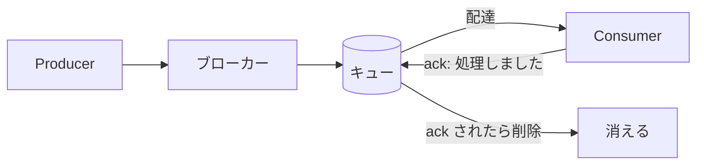
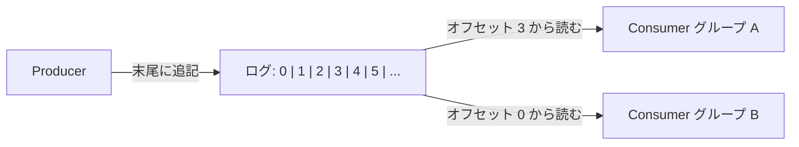

# 第5章: メッセージング製品の全体像

## この章のゴール

RabbitMQ・Kafka・クラウドのメッセージングサービスなどを「キュー型」「ログ型」「軽量型」に分類し、それぞれの得意なことを説明できるようになります。

## Why: なぜこれを学ぶのか

現場では「Kafka を入れたい」「SQS でいいのでは」「Redis にも Pub/Sub がある」と、さまざまな製品名が飛び交います。製品ごとの細かい機能を覚えるより先に、「この製品はどの系統か」をつかむことが大切です。系統がわかれば、メッセージがいつ消えるのか、何度でも読み直せるのか、順序はどこまで保証されるのかといった性質をおおよそ予想できます。

この講座で RabbitMQ を選んだ理由も、この章の最後で説明します。

## 前提

第15章で、Publisher・Subscriber・Broker の役割と、P2P と Pub/Sub の違いを学びました。

## ステップ1: キュー型ブローカーを知る

1つめの系統は、**キュー型（メッセージブローカー型）** です。

- メッセージは、コンシューマーが **処理完了（ack）を返すと削除** される
- 1件ずつ ack するので、「どのメッセージが処理済みか」をブローカーが管理する
- ルーティング（どのキューに届けるか）の仕組みが充実している製品が多い

代表的な製品は次のとおりです。

| 製品 | 種類 | 特徴 |
| :--- | :--- | :--- |
| RabbitMQ | OSS | AMQP の代表的な実装。エクスチェンジによる柔軟なルーティング |
| Apache ActiveMQ（Artemis） | OSS | Java の標準 API（JMS / Jakarta Messaging）と相性がよい |
| Amazon SQS | AWS | フルマネージドなキュー。標準キューと FIFO キュー |
| Azure Service Bus | Azure | キューとトピック。AMQP 1.0 で接続 |
| IBM MQ | 商用 | 金融・基幹系での採用実績が多い |

**Why**: キュー型は「仕事を確実に1回処理してもらう」ことが得意です。処理したら消えるので、ブローカーには「まだ処理されていない仕事」だけが残ります。

## ステップ2: ログ型（ストリーム型）を知る

2つめの系統は、**ログ型（ストリーム型）** です。

- メッセージは、追記専用のログ（日記帳のようなもの）の末尾に書き足される
- コンシューマーが読んでも **消えない**。保持期間（例：7日）が過ぎるまで残る
- コンシューマーは「どこまで読んだか（オフセット）」を自分で覚えておく
- オフセットを巻き戻せば、過去のメッセージを **読み直せる（リプレイ）**

代表的な製品は次のとおりです。

| 製品 | 種類 | 特徴 |
| :--- | :--- | :--- |
| Apache Kafka | OSS | 大量のイベントを高速に扱う。パーティション単位で順序を保証 |
| Amazon Kinesis Data Streams | AWS | Kafka に近い考え方のマネージドサービス |
| Azure Event Hubs | Azure | Kafka 互換の API も持つ |
| Redpanda | OSS / 商用 | Kafka 互換で、運用を簡単にすることを重視 |
| Apache Pulsar | OSS | キュー型とログ型の両方の性質を持つ |

**Why**: ログ型は「起きたことを記録として残し、あとから何度でも、いろいろな目的で読む」ことが得意です。新しい分析システムを作ったときに、過去1週間ぶんのイベントを最初から流し直す、といった使い方ができます。

**⚠️ よくある失敗・誤解**: 「Kafka はキューの高性能版」と考えると、使い方を誤ります。Kafka では、1件ずつ ack して「このメッセージだけ後でやり直す」ことが基本的にできません。オフセットは「ここまで読んだ」という1つの位置なので、途中の1件だけ失敗した場合の扱いを、アプリ側で設計する必要があります。

## ステップ3: 軽量型を知る

3つめは、永続化を最小限にして速さと手軽さを優先する **軽量型** です。

| 製品 | 特徴 |
| :--- | :--- |
| Redis Pub/Sub | 購読中の相手にだけ即座に届ける。購読していなかった間のメッセージは届かない |
| Redis Streams | Redis の中でログ型に近い使い方ができる |
| NATS | 非常に軽量で速い。永続化が必要なら JetStream という機能を使う |

**Why**: Redis Pub/Sub はメッセージを保存しません。そのため購読者が落ちていた間のメッセージは、二度と届きません。「チャットで今オンラインの人に表示する」のように、取りこぼしてもよい用途に向いています。

**💼 現場Tip**: 「Redis がもうあるから Pub/Sub もそれで」と決めてしまい、後から「ポイント付与が抜けている」と発覚する事故は珍しくありません。取りこぼしが許されないかどうかを、製品選定の最初に確認しましょう。

## ステップ4: クラウドのサービスを知る

クラウドには、Pub/Sub を簡単に使えるマネージドサービスがあります。サーバーの面倒を見なくてよい代わりに、そのクラウドの流儀に合わせる必要があります。

| サービス | 系統 | 主な特徴 |
| :--- | :--- | :--- |
| Amazon SNS | Pub/Sub | トピックに発行すると、購読している SQS・Lambda・HTTP などへ配る |
| Amazon SQS | キュー型 | SNS と組み合わせて購読者ごとのキューにする（ファンアウト） |
| Amazon EventBridge | イベントバス | ルールでイベントの中身を見て、配り先を決める |
| Google Cloud Pub/Sub | Pub/Sub | トピックとサブスクリプション。プッシュ型とプル型の両方に対応 |
| Azure Service Bus | キュー型 | キューとトピック・サブスクリプション |
| Azure Event Grid | イベントバス | Azure のリソースで起きた出来事を配る |

**Why**: これらのサービスは製品としては別物ですが、この講座で学ぶ「ack」「再配達」「デッドレターキュー」「重複」「順序」の考え方をそのまま持っています。第24章で、学んだ概念と各サービスの機能名を対応表にまとめます。

## ステップ5: プロトコルを知る

製品とクライアントの間でやり取りする約束事を **プロトコル** と呼びます。標準化されたプロトコルを使う製品なら、別の会社が作ったクライアントライブラリでも接続できます。

| プロトコル | 主な用途・製品 |
| :--- | :--- |
| AMQP 0-9-1 | RabbitMQ の基本のプロトコル。この講座で使う |
| AMQP 1.0 | 国際標準（ISO/IEC 19464）。Azure Service Bus・ActiveMQ Artemis・RabbitMQ 4 などが対応 |
| MQTT | IoT 機器向けの軽量なプロトコル。RabbitMQ もプラグインで対応 |
| STOMP | テキストベースのシンプルなプロトコル |
| Kafka プロトコル | Kafka 独自。Redpanda や Event Hubs が互換 API を提供 |
| HTTP / gRPC | クラウドのサービスの多くが採用 |

AMQP 0-9-1 と AMQP 1.0 は、名前は似ていますが中身は大きく異なる別のプロトコルです。次の章では AMQP 0-9-1 を詳しく見ます。

## ステップ6: なぜこの講座では RabbitMQ を使うのか

この講座で RabbitMQ を選んだ理由は次のとおりです。

1. **概念が目に見える**: エクスチェンジ・キュー・バインディングを自分で宣言するので、「メッセージがどこを通ってどこに届くか」を手で組み立てられる
2. **管理画面がある**: キューにたまったメッセージ数や、ack 待ちの件数をブラウザで確認できる
3. **手元で動く**: Docker を使えば数秒で起動でき、止めたり再起動したりして障害を再現できる
4. **考え方が他の製品に移せる**: キュー型の ack・再配達・デッドレターは、SQS や Cloud Pub/Sub でも同じ考え方で通用する

**🔍 確認・実験してみよう**: 管理画面の Overview タブの下のほうにある「Ports and contexts」を開くと、RabbitMQ が待ち受けているポートとプロトコルの一覧が見られます。`amqp` と `http` が何番ポートで待ち受けているか確認してみましょう。

## 動作確認

この章ではプログラムを実行しません。次の3つを説明できるか確認してください。

1. キュー型とログ型で、コンシューマーが読んだメッセージはそれぞれどうなるか
2. Redis Pub/Sub が「取りこぼしが許されない用途」に向かないのはなぜか
3. AMQP 0-9-1 と AMQP 1.0 の関係

## もっと良くしてみよう

### 理解確認

1. 過去1週間ぶんのイベントを、新しい分析システムに最初から流し直したい場合、キュー型とログ型のどちらが向いているでしょうか。
2. Amazon SNS と Amazon SQS を組み合わせるのはなぜでしょうか。第15章の「サブスクリプション」と結び付けて考えてみましょう。
3. 標準化されたプロトコルを使う製品には、どのような利点があるでしょうか。

### 発展改善クイズ

1. 1日に数億件のクリックログを集めて分析したいサービスと、1日に数千件の注文確定メールを確実に送りたいサービスがあります。それぞれどの系統の製品を選ぶか、理由とともに考えてみましょう。
2. クラウドのマネージドサービスを使うと、サーバー運用の手間は減ります。一方で、どのような点に注意が必要になるでしょうか。

---

| [← 第4章: 設計の考え方　同期にするか、非同期にするか](./04-design-thinking.md) | [全章目次](./README.md) | [第6章: AMQPとはどのようなプロトコルか →](./06-amqp.md) |
| - | :-: | --: |
