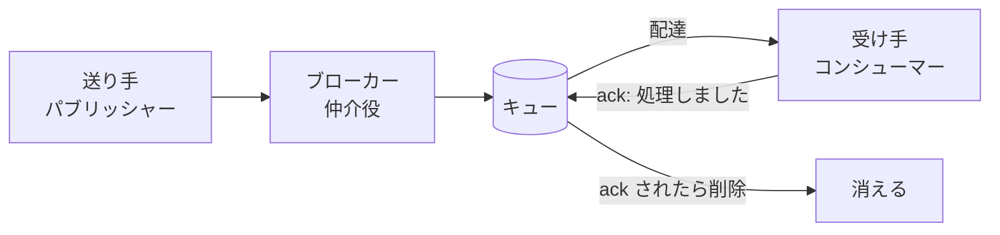
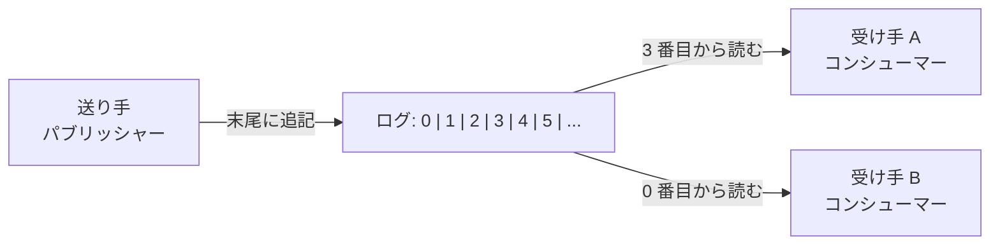

# 第5章: メッセージング製品の全体像

## この章のゴール

RabbitMQ・Kafka・クラウドのメッセージングサービスなどを「キュー型」「ログ型」「軽量型」に分類し、それぞれの得意なことを説明できるようになります。製品の名前がたくさん出てきますが、名前を覚えることが目的ではありません。「系統の違い」をつかむことが目的です。

## Why: なぜこれを学ぶのか

現場では「Kafka を入れたい」「SQS でいいのでは」「Redis にも Pub/Sub がある」と、さまざまな製品名が飛び交います。製品ごとの細かい機能を覚えるより先に、「この製品はどの系統か」をつかむことが大切です。系統がわかれば、メッセージがいつ消えるのか、何度でも読み直せるのか、順序はどこまで保証されるのかといった性質をおおよそ予想できます。

この講座で RabbitMQ を選んだ理由も、この章の最後で説明します。

## 前提

第3章で、非同期処理の土台が「キューとワーカー」であることを学びました。この章では、その土台を提供する製品を分類します。メッセージを送る側を **送り手（パブリッシャー）**、受け取って処理する側を **受け手（コンシューマー）** と呼びます。製品の公式ドキュメントでは英語の呼び名が使われるので、この講座では両方を並べて書きます。送り手を「プロデューサー」、受け手を「サブスクライバー」と呼ぶ製品もあります。メッセージを預かって仲介するソフトウェアを **ブローカー** と呼びます。

## ステップ1: キュー型ブローカーを知る

1つめの系統は、**キュー型（メッセージブローカー型）** です。

- メッセージは、受け手（コンシューマー）が **処理完了（ack）を返すと削除** される
- 1件ずつ ack するので、「どのメッセージが処理済みか」をブローカーが管理する
- 「どのキューに届けるか」を決める仕組み（ルーティング）が充実している製品が多い

代表的な製品は次のとおりです。

| 製品 | 種類 | 特徴 |
| :--- | :--- | :--- |
| RabbitMQ | OSS（無料で公開されているソフト） | AMQP（第6章で説明する通信ルール）の代表的な実装。「エクスチェンジ」という振り分け役による柔軟なルーティング |
| Apache ActiveMQ（Artemis） | OSS | Java の標準的なメッセージ用 API（JMS）と相性がよい |
| Amazon SQS | AWS | サーバーの運用をクラウド側に任せられるキュー（マネージドサービス）。順番を守る FIFO キューもある |
| Azure Service Bus | Azure | キューと、複数に配る仕組み（トピック）を持つ |
| IBM MQ | 商用 | 金融・基幹系での採用実績が多い |

**Why**: キュー型は「仕事を確実に1回処理してもらう」ことが得意です。処理したら消えるので、ブローカーには「まだ処理されていない仕事」だけが残ります。

## ステップ2: ログ型（ストリーム型）を知る

2つめの系統は、**ログ型（ストリーム型）** です。

- メッセージは、追記専用のログ（日記帳のようなもの）の末尾に書き足される。「ログ型」の「ログ」は、アプリの動作記録ではなく、この記録帳のことです
- 受け手（コンシューマー）が読んでも **消えない**。保持期間（例：7日）が過ぎるまで残る
- 受け手（コンシューマー）は「何番目まで読んだか（オフセット）」を自分で覚えておく
- 読む位置を巻き戻せば、過去のメッセージを **読み直せる（リプレイ）**

代表的な製品は次のとおりです。

| 製品 | 種類 | 特徴 |
| :--- | :--- | :--- |
| Apache Kafka | OSS | 大量のデータを高速に扱う。ログを分割した単位（パーティション）の中で順番を保証 |
| Amazon Kinesis Data Streams | AWS | Kafka に近い考え方の、運用を任せられるサービス |
| Azure Event Hubs | Azure | Kafka と同じ使い方もできる |
| Redpanda | OSS / 商用 | Kafka と同じ使い方ができ、運用を簡単にすることを重視 |
| Apache Pulsar | OSS | キュー型とログ型の両方の性質を持つ |

**Why**: ログ型は「起きたことを記録として残し、あとから何度でも、いろいろな目的で読む」ことが得意です。新しい分析システムを作ったときに、過去1週間ぶんの出来事を最初から流し直す、といった使い方ができます。

**⚠️ よくある失敗・誤解**: 「Kafka はキューの高性能版」と考えると、使い方を誤ります。Kafka では、1件ずつ ack して「このメッセージだけ後でやり直す」ことが基本的にできません。オフセットは「ここまで読んだ」という1つの位置を示すだけなので、途中の1件だけ失敗した場合の扱いを、アプリ側で設計する必要があります。

## ステップ3: 軽量型を知る

3つめは、メッセージを保存することを最小限にして、速さと手軽さを優先する **軽量型** です。ここで「Pub/Sub」という言葉が出ます。これは「1つの知らせを、受け取りたい人全員に配る仕組み」のことで、第15章で詳しく学びます。

| 製品 | 特徴 |
| :--- | :--- |
| Redis Pub/Sub | 受け取る準備をしている相手にだけ、即座に届ける。準備していなかった間のメッセージは届かない |
| Redis Streams | Redis の中でログ型に近い使い方ができる |
| NATS | 非常に軽量で速い。保存が必要なときは、追加機能（JetStream）を使う |

**Why**: Redis Pub/Sub はメッセージを保存しません。そのため受け取る側が落ちていた間のメッセージは、二度と届きません。「チャットで今オンラインの人に表示する」のように、取りこぼしてもよい用途に向いています。

**💼 現場Tip**: 「Redis がもうあるから Pub/Sub もそれで」と決めてしまい、後から「ポイント付与が抜けている」と発覚する事故は珍しくありません。取りこぼしが許されないかどうかを、製品選定の最初に確認しましょう。

## ステップ4: クラウドのサービスを知る

クラウドには、メッセージのやり取りを簡単に使えるサービスがあります。サーバーの面倒を見なくてよい代わりに、そのクラウドの流儀に合わせる必要があります。

| サービス | 系統 | 主な特徴 |
| :--- | :--- | :--- |
| Amazon SNS | Pub/Sub | 「トピック」というお知らせ窓口に送ると、登録している SQS などへ配る |
| Amazon SQS | キュー型 | SNS と組み合わせて、受け取る側ごとのキューにする（ファンアウト） |
| Amazon EventBridge | イベントバス（出来事を配る共通の通り道） | ルールで出来事の中身を見て、配り先を決める |
| Google Cloud Pub/Sub | Pub/Sub | トピック（お知らせ窓口）とサブスクリプション（受け取りの登録）。向こうから届ける方式と、取りに行く方式の両方に対応 |
| Azure Service Bus | キュー型 | キューと、トピック（お知らせ窓口） |
| Azure Event Grid | イベントバス | Azure 上で起きた出来事を配る |

**Why**: これらのサービスは製品としては別物ですが、この講座で学ぶ「ack（処理完了の知らせ）」「再配達（届け直し）」「デッドレターキュー（処理できないメッセージの置き場）」「重複」「順序」の考え方をそのまま持っています。第21章で、学んだ概念と各サービスの機能名を対応表にまとめます。

## ステップ5: プロトコルを知る

製品とプログラムの間でやり取りする約束事（通信のルール）を **プロトコル** と呼びます。標準化されたプロトコルを使う製品なら、別の会社が作った接続用のライブラリでも接続できます。HTTP も、ブラウザとサーバーの間で使われるプロトコルの1つです。

| プロトコル | 主な用途・製品 |
| :--- | :--- |
| AMQP 0-9-1 | RabbitMQ の基本のプロトコル。この講座で使う |
| AMQP 1.0 | 国際標準。Azure Service Bus・ActiveMQ Artemis・RabbitMQ 4 などが対応 |
| MQTT | センサーなどの機器向けの軽量なプロトコル。RabbitMQ も追加機能で対応 |
| STOMP | 文字だけで書けるシンプルなプロトコル |
| Kafka プロトコル | Kafka 独自。Redpanda や Event Hubs も同じ使い方に対応 |
| HTTP など | クラウドのサービスの多くが採用 |

AMQP 0-9-1 と AMQP 1.0 は、名前は似ていますが中身は大きく異なる別のプロトコルです。次の章では AMQP 0-9-1 を詳しく見ます。

## ステップ6: なぜこの講座では RabbitMQ を使うのか

この講座で RabbitMQ を選んだ理由は次のとおりです。

1. **仕組みが目に見える**: 振り分け役（エクスチェンジ）・キュー・両者のつなぎ方（バインディング）を自分で作るので、「メッセージがどこを通ってどこに届くか」を手で組み立てられる
2. **管理画面がある**: キューにたまったメッセージ数や、処理完了の知らせ待ちの件数をブラウザで確認できる
3. **手元で動く**: 第0章のように数秒で起動でき、止めたり再起動したりして障害を再現できる
4. **考え方が他の製品に移せる**: キュー型の処理完了の知らせ・届け直し・処理できないメッセージの置き場は、SQS や Google Cloud Pub/Sub でも同じ考え方で通用する

**🔍 確認・実験してみよう**: 管理画面の Overview タブの下のほうにある「Ports and contexts」を開くと、RabbitMQ が待ち受けているポート（通信の窓口の番号）とプロトコルの一覧が見られます。`amqp` と `http` が何番ポートで待ち受けているか確認してみましょう。

## 動作確認

この章ではプログラムを実行しません。次の3つを説明できるか確認してください。

1. キュー型とログ型で、受け手（コンシューマー）が読んだメッセージはそれぞれどうなるか
2. Redis Pub/Sub が「取りこぼしが許されない用途」に向かないのはなぜか
3. AMQP 0-9-1 と AMQP 1.0 の関係

## もっと良くしてみよう

### 理解確認

1. 過去1週間ぶんのイベントを、新しい分析システムに最初から流し直したい場合、キュー型とログ型のどちらが向いているでしょうか。
2. Amazon SNS（1つの知らせを複数に配る）と Amazon SQS（キュー）を組み合わせるのはなぜでしょうか。配り先ごとにキューがあると何がうれしいか、考えてみましょう。
3. 標準化されたプロトコルを使う製品には、どのような利点があるでしょうか。

### 発展改善クイズ

1. 1日に数億件のクリックログを集めて分析したいサービスと、1日に数千件の注文確定メールを確実に送りたいサービスがあります。それぞれどの系統の製品を選ぶか、理由とともに考えてみましょう。
2. クラウドのマネージドサービスを使うと、サーバー運用の手間は減ります。一方で、どのような点に注意が必要になるでしょうか。

---

| [← 第4章: 設計の考え方　同期にするか、非同期にするか](./04-design-thinking.md) | [全章目次](./README.md) | [第6章: AMQPとはどのようなプロトコルか →](./06-amqp.md) |
| - | :-: | --: |
