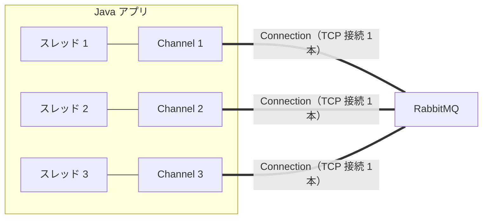
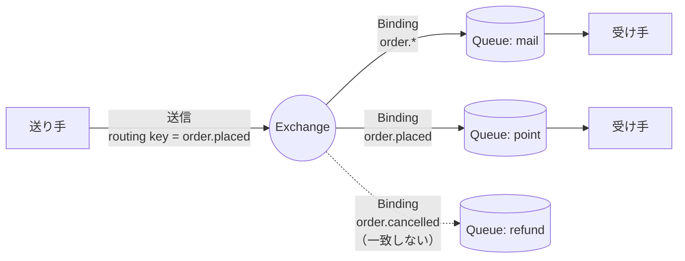
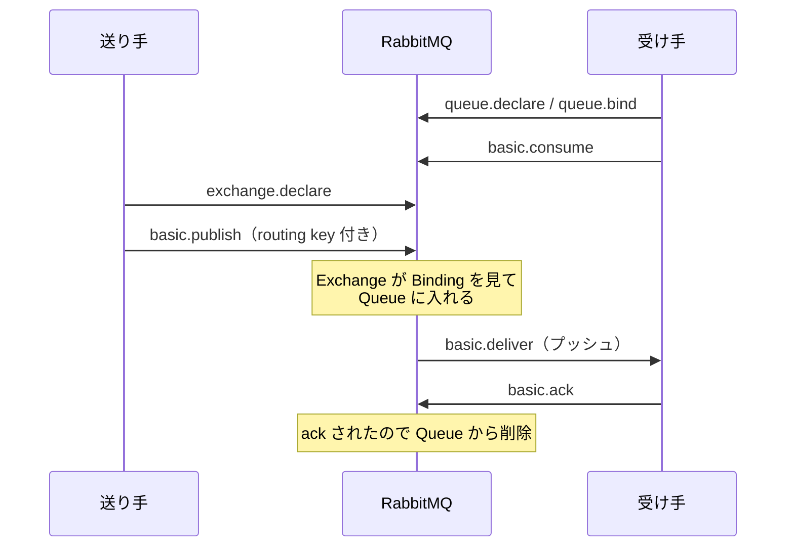

# 第6章: AMQPとはどのようなプロトコルか

## この章のゴール

AMQP 0-9-1 の Connection（接続）・Channel（通り道）・Exchange（振り分け役）・Queue（キュー）・Binding（振り分けの規則）の関係を説明できるようになります。管理画面で、RabbitMQ に最初から用意されているエクスチェンジを確認します。

## Why: なぜこれを学ぶのか

第8章以降で書く Java コードには `createChannel()`、`exchangeDeclare()`、`queueBind()`、`basicPublish()`、`basicAck()` といったメソッドが出てきます。これらは AMQP という通信ルール（プロトコル）が定めている操作に、ほぼ1対1で対応しています。今は名前の意味がわからなくて大丈夫です。この章で、それぞれの意味を順に説明します。プロトコルの仕組みを先に知っておくと、メソッド名を暗記しなくても「今どの操作をしているのか」がわかるようになります。

## 前提

第5章で、AMQP 0-9-1 が RabbitMQ の基本のプロトコルであることを学びました。この章でも、第5章と同じく「送り手（パブリッシャー）」「受け手（コンシューマー）」と書きます。

## ステップ1: AMQP の位置付けを知る

**AMQP（Advanced Message Queuing Protocol）** は、メッセージをやり取りするための、公開された標準のルールです。2000年代の金融業界で、特定の会社の製品に縛られないやり取りを目指して作られました。

| バージョン | 内容 |
| :--- | :--- |
| AMQP 0-9-1 | エクスチェンジ・キュー・バインディングという「ブローカーの中の部品」まで決めている。RabbitMQ の基本 |
| AMQP 1.0 | 送り手（パブリッシャー）と受け手（コンシューマー）の間のメッセージ転送の方法だけを決め、ブローカーの中の作りは製品に任せている。国際標準になっている |

**Why**: AMQP 0-9-1 はブローカー（メッセージを預かる仲介役）の中の部品まで決めているので、アプリからその構成を組み立てられます。この講座では、それを利用して「メッセージの通り道」を自分の手で作ります。

## ステップ2: Connection と Channel を知る

AMQP では、Java プログラムとブローカーの間に **接続（TCP という通信方法の接続）を1本張り、その中に複数のチャネル（Channel）を作って** 通信します。

| 部品 | 意味 | 作るコスト |
| :--- | :--- | :--- |
| Connection | プログラムとブローカーの間の接続。ユーザー名とパスワードによる認証もここで行う | 高い（接続の確立や認証のやり取りが必要） |
| Channel | Connection の中に作る、軽量な仮想の通信路。ほぼすべての操作はチャネル上で行う | 低い |

**Why**: TCP 接続を作るのは時間がかかり、ブローカー側のリソースも消費します。そこで AMQP は、1本の接続の中に番号付きのチャネルを複数作り、別々の通信として扱えるようにしています。送るデータは小さな単位に分けられ、それぞれにチャネル番号が付いています。

**⚠️ よくある失敗・誤解**: 「メッセージを1件送るたびに Connection を開いて閉じる」コードは、性能問題の典型です。Connection はアプリの起動時に作って使い回します。また、Channel は複数のスレッドから同時に使うと壊れることがあります。スレッドごとに Channel を分けるのが原則です。

## ステップ3: Exchange・Queue・Binding を知る

AMQP 0-9-1 のブローカーの中は、次の3つの部品でできています。

| 部品 | 役割 | たとえ |
| :--- | :--- | :--- |
| Exchange | メッセージを受け取り、どのキューに届けるかを決める。メッセージは保存しない | 郵便局の仕分け係 |
| Queue | メッセージをためておき、受け手（コンシューマー）に届ける | 各家の郵便受け |
| Binding | 「このエクスチェンジに来た、この条件のメッセージを、このキューへ」という規則 | 仕分け係が持つ宛先表 |
| Routing key | メッセージに付ける宛先ラベル。Binding の条件と照合される | 封筒に書く宛名 |

**Why**: 送り手（パブリッシャー）は **キューに直接は送りません。必ずエクスチェンジに送ります**。送り手（パブリッシャー）が知っているのはエクスチェンジ名とルーティングキーだけです。どのキューに届くかは、受け手（コンシューマー）側が張った Binding で決まります。こうして、送り手（パブリッシャー）は受け手（コンシューマー）が誰かを知らなくて済みます。

## ステップ4: エクスチェンジの種類を知る

エクスチェンジには、振り分けの規則が異なる4つの種類があります。

| 種類 | 振り分けの規則 | 使う章 |
| :--- | :--- | :--- |
| direct | ルーティングキーが Binding のキーと **完全一致** したキューへ | 第19章 |
| fanout | ルーティングキーを見ず、Binding されている **全キュー** へ | 第16章 |
| topic | ルーティングキーを `.` 区切りの単語と見て、`*`（任意の1単語）や `#`（0個以上の単語）で **パターン一致** したキューへ | 第17章 |
| headers | ルーティングキーではなく、メッセージのヘッダーの値で振り分ける | 本章で紹介のみ |

さらに、名前が空文字 `""` の **既定エクスチェンジ（default exchange）** があります。すべてのキューが、自分のキュー名をキーとして自動で Binding されている特別な direct エクスチェンジです。そのため「既定エクスチェンジにルーティングキー `hello` で送る」と、`hello` キューに直接届いたように見えます。第7章と第9章で使います。

## ステップ5: メッセージの中身を知る

AMQP のメッセージは、次の3つの部分でできています。

| 部分 | 内容 |
| :--- | :--- |
| ルーティング情報 | 送り先のエクスチェンジ名とルーティングキー |
| プロパティ | 標準で決まっているメタデータと、自由に使える `headers` |
| 本文（ボディ） | ただのバイト列（データの並び）。JSON でも画像でもよい。ブローカーは中身を見ない |

プロパティには、メッセージの種類（`type`）や、1件ごとの番号（`message-id`）などを入れられます。具体的な使い方は第18章で見ます。

## ステップ6: 操作（メソッド）の流れを知る

AMQP の操作は「クラス名.メソッド名」の形で定義されています。Java クライアントのメソッド名は、これに対応しています。たとえば `basic.publish`（メッセージを送る）は `basicPublish`、`queue.declare`（キューを作る）は `queueDeclare` です。それぞれのメソッドは、使う章で説明します。

送信から受信までの流れを図にすると、次のようになります。

**Why**: `declare` 系の操作は「なければ作る、あれば何もしない」という、何度やっても結果が同じ操作です。そのため、送り手（パブリッシャー）と受け手（コンシューマー）の両方が起動時に同じ宣言をしておけば、どちらが先に起動しても動きます。ただし、すでにあるものと **違う設定** で宣言するとエラーになります。この落とし穴は第13章で体験します。

**💼 現場Tip**: 本番環境では、アプリに `declare` させず、インフラ構成のコード（設定ファイルでインフラを管理するツールや、RabbitMQ の定義ファイル）でエクスチェンジやキューを作る運用もよく見かけます。アプリの権限を「送受信だけ」に絞れるので、誤ってキューの設定を変えてしまう事故を防げます。

## ステップ7: 管理画面で既定のエクスチェンジを見る

管理画面の Exchanges タブを開きます。キューをまだ1つも作っていなくても、いくつかのエクスチェンジが最初から存在します。

| 名前 | 種類 | 説明 |
| :--- | :--- | :--- |
| `(AMQP default)` | direct | 名前が空文字の既定エクスチェンジ |
| `amq.direct` | direct | あらかじめ用意された direct エクスチェンジ |
| `amq.fanout` | fanout | あらかじめ用意された fanout エクスチェンジ |
| `amq.headers` / `amq.match` | headers | あらかじめ用意された headers エクスチェンジ |
| `amq.topic` | topic | あらかじめ用意された topic エクスチェンジ |

`(AMQP default)` をクリックすると、詳細画面の Bindings 欄に「Default exchange は全キューに暗黙的にバインドされている」という説明が表示されます。

**🔍 確認・実験してみよう**: 管理画面の上部に表示されている「Virtual host」は何を意味しているでしょうか。1つの RabbitMQ の中を、名前の区画に分けて、複数のアプリを同居させる仕組みです。Admin タブの Virtual Hosts で、今ある仮想ホストの一覧を確認してみましょう。

## 動作確認

管理画面の Exchanges タブで、`(AMQP default)`・`amq.direct`・`amq.fanout`・`amq.topic`・`amq.headers` が表示されることを確認したら完了です。

## もっと良くしてみよう

### 理解確認

1. Connection と Channel の違いは何でしょうか。1件送るたびに Connection を作ると何が困るでしょうか。
2. 送り手（パブリッシャー）がキューに直接メッセージを送らず、エクスチェンジに送るのはなぜでしょうか。
3. 既定エクスチェンジにルーティングキー `hello` で送ると、`hello` キューに届くのはなぜでしょうか。

### 発展改善クイズ

1. ブローカーは本文の中身を見ません。それなのに、受け手（コンシューマー）が本文を正しく解釈できるようにするには、送り手（パブリッシャー）は何をしておくべきでしょうか。
2. 受け取り方には、ブローカーに届けてもらう `basic.consume`（プッシュ型）と、1件ずつ取りに行く `basic.get`（プル型）があります。メッセージが1秒に1000件届くキューで `basic.get` を使い続けると、何が起きそうか考えてみましょう。

---

| [← 第5章: メッセージング製品の全体像](./05-messaging-products.md) | [全章目次](./README.md) | [第7章: HTTP APIでメッセージを送受信する →](./07-http-api.md) |
| - | :-: | --: |
