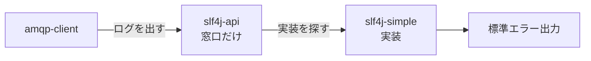

# 第8章: Javaクライアントを導入して接続する

## この章のゴール

`pom.xml` に入っている RabbitMQ の Java クライアント `amqp-client` の役割を知り、AMQP で RabbitMQ に接続できることを確認します。接続処理をまとめた共通クラス `RabbitConnection` を読みます。

## Why: なぜこれを学ぶのか

第7章で、HTTP のポーリングでは「届いた瞬間に受け取る」ことができないとわかりました。届いた瞬間に受け取る（プッシュ型）には、ブローカーとの接続を張りっぱなしにして、AMQP の決まりごとに沿ったデータを読み書きし続ける必要があります。さらに、相手が生きているかの定期確認、切れたときの再接続、チャネルの管理も必要です。これを自分で実装するのは大変なので、RabbitMQ の開発元が提供している公式ライブラリを使います。

この講座で初めて外部ライブラリを使います。`starter-java-build-tools` で学んだ Maven の依存関係の知識がここで生きてきます。

## 前提

第7章までで、RabbitMQ の管理画面と HTTP API に触れました。

## ステップ1: pom.xml の依存ライブラリを確認する

[pom.xml](../pom.xml) を開きます。`<dependencies>` には、次の2つが書かれています。

```xml
    <dependencies>
        <!-- RabbitMQ 公式の Java クライアント（AMQP 0-9-1） -->
        <dependency>
            <groupId>com.rabbitmq</groupId>
            <artifactId>amqp-client</artifactId>
            <version>5.37.0</version>
        </dependency>
        <!-- amqp-client が使うログ API（SLF4J）の出力先 -->
        <dependency>
            <groupId>org.slf4j</groupId>
            <artifactId>slf4j-simple</artifactId>
            <version>1.7.36</version>
        </dependency>
    </dependencies>
```

依存関係の木を表示してみます。

```bash
mvn -q dependency:tree -DoutputFile=/dev/stdout
```

```text
com.example:async:jar:1.0-SNAPSHOT
+- com.rabbitmq:amqp-client:jar:5.37.0:compile
|  +- org.slf4j:slf4j-api:jar:1.7.36:compile
|  +- io.netty:netty-transport:jar:4.2.18.Final:compile
...
\- org.slf4j:slf4j-simple:jar:1.7.36:compile
```

**Why**: `amqp-client` は、ログの出力に **SLF4J** という「ログの窓口だけを決めた API」を使っています。SLF4J は窓口だけなので、実際にどこへ出力するかを決める実装（バインディング）を別に追加する必要があります。`slf4j-simple` は、標準エラー出力にログを出すだけのシンプルな実装です。ライブラリの警告（接続が切れた、など）が見えるようになります。

ライブラリと SLF4J の関係を図にすると、次のようになります。



**⚠️ よくある失敗・誤解**: 最新版だからと `slf4j-simple` の 2.x を追加すると、起動時に次の警告が出てログが一切出なくなります。

```text
SLF4J: Failed to load class "org.slf4j.impl.StaticLoggerBinder".
SLF4J: Defaulting to no-operation (NOP) logger implementation
```

`dependency:tree` を見ると、`amqp-client` が使っている `slf4j-api` は 1.7.36 です。SLF4J は 1.7 系と 2.x 系で実装を探す仕組みが変わったため、API と実装のメジャーバージョンをそろえる必要があります。「推移的に入ってくるライブラリのバージョンを確かめる」のは、Maven で依存関係を追加するときの基本動作です。

## ステップ2: 接続を作る共通クラスを読む

接続先のホストやパスワードは、どのプログラムでも同じです。毎回書かずに済むよう、共通クラスにまとめてあります。[RabbitConnection.java](../src/main/java/com/example/async/common/RabbitConnection.java) を開きます。中心となる部分を抜粋します。

<!-- code: src/main/java/com/example/async/common/RabbitConnection.java#open -->
```java
/**
 * RabbitMQ に接続する。
 *
 * @param connectionName 管理画面の Connections 一覧に表示される名前
 * @return 確立した接続（使い終わったら close すること）
 * @throws IOException      ネットワークや認証に失敗した場合
 * @throws TimeoutException 接続がタイムアウトした場合
 */
public static Connection open(String connectionName) throws IOException, TimeoutException {
    // 接続設定の入れ物を作る
    ConnectionFactory factory = new ConnectionFactory();
    // 接続先ホスト・ポート・ユーザー・パスワードを環境変数から読む（なければ学習用の既定値）
    factory.setHost(env("RABBITMQ_HOST", "localhost"));
    factory.setPort(Integer.parseInt(env("RABBITMQ_PORT", "5672")));
    factory.setUsername(env("RABBITMQ_USER", "app"));
    factory.setPassword(env("RABBITMQ_PASSWORD", "app"));
    // 仮想ホスト（ブローカー内の論理的な区画）。既定は "/"
    factory.setVirtualHost(env("RABBITMQ_VHOST", "/"));
    // 接続が切れたら自動で再接続する（amqp-client 4.0 以降は既定で有効だが、明示しておく）
    factory.setAutomaticRecoveryEnabled(true);
    // 名前を付けて接続する
    return factory.newConnection(connectionName);
}
```

**Why**: `ConnectionFactory` は「どこに、誰として接続するか」の設定を持つ工場クラスです。`newConnection` を呼ぶたびに新しい接続を作ります。接続先を環境変数で差し替えられるのは、開発・検証・本番で接続先が変わっても、コードを書き換えずに済ませるためです。

`setAutomaticRecoveryEnabled(true)` は、ネットワークの瞬断やブローカーの再起動で接続が切れたとき、ライブラリが自動で再接続し、チャネルや受け取りの登録も作り直す設定です。第11章で、その動きを実際に確かめます。

`newConnection` に渡した名前は、管理画面の Connections タブに表示されます。本番で「この接続はどのアプリのものか」を調べるときの手がかりになります。

## ステップ3: 接続を確認するプログラムを読む

[ConnectionCheck.java](../src/main/java/com/example/async/hello/ConnectionCheck.java) を開いて、コードを読んでみましょう。

**Why**: `Connection` と `Channel` はどちらも `AutoCloseable` なので、try-with-resources で確実に閉じられます。閉じ忘れた接続はブローカー側に残り続け、接続数の上限やメモリを圧迫します。

## ステップ4: 実行して管理画面で確かめる

```bash
./run.sh hello.ConnectionCheck
```

```text
[09:31:39.066][main] 接続OK product=RabbitMQ version=4.x.x
[09:31:39.072][main] チャネル番号=1
[09:31:39.072][main] 30秒待ちます。管理画面の Connections タブを見てみましょう
```

30秒の間に、管理画面の Connections タブを開きます。`connection-check` という名前の接続が表示され、`Channels` 欄が 1 になっています。接続名をクリックすると、使っているプロトコル（AMQP 0-9-1）やクライアントライブラリのバージョンも確認できます。

30秒たつとプログラムが終了し、管理画面からも接続が消えます。

**🔍 確認・実験してみよう**: 次の2つを試し、それぞれどの例外になるか確かめてみましょう。

```bash
# パスワードを間違える
RABBITMQ_PASSWORD=wrong ./run.sh hello.ConnectionCheck
# RabbitMQ を止めてから接続する（確認後は ./broker.sh start で起動し直す）
./broker.sh stop
./run.sh hello.ConnectionCheck
```

**💼 現場Tip**: 接続に失敗したときのメッセージを見分けられるようにしておくと、障害対応が速くなります。

| 例外 | 主な原因 |
| :--- | :--- |
| `AuthenticationFailureException: ACCESS_REFUSED` | ユーザー名・パスワードの誤り、`guest` を外部から使った |
| `ConnectException: Connection refused` | ブローカーが起動していない、ホスト名・ポートの誤り |
| `SocketTimeoutException` / `TimeoutException` | ファイアウォールで遮断されている、ネットワーク経路がない |

## 動作確認

`./run.sh hello.ConnectionCheck` を実行し、次の2点を確認できたら完了です。

1. `接続OK product=RabbitMQ` と表示された
2. 実行中に、管理画面の Connections タブに `connection-check` が表示された

## もっと良くしてみよう

### 理解確認

1. `slf4j-simple` を追加しないと、`amqp-client` のログはどうなるでしょうか。
2. `newConnection` に接続名を渡しておくと、運用でどのように役立つでしょうか。
3. 接続先を環境変数で差し替えられるようにしているのはなぜでしょうか。

### 発展改善クイズ

1. `RabbitConnection` は、パスワードの既定値として `app` をコードに書いています。本番環境ではどのような問題になるか、どう直すとよいか考えてみましょう。
2. 本番環境では、ネットワーク上を流れるパスワードやメッセージを盗み見されないようにする必要があります。`ConnectionFactory` にどのような設定が必要になりそうか調べてみましょう。

---

| [← 第7章: HTTP APIでメッセージを送受信する](./07-http-api.md) | [全章目次](./README.md) | [第9章: キューに送ってDefaultConsumerで受け取る →](./09-point-to-point.md) |
| - | :-: | --: |
