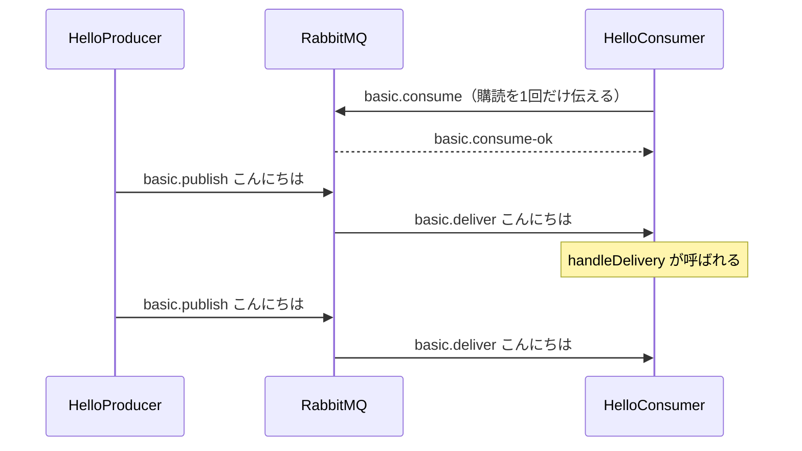
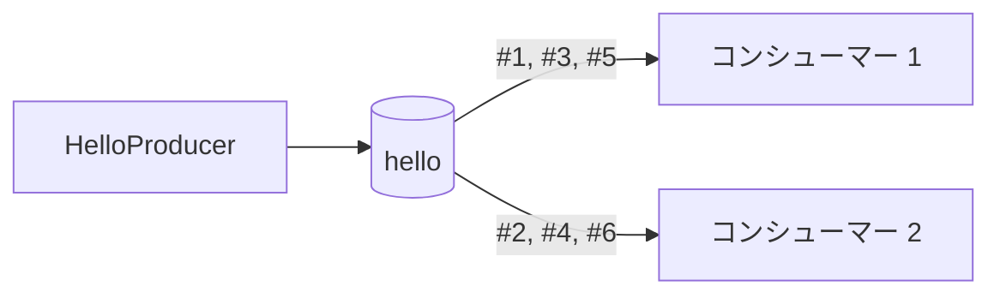

# 第9章: キューに送ってDefaultConsumerで受け取る

## この章のゴール

`hello` キューにメッセージを送るプロデューサーと、`DefaultConsumer` を継承してプッシュ型で受け取るコンシューマーを作ります。HTTP のポーリングと違い、メッセージが届いた瞬間に受け取れることを体験します。

## Why: なぜこれを学ぶのか

第7章のポーリングでは、遅延と空振りのどちらかを我慢する必要がありました。AMQP の `basic.consume` を使うと、コンシューマーは「このキューを購読します」と一度伝えるだけで済みます。あとはブローカーが、メッセージが届くたびに押し出してきます。

この章で作る「送る側」と「受け取る側」の形は、以後のすべての章の土台になります。

## 前提

第8章で `amqp-client` を追加し、`RabbitConnection.open(...)` で接続できるようになりました。

## ステップ1: プロデューサーを書く

`src/main/java/com/example/async/p2p/HelloProducer.java` を新規作成します。

<!-- code: answers/src/main/java/com/example/async/p2p/HelloProducer.java -->
```java
package com.example.async.p2p;

import java.nio.charset.StandardCharsets;

import com.example.async.common.Console;
import com.example.async.common.RabbitConnection;
import com.rabbitmq.client.Channel;
import com.rabbitmq.client.Connection;

/**
 * hello キューにメッセージを送るプロデューサー（送信側）。
 */
public class HelloProducer {
    // 送り先のキュー名
    static final String QUEUE = "hello";

    /**
     * 引数で指定した件数（省略時は3件）のメッセージを hello キューへ送る。
     *
     * @param args 送る件数
     * @throws Exception 接続や送信に失敗した場合
     */
    public static void main(String[] args) throws Exception {
        // 送る件数を決める
        int count = args.length > 0 ? Integer.parseInt(args[0]) : 3;
        try (Connection connection = RabbitConnection.open("hello-producer");
                Channel channel = connection.createChannel()) {
            // キューを宣言する。すでに同じ設定で存在すれば何もしない（冪等な操作）
            // 引数: キュー名, durable(再起動後も残す), exclusive(この接続専用), autoDelete(使われなくなったら消す), その他の設定
            channel.queueDeclare(QUEUE, true, false, false, null);
            for (int i = 1; i <= count; i++) {
                // 本文はバイト列で送る。文字列なら文字コードを明示して変換する
                String text = "こんにちは #" + i;
                // 既定エクスチェンジ("")に、ルーティングキー=キュー名で送ると、そのキューに直接届く
                channel.basicPublish("", QUEUE, null, text.getBytes(StandardCharsets.UTF_8));
                Console.log("送信: " + text);
            }
        }
    }
}
```

**Why**: `queueDeclare` の引数は次の意味を持ちます。

| 引数 | 値 | 意味 |
| :--- | :--- | :--- |
| `queue` | `"hello"` | キュー名 |
| `durable` | `true` | ブローカーを再起動してもキューの定義を残す |
| `exclusive` | `false` | この接続専用にしない（他の接続からも使える） |
| `autoDelete` | `false` | コンシューマーがいなくなっても削除しない |
| `arguments` | `null` | その他の設定（第13章で使う） |

`basicPublish("", QUEUE, null, body)` は、第6章で学んだ **既定エクスチェンジ** に、ルーティングキー＝キュー名で送っています。本文は `byte[]` で渡します。ブローカーは本文の中身を解釈しないので、文字列なら送る側で文字コードを決めてバイト列にします。

## ステップ2: 受け手がいない状態で送る

コンシューマーを書く前に、プロデューサーだけを実行してみます。

```bash
./run.sh p2p.HelloProducer
```

```text
[09:16:04.336][main] 送信: こんにちは #1
[09:16:04.341][main] 送信: こんにちは #2
[09:16:04.342][main] 送信: こんにちは #3
```

管理画面の Queues and Streams タブで `hello` キューを見ると、`Ready` が 3 になっています。

**Why**: 受け手がまだ存在しないのに、送信は成功しました。メッセージはキューにたまり、受け手が来るのを待っています。これが第15章で学んだ **時間の切り離し** です。

## ステップ3: DefaultConsumer を継承してコンシューマーを書く

`src/main/java/com/example/async/p2p/HelloConsumer.java` を新規作成します。

<!-- code: answers/src/main/java/com/example/async/p2p/HelloConsumer.java -->
```java
package com.example.async.p2p;

import java.io.IOException;
import java.nio.charset.StandardCharsets;

import com.example.async.common.Console;
import com.example.async.common.RabbitConnection;
import com.rabbitmq.client.AMQP;
import com.rabbitmq.client.Channel;
import com.rabbitmq.client.Connection;
import com.rabbitmq.client.DefaultConsumer;
import com.rabbitmq.client.Envelope;

/**
 * hello キューからメッセージを受け取るコンシューマー（受信側）。
 * DefaultConsumer を継承し、メッセージが届いたときに呼ばれる handleDelivery を上書きする。
 */
public class HelloConsumer extends DefaultConsumer {

    /**
     * @param channel このコンシューマーが使うチャネル
     */
    public HelloConsumer(Channel channel) {
        super(channel);
    }

    /**
     * ブローカーからメッセージが「押し出されて」きたときに、ライブラリのスレッドから呼ばれる。
     */
    @Override
    public void handleDelivery(String consumerTag, Envelope envelope,
            AMQP.BasicProperties properties, byte[] body) throws IOException {
        // バイト列を送信側と同じ文字コードで文字列に戻す
        String text = new String(body, StandardCharsets.UTF_8);
        // deliveryTag はこのチャネル内での配達番号（1, 2, 3, ...）
        Console.log("受信: " + text + " (deliveryTag=" + envelope.getDeliveryTag() + ")");
    }

    /**
     * hello キューの購読を開始し、Ctrl+C で止めるまで待ち続ける。
     *
     * @param args 使わない
     * @throws Exception 接続に失敗した場合
     */
    public static void main(String[] args) throws Exception {
        // 受信側は待ち続けるので try-with-resources は使わず、開きっぱなしにする
        Connection connection = RabbitConnection.open("hello-consumer");
        Channel channel = connection.createChannel();
        // 送信側より先に起動してもよいように、受信側でもキューを宣言しておく
        channel.queueDeclare(HelloProducer.QUEUE, true, false, false, null);
        // 購読を開始する。第2引数 autoAck=true は「届けた時点で処理済みとみなす」という指定（第11章で掘り下げる）
        channel.basicConsume(HelloProducer.QUEUE, true, new HelloConsumer(channel));
        Console.log("hello キューを購読中です。Ctrl+C で終了します");
    }
}
```

**Why**: `DefaultConsumer` は、ブローカーからの通知を受け取るためのメソッドを、何もしない形で一通り実装したクラスです。必要なメソッドだけを上書き（オーバーライド）して使います。

| メソッド | 呼ばれるとき |
| :--- | :--- |
| `handleDelivery` | メッセージが届いたとき |
| `handleConsumeOk` | 購読の開始をブローカーが受け付けたとき |
| `handleCancel` | キューが削除されるなど、ブローカー側から購読を打ち切られたとき |
| `handleShutdownSignal` | チャネルや接続が閉じたとき |

`handleDelivery` の引数のうち、`Envelope` は届いたメッセージの宛名情報です。届いたエクスチェンジ・ルーティングキー・配達番号（deliveryTag）・再配達フラグを持っています。`AMQP.BasicProperties` は、送る側の付けたプロパティです。

`main` の最後で接続を閉じていないことにも注目してください。`basicConsume` はすぐに戻ってきますが、ライブラリが内部で動かしているスレッドが残るため、プログラムは終了せずに待ち続けます。

## ステップ4: コンシューマーを起動する

```bash
./run.sh p2p.HelloConsumer
```

```text
[09:16:07.560][pool-1-thread-4] 受信: こんにちは #1 (deliveryTag=1)
[09:16:07.560][main] hello キューを購読中です。Ctrl+C で終了します
[09:16:07.564][pool-1-thread-4] 受信: こんにちは #2 (deliveryTag=2)
[09:16:07.564][pool-1-thread-4] 受信: こんにちは #3 (deliveryTag=3)
```

キューにたまっていた3件が、起動と同時に届きました。管理画面の `hello` キューの `Ready` は 0 になっています。

コンシューマーを起動したまま、別のターミナルでプロデューサーをもう一度実行します。

```bash
./run.sh p2p.HelloProducer
```

送信した瞬間に、コンシューマー側に「受信」が表示されます。ログの時刻を見比べると、送信から受信までの差は数ミリ秒です。

**Why**: 第7章のポーリングとの違いを確かめましょう。コンシューマーは何もリクエストを送っていません。ブローカーがメッセージを受け取った瞬間に `basic.deliver` で押し出し、ライブラリが `handleDelivery` を呼び出しています。

送信から受信までの流れを図にすると、次のようになります。コンシューマーが購読を伝えるのは最初の1回だけです。



ログのスレッド名が `main` ではなく `pool-1-thread-4` になっていることにも注目してください。`handleDelivery` は、ライブラリが用意したスレッドプールのスレッドから呼ばれます。

**⚠️ よくある失敗・誤解**: 1つのチャネルに届いたメッセージの `handleDelivery` は、**1件ずつ順番に** 呼ばれます。`handleDelivery` の中で時間のかかる処理をすると、その間、同じチャネルの次のメッセージは待たされます。「受信が遅い」と感じたら、まず `handleDelivery` の中で何に時間がかかっているかを疑いましょう。

## ステップ5: コンシューマーを2つ起動する

コンシューマーを Ctrl+C で止め、2つのターミナルでそれぞれ起動し直します。

```bash
./run.sh p2p.HelloConsumer
```

3つめのターミナルで、6件送ります。

```bash
./run.sh p2p.HelloProducer 6
```

1つめのコンシューマーには `#1`・`#3`・`#5`、2つめには `#2`・`#4`・`#6` が届きます。

**Why**: 1つのキューに複数のコンシューマーがいると、ブローカーはメッセージを **順番に1件ずつ配ります（ラウンドロビン）**。1件のメッセージは、どちらか一方にしか届きません。これが第15章の P2P モデルです。コンシューマーを増やすだけで、処理を分担させられます。

配られ方を図にすると、次のようになります。



**🔍 確認・実験してみよう**: コンシューマーを2つ起動したまま、管理画面で `hello` キューを開き、下のほうにある「Delete」ボタンでキューを削除してみましょう。コンシューマーには何が起きるでしょうか。`handleCancel` を上書きしてログを出すようにすると、何がわかるか試してみましょう。

**💼 現場Tip**: `DefaultConsumer` を継承する方法のほかに、ラムダ式で書ける `DeliverCallback` を使う方法もあります。

```java
// ラムダ式で受信処理を渡す書き方。中身は handleDelivery と同じ
channel.basicConsume("hello", true,
        (consumerTag, delivery) -> Console.log(new String(delivery.getBody(), StandardCharsets.UTF_8)),
        consumerTag -> Console.log("購読が打ち切られました"));
```

短い処理ならラムダ式が手軽です。この講座では、受信処理を1つのクラスとして名前を付けて扱え、`handleCancel` などの他の通知も同じクラスで受けられる `DefaultConsumer` の継承を使います。

## 動作確認

次の3つを確認できたら完了です。

1. コンシューマーがいない状態で送ったメッセージが、管理画面の `Ready` に残った
2. コンシューマーを起動すると、たまっていたメッセージがすぐに届いた
3. コンシューマーを2つ起動すると、メッセージが交互に分配された

## もっと良くしてみよう

### 理解確認

1. プロデューサーとコンシューマーの両方で `queueDeclare` しているのはなぜでしょうか。
2. `handleDelivery` はどのスレッドで呼ばれるでしょうか。`main` メソッドが終わってもプログラムが終了しないのはなぜでしょうか。
3. 1つのキューにコンシューマーが2つあるとき、1件のメッセージは何人に届くでしょうか。

### 発展改善クイズ

1. `basicConsume` の第2引数 `autoAck` を `true` にしています。`handleDelivery` の処理の途中でプログラムが落ちたら、そのメッセージはどうなるでしょうか。
2. 処理に3秒かかるメッセージと0.3秒で終わるメッセージが交互に届く場合、ラウンドロビンで2つのコンシューマーに配ると何が起きそうでしょうか。

---

| [← 第8章: Javaクライアントを導入して接続する](./08-java-client-setup.md) | [全章目次](./README.md) | [第10章: ジョブキューで時間のかかる処理を任せる →](./10-job-queue.md) |
| - | :-: | --: |
