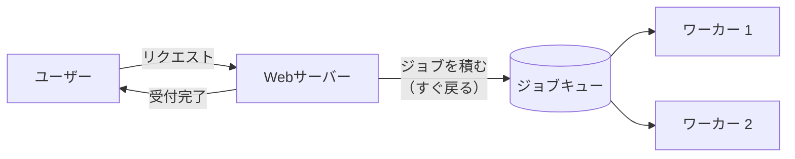
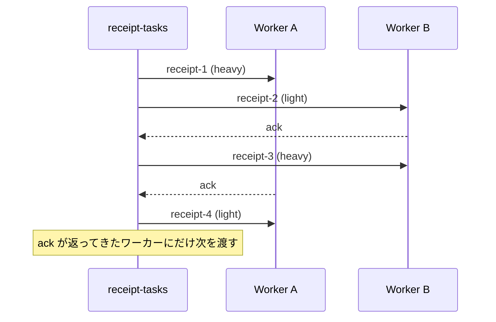

# 第10章: ジョブキューで時間のかかる処理を任せる

## この章のゴール

「領収書 PDF の作成」という時間のかかる仕事を、キューに積んで裏側のワーカーに任せる **ジョブキュー** を作ります。複数のワーカーで分担し、「処理が終わったら自分で完了の通知（ack）を返す」書き方と、「一度に手元へ受け取る件数の上限（prefetch。`basicQos` で指定）」の役割を理解して、仕事の偏りを解消します。

## Why: なぜこれを学ぶのか

Webサービスには、ユーザーを待たせたくない重い処理がたくさんあります。PDF の作成、画像の縮小、CSV の取り込み、外部システムへの一括連携などです。これらを **ジョブ**（仕事の依頼）としてキューに積み、裏側の **ワーカー** に処理させる仕組みが、ジョブキューです。Webサービスの非同期処理で、いちばん広く使われています。

言語やフレームワークが違っても、ジョブキューの形は同じです。この講座の第3章では、これを非同期処理の「土台」と呼びました。この章で、その土台を自分の手で作ります。

ワーカーは負荷に応じて増やせます。しかし、ただ増やすだけでは仕事をうまく分担できない場合があります。この章では、その原因と対策を体験します。

## 前提

第9章で、1つのキューに複数の受け手（コンシューマー）がいるとメッセージがラウンドロビンで配られることを確かめました。

## ステップ0: ジョブキューの形を知る



| 登場人物 | 役割 |
| :--- | :--- |
| 送り手（パブリッシャー） | ジョブを積む側。Web サーバー（リクエストを受けるプログラム）が担当する |
| キュー | ジョブを預かる場所 |
| ワーカー | ジョブを1件ずつ取り出して処理する側。台数を増やすと、処理能力が増える |

**Why**: Web サーバーは、ジョブを積んだらすぐにユーザーへ応答できます。重い処理は、ユーザーの画面とは関係のない場所で進みます。第1章の「遅さ」を解決する、いちばん基本の形です。1件のジョブは、**ちょうど1つのワーカー** だけが処理します。同じ仕事を複数のワーカーが重複して行うことはありません（ただし、第12章で見るように、障害時には重複することがあります）。

## ステップ1: ジョブを積む送り手（パブリッシャー）を読む

[ReceiptTaskProducer.java](../src/main/java/com/example/async/workqueue/ReceiptTaskProducer.java) を開いて、コードを読んでみましょう。奇数番のタスクは重く（3秒）、偶数番は軽い（0.3秒）という想定です。

**Why**: 第9章では `basicPublish` の第3引数（プロパティ）に `null` を渡していました。ここでは `MessageProperties.PERSISTENT_TEXT_PLAIN` を渡しています。「このメッセージはディスクにも保存してほしい」という指定です。ジョブキューの仕事は、ブローカーが再起動しても失われてほしくないためです。詳しくは第11章で確かめます。

## ステップ2: 処理が終わってから ack を返すワーカーを読む

[ReceiptWorker.java](../src/main/java/com/example/async/workqueue/ReceiptWorker.java) を開きます。中心となる部分を抜粋します。

<!-- code: src/main/java/com/example/async/workqueue/ReceiptWorker.java#handleDelivery,main -->
```java
/**
 * タスクを1件処理し、終わったら ack（処理完了の通知）を返す。
 */
@Override
public void handleDelivery(String consumerTag, Envelope envelope,
        AMQP.BasicProperties properties, byte[] body) throws IOException {
    String task = new String(body, StandardCharsets.UTF_8);
    Console.log(workerName + " 開始: " + task);
    // heavy なら3秒、light なら0.3秒かかる処理の代わり
    Console.sleep(task.endsWith("heavy") ? 3000 : 300);
    Console.log(workerName + " 完了: " + task);
    // 処理が終わってから ack する。第2引数 multiple=false は「この1件だけ」という意味
    getChannel().basicAck(envelope.getDeliveryTag(), false);
}

// （中略）

/**
 * ワーカーを起動する。
 *
 * @param args [0] ワーカー名, [1] prefetch 数（0 なら無制限）
 * @throws Exception 接続に失敗した場合
 */
public static void main(String[] args) throws Exception {
    String name = args.length > 0 ? args[0] : "worker";
    int prefetch = args.length > 1 ? Integer.parseInt(args[1]) : 0;
    Connection connection = RabbitConnection.open("receipt-" + name);
    Channel channel = connection.createChannel();
    channel.queueDeclare(ReceiptTaskProducer.QUEUE, true, false, false, null);
    // prefetch: ack を返していないメッセージを、最大何件まで手元に受け取るか（0 は無制限）
    channel.basicQos(prefetch);
    // autoAck=false にして、処理完了後に自分で ack を返す
    channel.basicConsume(ReceiptTaskProducer.QUEUE, false, new ReceiptWorker(channel, name));
    Console.log(name + " 起動（prefetch=" + prefetch + "）。Ctrl+C で終了します");
}
```

**Why**: 第9章との大きな違いは2つです。

1. `basicConsume` の `autoAck` を `false` にし、処理が終わってから `basicAck` で **ack（処理完了の通知）** を返している
2. `basicQos(prefetch)` で、ack を返していないメッセージを手元に最大何件まで受け取るかを指定している

ブローカーは、ack を受け取るまでメッセージを消しません。ack 待ちのメッセージは、管理画面で `Unacked` として数えられます。

`basicAck` の第1引数 `deliveryTag` は、「どのメッセージの ack か」を示す配達番号です。第2引数 `multiple` を `true` にすると「この番号以下をまとめて ack」になりますが、ここでは1件ずつ返します。

## ステップ3: prefetch を無制限にして2つのワーカーを動かす

2つのターミナルで、prefetch を 0（無制限）にしてワーカーを起動します。

```bash
# ターミナル1
./run.sh workqueue.ReceiptWorker A 0
```

```bash
# ターミナル2
./run.sh workqueue.ReceiptWorker B 0
```

3つめのターミナルで、8件のタスクを投入します。

```bash
./run.sh workqueue.ReceiptTaskProducer 8
```

ワーカーの出力から「完了」の行だけを抜き出すと、次のようになります（スレッド名は省略しています）。

```text
[09:16:19.823] B 完了: receipt-2:light
[09:16:20.126] B 完了: receipt-4:light
[09:16:20.427] B 完了: receipt-6:light
[09:16:20.730] B 完了: receipt-8:light
[09:16:22.518] A 完了: receipt-1:heavy
[09:16:25.526] A 完了: receipt-3:heavy
[09:16:28.530] A 完了: receipt-5:heavy
[09:16:31.535] A 完了: receipt-7:heavy
```

B は約1秒で4件を終えて暇になりました。一方の A は、重いタスクを4件抱えて約12秒かかっています。

**Why**: prefetch が無制限だと、ブローカーはワーカーの処理状況を見ずに、メッセージを **届いた順にラウンドロビンで次々と押し出します**。8件は投入直後に、奇数番は A、偶数番は B の手元へ渡ってしまいます。B がすぐ暇になっても、A の手元にある仕事を横取りする仕組みはありません。

**🔍 確認・実験してみよう**: タスクを投入した直後に管理画面で `receipt-tasks` キューを見ると、`Ready` と `Unacked` はそれぞれ何件になっているでしょうか。管理画面の数値は数秒おきに更新されるので、何度か再読み込みしながら観察してみましょう。

## ステップ4: prefetch を 1 にして動かし直す

両方のワーカーを Ctrl+C で止め、prefetch を 1 にして起動し直します。

```bash
# ターミナル1
./run.sh workqueue.ReceiptWorker A 1
```

```bash
# ターミナル2
./run.sh workqueue.ReceiptWorker B 1
```

もう一度8件を投入します。

```bash
./run.sh workqueue.ReceiptTaskProducer 8
```

```text
[09:43:01.620] B 完了: receipt-2:light
[09:43:04.308] A 完了: receipt-1:heavy
[09:43:04.611] A 完了: receipt-4:light
[09:43:04.626] B 完了: receipt-3:heavy
[09:43:04.929] B 完了: receipt-6:light
[09:43:07.613] A 完了: receipt-5:heavy
[09:43:07.918] A 完了: receipt-8:light
[09:43:07.933] B 完了: receipt-7:heavy
```

重いタスクが A と B に2件ずつ分かれ、全体が約6.6秒で終わりました。

**Why**: prefetch を 1 にすると、ブローカーは「ack を返していないメッセージが1件あるワーカーには、次を渡さない」ようになります。B は軽いタスクを終えて ack を返した瞬間に次をもらい、A が重いタスクを処理している間に、残りの仕事を引き受けられます。手が空いたワーカーから順に仕事を取っていく形になり、偏りがなくなります。



**⚠️ よくある失敗・誤解**: 「prefetch は 1 が一番公平なので常に 1 にする」と考えがちですが、そうとは限りません。prefetch が 1 だと、ワーカーは ack を返してから次のメッセージが届くまで、毎回ブローカーとの往復を待ちます。1件が数ミリ秒で終わる軽い処理では、この待ち時間が処理時間より長くなり、全体が遅くなります。処理が重いなら小さく、軽いなら数十〜数百程度に設定し、実測して決めます。

**💼 現場Tip**: prefetch は、ほとんどのメッセージング製品に同じ考え方の設定があります。製品ごとの呼び名は、第21章の対応表にまとめてあります。

**💼 現場Tip**: 本番では「キューにたまっているメッセージの件数」を監視し、件数が増えたらワーカーを自動で増やす（オートスケール）構成がよく使われます。クラウドの多くは、キューの滞留件数をもとにワーカーの台数を自動で変える機能を持っています。

## 動作確認

次の2点を確認できたら完了です。

1. prefetch 0 のとき、重いタスクが片方のワーカーに偏った
2. prefetch 1 のとき、重いタスクが両方のワーカーに分かれ、全体の処理時間が短くなった

## もっと良くしてみよう

### 理解確認

1. `autoAck=false` にしたのに `basicAck` を呼ばないと、管理画面の `Unacked` はどうなるでしょうか。
2. prefetch 0 のとき、B が暇になっても A の仕事を手伝えないのはなぜでしょうか。
3. prefetch を 1 にすると、どのような場合に全体の処理が遅くなるでしょうか。

### 発展改善クイズ

1. ワーカー A が重いタスクを処理している途中で、A のプロセスが強制終了されたら、そのタスクはどうなるでしょうか。`autoAck=true` の場合と比べて考えてみましょう。
2. 1つのワーカーの中で、複数のタスクを並行に処理したい場合、どのような方法が考えられるでしょうか。チャネルとスレッドの関係に注意しながら考えてみましょう。

---

| [← 第9章: キューに送ってDefaultConsumerで受け取る](./09-point-to-point.md) | [全章目次](./README.md) | [第11章: メッセージが消えないために →](./11-not-losing-messages.md) |
| - | :-: | --: |
