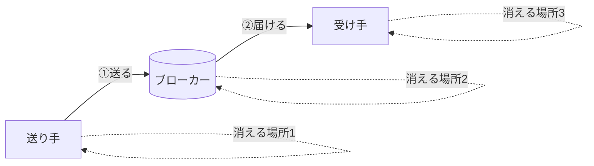
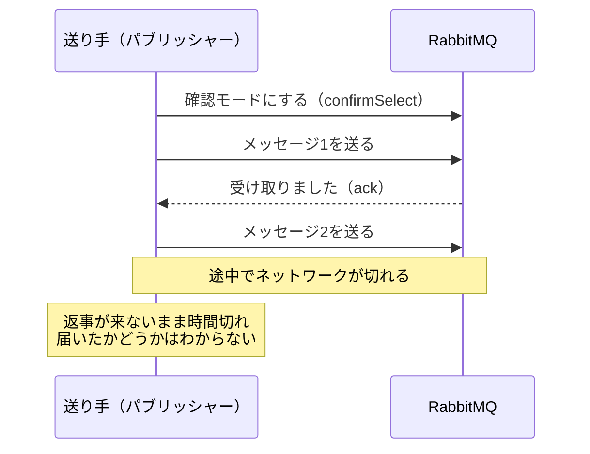

# 第11章: メッセージが消えないために

## この章のゴール

メッセージが消える3つの場所と、それぞれの基本の対策を知ります。3つの場所とは、ブローカー・受け手（コンシューマー）・送り手（パブリッシャー）です。ブローカーの再起動と、受け手（コンシューマー）の強制終了を実際に体験し、送り手（パブリッシャー）の対策は考え方を紹介します。

## Why: なぜこれを学ぶのか

ここからの3章（第11〜13章）は、ジョブキューで現場によく起きるトラブルを紹介します。目的は **基本を知り、「気をつけることがあるんだ」と気付くこと** で、深く作り込む章ではありません。細かい設計は、業務で必要になった時点で、公式ドキュメントを読みながら進めれば十分です。

最初のトラブルは「メッセージが消えた」です。ブローカーは再起動しますし、受け手（コンシューマー）のアプリは、新しい版へ入れ替える（デプロイ）たびに止まります。そのたびにたまっていたジョブが消えていたら、領収書とメールが作られないままになります。

## 前提

第10章で、ジョブキューとワーカーを作りました。RabbitMQ は `./broker.sh` で起動しています。

## ステップ1: メッセージが消える3つの場所



| 場所 | 消える原因の例 | 基本の対策 | この章での扱い |
| :--- | :--- | :--- | :--- |
| ブローカー | 再起動、障害でメモリの内容が失われる | 永続化（再起動しても残るよう、ディスクにも書く。キューとメッセージの両方） | 体験する |
| 受け手（コンシューマー） | 処理の途中でアプリが落ちる | 処理が終わってから ack（処理完了の通知）を返す | 体験する |
| 送り手（パブリッシャー） | ブローカーに届く前に、ネットワークが切れる | 「受け取りました」という返事を待つ（パブリッシャー確認） | 紹介する |

## ステップ2: ブローカーが再起動するとどうなるか

同じキューに、非永続のメッセージと永続のメッセージを3件ずつ送り、RabbitMQ を再起動して、どちらが残るかを確かめます。

[PersistenceDemoProducer.java](../src/main/java/com/example/async/durability/PersistenceDemoProducer.java) を開いて、コードを読んでみましょう。

キューの中身をすべて取り出して表示するプログラムも使います。[QueueDrainer.java](../src/main/java/com/example/async/durability/QueueDrainer.java) を開いて、コードを読んでみましょう。

6件を送り、RabbitMQ を再起動してから、キューの中身を取り出します。

```bash
./run.sh durability.PersistenceDemoProducer
./broker.sh restart
./run.sh durability.QueueDrainer
```

```text
[09:20:03.813][main] 残っていた: persistent-1
[09:20:03.818][main] 残っていた: persistent-2
[09:20:03.818][main] 残っていた: persistent-3
[09:20:03.821][main] durability-demo から 3 件取り出しました
```

`transient-` のメッセージは、再起動で消えました。

**Why**: 非永続のメッセージは、ブローカーのメモリにだけ置かれます。永続のメッセージはディスクにも書かれるので、再起動後に読み込み直されます。永続メッセージにするには、`MessageProperties.PERSISTENT_TEXT_PLAIN` のように `deliveryMode=2` を付けて送ります。

**気をつけること**:

- ブローカーの再起動を乗り越えるには、**エクスチェンジ・キュー・メッセージの3つすべて** を永続にする必要があります。「durable なキューに入れたから大丈夫」ではありません。durable はキューの定義を残す指定で、中のメッセージは別の指定です
- 非永続が悪いわけではありません。消えても困らない通知（画面のリアルタイム更新など）は、非永続のほうが速く済みます
- 本番では、1台のサーバーのディスクが壊れても残るよう、複数台にコピーを持つキューを使います（RabbitMQ ではクォーラムキュー）

## ステップ3: 受け手（コンシューマー）が落ちるとどうなるか

1件に3秒かかるポイント付与を、自動 ack と手動 ack で動かし、処理の途中で Ctrl+C で止めます。

[PointTaskProducer.java](../src/main/java/com/example/async/ack/PointTaskProducer.java) を開いて、コードを読んでみましょう。

[SlowPointConsumer.java](../src/main/java/com/example/async/ack/SlowPointConsumer.java) を開きます。中心となる部分を抜粋します。

<!-- code: src/main/java/com/example/async/ack/SlowPointConsumer.java#handleDelivery -->
```java
/**
 * 3秒かけて処理し、手動 ack のときだけ ack を返す。
 */
@Override
public void handleDelivery(String consumerTag, Envelope envelope,
        AMQP.BasicProperties properties, byte[] body) throws IOException {
    String task = new String(body, StandardCharsets.UTF_8);
    // isRedeliver() が true なら「以前にも誰かに届けたが ack されなかった」メッセージ
    Console.log("処理開始: " + task + " redelivered=" + envelope.isRedeliver());
    Console.sleep(3000);
    Console.log("処理完了: " + task);
    // 処理が終わってから ack する
    if (manualAck) {
        getChannel().basicAck(envelope.getDeliveryTag(), false);
    }
}
```

まず自動 ack で試します。5件を送って起動し、`order-2` の「処理開始」が出たら Ctrl+C で止めます。

```bash
./run.sh ack.PointTaskProducer
./run.sh ack.SlowPointConsumer auto
```

```text
[09:20:26.559][pool-1-thread-4] 処理開始: order-1 redelivered=false
[09:20:29.563][pool-1-thread-4] 処理完了: order-1
[09:20:29.563][pool-1-thread-4] 処理開始: order-2 redelivered=false
^C
```

管理画面の `point-tasks` キューは、`Ready` と `Unacked` がどちらも 0 です。処理を終えたのは `order-1` だけなのに、5件すべてが消えました。

次に手動 ack で試します。キューを空にしてから、同じ手順を行います。

```bash
./run.sh durability.QueueDrainer point-tasks
./run.sh ack.PointTaskProducer
./run.sh ack.SlowPointConsumer manual
```

`order-2` の「処理開始」が出たら Ctrl+C で止めます。管理画面の `Ready` は 4 です。もう一度 `manual` で起動し直します。

```bash
./run.sh ack.SlowPointConsumer manual
```

```text
[09:21:02.404][pool-1-thread-4] 処理開始: order-2 redelivered=true
[09:21:05.409][pool-1-thread-4] 処理完了: order-2
```

`order-2` が `redelivered=true`（再配達）で届き直しました。

**Why**: 自動 ack は、ブローカーがメッセージを **送り出した時点で** 処理済みとみなして削除します。受け手（コンシューマー）のメモリにあったメッセージは、プロセスと一緒に消えます。手動 ack は、ack を受け取るまでブローカーが預かり続けます。受け手（コンシューマー）が落ちると、ack されていないメッセージはキューに戻り、別の受け手（コンシューマー）か、再起動後の同じ受け手に再配達されます。

**気をつけること**:

- ack は、**処理（DB への書き込みの確定など）がすべて終わった後** に返します。最初に返すと、手動 ack にした意味がなくなります
- `autoAck=false` なのに ack を書き忘れると、エラーを出さずに受け手（コンシューマー）が静かに止まります。手がかりは、管理画面の `Unacked` が減らないことです
- 受け手（コンシューマー）が落ちて再配達されると、処理の途中までやったメッセージを **もう一度** 処理することになります。これが次の章の「重複」につながります
- 失敗を伝える `basicNack` や `basicReject` もあります。使い方は第13章で扱います

## ステップ4: 送り手（パブリッシャー）側の消失を知る（紹介）

最後の1か所が送り手（パブリッシャー）です。`basicPublish` は、例外を投げずに戻ってきても、**ブローカーが受け取ったことを保証しません**。メッセージを送信バッファに書いた時点で戻ってくるからです。

| 起こること | 送り手（パブリッシャー）の気づき方 |
| :--- | :--- |
| 届け先のキューがなく、捨てられた | 送るときに「行き場がなければ返して」と指定する（`mandatory=true`）と、送り手に返送される |
| ブローカーに届く前に、ネットワークが切れた | **パブリッシャー確認**（publisher confirms）を使うと、確認が返ってこないことでわかる |

パブリッシャー確認は、送信のたびに「ブローカーが受け取りました」という返事をもらう仕組みです。



試してみたい方のために、`confirm/` パッケージに2つのクラスを置いてあります。[UnroutableDemo.java](../src/main/java/com/example/async/confirm/UnroutableDemo.java) は行き場のないメッセージを返送させ、[ConfirmPublisher.java](../src/main/java/com/example/async/confirm/ConfirmPublisher.java) は確認の待ち方による速さを比べます。

**気をつけること**:

- 確認が返ってこなかったとき、メッセージが届いたかどうかは **わかりません**。ブローカーは受け取ったのに、返事だけが途中で失われた可能性もあるからです
- 再送すると重複する可能性があり、再送しないと消える可能性があります。業務で消えることが許されないなら、再送を選び、**受け手（コンシューマー）を重複に強く作ります**（第12章）
- パブリッシャー確認は、RabbitMQ 独自の機能ではありません。どの製品にも、保存できたかどうかを送り手へ知らせる仕組みがあります

## ステップ5: 配達保証の3つの水準を知る

ここまでの体験を、メッセージングの世界で共通の言葉で整理します。

| 水準 | 意味 | 起きうること | ここまでの体験 |
| :--- | :--- | :--- | :--- |
| at-most-once（最大1回） | 0回か1回 | **消失** | 自動 ack |
| at-least-once（最低1回） | 1回以上 | **重複** | 手動 ack + 再配達、送り手（パブリッシャー）の再送 |
| exactly-once（ちょうど1回） | 必ず1回 | なし（ただし実現には受け手（コンシューマー）の協力が必要） | 次の章で、受け手（コンシューマー）の工夫として体験 |

**Why**: ネットワーク越しのやり取りでは、「相手に届いたか」と「相手が処理を終えたか」を確実に同時に知る方法がありません。そのため多くの場合、**消失を許すか、重複を許すか** の二択になります。業務で大切なデータは、消失を許さず、重複を許して、受け手（コンシューマー）側で重複を処理します。

## ステップ6: 「消えない」ためのチェックリスト

| 場所 | 確認すること |
| :--- | :--- |
| ブローカー | エクスチェンジとキューは durable か。メッセージは persistent か。重要なキューは複数台に複製されているか |
| 受け手（コンシューマー） | 手動 ack か。ack は処理の完了後か。ack 待ちのメッセージ数（prefetch）は適切か |
| 送り手（パブリッシャー） | 送信の確認を使っているか。確認が返らなかったときの再送方針はあるか |
| 全体 | 消えても困らないメッセージには、あえて軽い設定（非永続・自動 ack）を選んでいるか |

## 動作確認

次の3点を確認できたら完了です。

1. ブローカーの再起動で、非永続のメッセージだけが消えた
2. 自動 ack で止めると未処理の分も消え、手動 ack で止めると `redelivered=true` で届き直した
3. 送り手（パブリッシャー）側の消失を防ぐ2つの仕組み（`mandatory` とパブリッシャー確認）の役割を説明できる

## もっと良くしてみよう

### 理解確認

1. durable なキューに非永続のメッセージを入れて再起動すると、どうなるでしょうか。
2. 自動 ack で、まだ処理を始めていなかったメッセージまで消えるのはなぜでしょうか。
3. パブリッシャー確認がタイムアウトしたとき、再送するとどのような問題が起こりうるでしょうか。

### 発展改善クイズ

1. 手動 ack で再配達された `order-2` は、1回目の処理がどこまで進んでいたかわかりません。ポイントの二重加算を防ぐには、受け手（コンシューマー）をどう作ればよいでしょうか。次の章へ進む前に考えてみましょう。
2. 第10章の `ReceiptTaskProducer` は、`mandatory` とパブリッシャー確認のどちらも使っていません。ジョブを積む側の消失を検知できるようにするには、どこを直せばよいでしょうか。

---

| [← 第10章: ジョブキューで時間のかかる処理を任せる](./10-job-queue.md) | [全章目次](./README.md) | [第12章: 重複メッセージと冪等なコンシューマー →](./12-idempotency.md) |
| - | :-: | --: |
