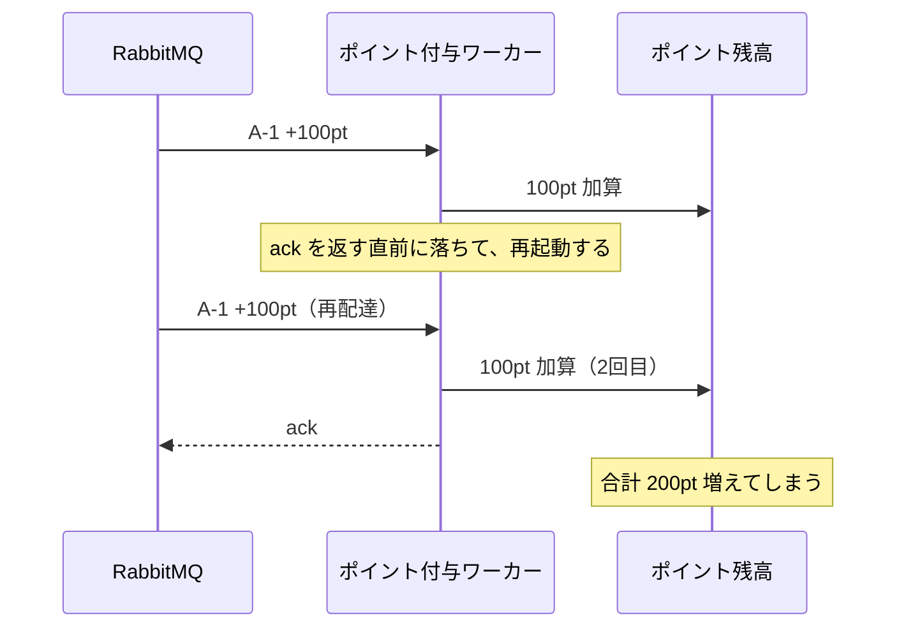
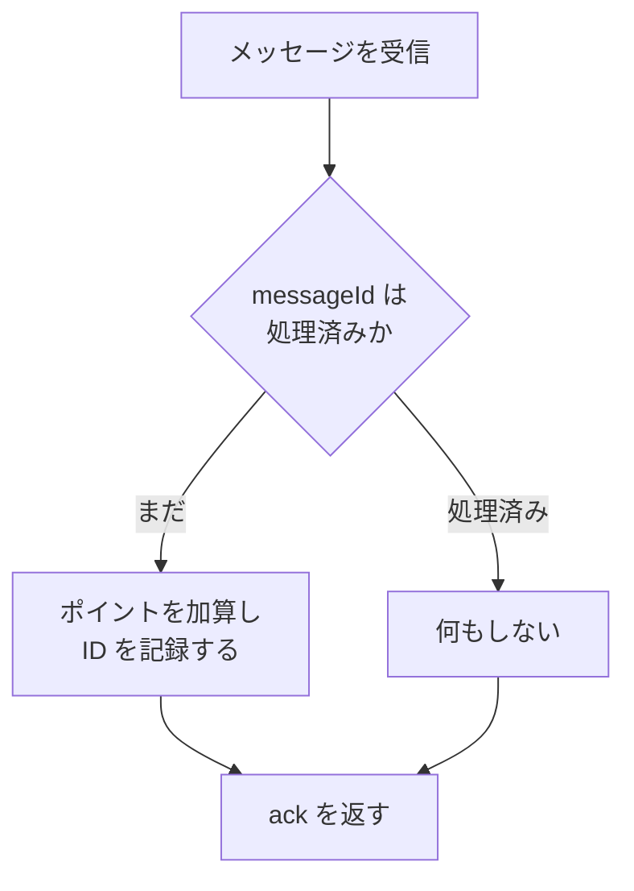

# 第12章: 重複メッセージと冪等なコンシューマー

## この章のゴール

同じポイント付与のジョブが2回届くと、ポイントが二重に付与されることを体験します。メッセージのIDを記録して重複を弾く、**冪等（べきとう）なコンシューマー** の基本を学びます。

## Why: なぜこれを学ぶのか

第11章で、消失を防ごうとすると重複が起きうることを学びました。受け手が ack の直前に落ちれば再配達され、送り手が確認のタイムアウトで再送すれば、同じメッセージが2通届きます。

つまり、重複は「起きたら困るバグ」ではなく **「必ず起きる前提」** です。重複を防ぐのはブローカーではなく、受け手の仕事になります。メッセージングを使う業務システムで、いちばん大切な考え方の1つです。

## 前提

第10章で作ったジョブキューの形を使います。ジョブには、ジョブごとに一意な `messageId`（メッセージのID）を付けます。第11章で、受け手が落ちると再配達が起きることを体験しました。

## ステップ1: 重複が起きる3つの場面

| 場面 | 何が起きるか |
| :--- | :--- |
| 受け手が ack の直前に落ちた | ブローカーは処理済みと知らないので、再配達する |
| 送り手が確認のタイムアウトで再送した | ブローカーが受け取っていたら、同じメッセージが2通になる |
| リトライや運用での再投入 | 失敗した分をやり直した結果、成功済みの分と重なる |

1つめの場面を図にすると、次のようになります。



## ステップ2: 冪等とは何かを知る

**冪等** とは、同じ操作を何回行っても、1回行ったときと結果が変わらない性質のことです。

| 操作 | 冪等か | 理由 |
| :--- | :--- | :--- |
| 注文の状態を「支払済」にする | 冪等 | 2回実行しても「支払済」のまま |
| 商品の価格を 1000 円に設定する | 冪等 | 2回実行しても 1000 円のまま |
| ポイント残高に 100 を **加算** する | 冪等ではない | 2回実行すると 200 増える |
| 確認メールを **送信** する | 冪等ではない | 2回実行すると2通届く |

冪等でない処理を冪等にするには、主に次の方法があります。

1. **操作を冪等な形に変える**: 「加算する」ではなく「注文 A-1 の付与ポイントを 100 に設定する」と記録する
2. **処理済みの ID を記録する**: 一度処理したメッセージの ID を覚え、同じ ID が来たら処理しない
3. **条件付きで更新する**: 「バージョンが 3 のときだけ 4 に更新する」のように、状態を確かめてから更新する（第20章）

この章では、2つめの方法を体験します。

## ステップ3: ポイントの保存先と、重複を起こすパブリッシャーを書く

学習用に、DB の代わりにメモリ上へポイントと処理済みIDを保存するクラスを使います。`src/main/java/com/example/async/idempotency/PointStore.java` を新規作成します。

<!-- code: answers/src/main/java/com/example/async/idempotency/PointStore.java -->
```java
package com.example.async.idempotency;

import java.util.HashMap;
import java.util.HashSet;
import java.util.Map;
import java.util.Set;

/**
 * ポイント残高と「処理済みメッセージID」をメモリ上に持つクラス。
 * 学習用に DB の代わりをさせている。プログラムを止めると記録は消える。
 */
public class PointStore {
    // 顧客ID → ポイント残高
    private final Map<String, Long> balances = new HashMap<>();
    // 処理済みのメッセージID
    private final Set<String> processedMessageIds = new HashSet<>();

    /**
     * 重複を気にせずポイントを加算する（素朴な実装）。
     * handleDelivery は複数のスレッドから呼ばれうるので、synchronized で1つずつ実行させる。
     *
     * @param customerId 顧客ID
     * @param points     加算するポイント
     */
    public synchronized void addPoints(String customerId, long points) {
        // 今の残高（なければ 0）に加算して保存する
        balances.put(customerId, balance(customerId) + points);
    }

    /**
     * まだ処理していないメッセージIDのときだけ、ポイントを加算する。
     *
     * @param messageId  メッセージID
     * @param customerId 顧客ID
     * @param points     加算するポイント
     * @return 加算したら true、処理済みだったら false
     */
    public synchronized boolean addPointsOnce(String messageId, String customerId, long points) {
        // Set.add は、すでに入っていると false を返す。それが「処理済み」の判定になる
        if (!processedMessageIds.add(messageId)) {
            return false;
        }
        addPoints(customerId, points);
        return true;
    }

    /**
     * @param customerId 顧客ID
     * @return 残高（記録がなければ 0）
     */
    public synchronized long balance(String customerId) {
        return balances.getOrDefault(customerId, 0L);
    }
}
```

**Why**: `addPointsOnce` が主役です。`Set.add` は、すでに入っている ID を追加しようとすると `false` を返します。これを「処理済み」の判定に使っています。`synchronized` を付けているのは、受信処理（`handleDelivery`）が複数のスレッドから呼ばれることがあるためです。

次に、同じジョブを2回積むパブリッシャーを書きます。`src/main/java/com/example/async/idempotency/DuplicatePublisher.java` を新規作成します。

<!-- code: answers/src/main/java/com/example/async/idempotency/DuplicatePublisher.java -->
```java
package com.example.async.idempotency;

import java.nio.charset.StandardCharsets;

import com.example.async.common.Console;
import com.example.async.common.RabbitConnection;
import com.rabbitmq.client.AMQP;
import com.rabbitmq.client.Channel;
import com.rabbitmq.client.Connection;

/**
 * 同じポイント付与ジョブを2回積んで、重複を人工的に起こすパブリッシャー。
 * 「確認が返ってこなかったので念のため再送した」という状況の再現。
 */
public class DuplicatePublisher {

    /**
     * A-1（1万円）を2回、A-2（5千円）を1回積む。
     *
     * @param args 使わない
     * @throws Exception 接続や送信に失敗した場合
     */
    public static void main(String[] args) throws Exception {
        try (Connection connection = RabbitConnection.open("duplicate-publisher");
                Channel channel = connection.createChannel()) {
            channel.queueDeclare(PointGrantConsumer.QUEUE, true, false, false, null);
            channel.confirmSelect();
            // 顧客 C-1 の注文 A-1（1万円）。ジョブIDは job-A-1
            publish(channel, "job-A-1", "A-1,C-1,10000");
            // 確認待ちがタイムアウトした、という想定で、同じジョブID（同じ messageId）のジョブをもう一度送る
            publish(channel, "job-A-1", "A-1,C-1,10000");
            // 別の注文 A-2（5千円）
            publish(channel, "job-A-2", "A-2,C-1,5000");
            channel.waitForConfirmsOrDie(5000);
            Console.log("A-1 を2回、A-2 を1回積みました。正しいポイントは 100 + 50 = 150 です");
        }
    }

    // messageId を付けて、永続メッセージとして1件積む
    private static void publish(Channel channel, String jobId, String body) throws Exception {
        AMQP.BasicProperties props = new AMQP.BasicProperties.Builder()
                .messageId(jobId).deliveryMode(2).build();
        channel.basicPublish("", PointGrantConsumer.QUEUE, props, body.getBytes(StandardCharsets.UTF_8));
    }
}
```

**Why**: `job-A-1` という **同じジョブID** で2回積んでいるので、2回とも同じ `messageId` が付きます。「確認がタイムアウトしたので再送した」状況の再現です。

## ステップ4: ポイントを付与するコンシューマーを書く

`src/main/java/com/example/async/idempotency/PointGrantConsumer.java` を新規作成します。起動引数で、重複を気にしない `naive` と、重複を弾く `idempotent` を切り替えます。

<!-- code: answers/src/main/java/com/example/async/idempotency/PointGrantConsumer.java -->
```java
package com.example.async.idempotency;

import java.io.IOException;
import java.nio.charset.StandardCharsets;

import com.example.async.common.Console;
import com.example.async.common.RabbitConnection;
import com.rabbitmq.client.AMQP;
import com.rabbitmq.client.Channel;
import com.rabbitmq.client.Connection;
import com.rabbitmq.client.DefaultConsumer;
import com.rabbitmq.client.Envelope;

/**
 * point-jobs キューからポイント付与のジョブを受け取り、金額の1%をポイントとして付与するワーカー。
 * naive モードは重複をそのまま処理し、idempotent モードは処理済みのメッセージIDで重複を弾く。
 */
public class PointGrantConsumer extends DefaultConsumer {
    /** ポイント付与のジョブを入れるキュー名 */
    public static final String QUEUE = "point-jobs";
    // ポイントを保存する場所
    private final PointStore store;
    // 冪等モードかどうか
    private final boolean idempotent;

    /**
     * @param channel    使うチャネル
     * @param store      ポイントの保存先
     * @param idempotent true なら重複を弾く
     */
    public PointGrantConsumer(Channel channel, PointStore store, boolean idempotent) {
        super(channel);
        this.store = store;
        this.idempotent = idempotent;
    }

    /**
     * ジョブを解釈してポイントを付与し、保存が終わってから ack する。
     */
    @Override
    public void handleDelivery(String consumerTag, Envelope envelope,
            AMQP.BasicProperties properties, byte[] body) throws IOException {
        // 本文は「注文ID,顧客ID,金額」
        String[] parts = new String(body, StandardCharsets.UTF_8).split(",");
        String orderId = parts[0];
        String customerId = parts[1];
        // 金額の1%をポイントにする
        long points = Long.parseLong(parts[2]) / 100;
        if (idempotent) {
            // メッセージIDで「すでに処理したか」を判定しながら加算する
            boolean applied = store.addPointsOnce(properties.getMessageId(), customerId, points);
            Console.log((applied ? "付与 " : "重複のためスキップ ") + orderId + " +" + points
                    + "pt → 残高 " + store.balance(customerId) + "pt");
        } else {
            // 何も考えずに加算する
            store.addPoints(customerId, points);
            Console.log("付与 " + orderId + " +" + points + "pt → 残高 " + store.balance(customerId) + "pt");
        }
        // 保存が終わってから ack する（逆順だと、ack 後に落ちたときポイントが消える）
        getChannel().basicAck(envelope.getDeliveryTag(), false);
    }

    /**
     * 指定したモードで購読を始める。
     *
     * @param args [0] naive / idempotent（省略時は naive）
     * @throws Exception 接続に失敗した場合
     */
    public static void main(String[] args) throws Exception {
        boolean idempotent = args.length > 0 && args[0].equals("idempotent");
        PointStore store = new PointStore();
        Connection connection = RabbitConnection.open("point-grant-consumer");
        Channel channel = connection.createChannel();
        channel.queueDeclare(QUEUE, true, false, false, null);
        channel.basicQos(10);
        channel.basicConsume(QUEUE, false, new PointGrantConsumer(channel, store, idempotent));
        Console.log((idempotent ? "idempotent" : "naive") + " モードで購読中です。Ctrl+C で終了します");
    }
}
```

## ステップ5: 素朴なコンシューマーで重複を体験する

```bash
./run.sh idempotency.PointGrantConsumer naive
```

別のターミナルで、重複を起こすパブリッシャーを実行します。

```bash
./run.sh idempotency.DuplicatePublisher
```

```text
[09:22:21.645][pool-1-thread-4] 付与 A-1 +100pt → 残高 100pt
[09:22:21.647][pool-1-thread-5] 付与 A-1 +100pt → 残高 200pt
[09:22:21.648][pool-1-thread-5] 付与 A-2 +50pt → 残高 250pt
```

正しくは 150pt のはずが、250pt になりました。A-1 のポイントが二重に付与されています。

## ステップ6: 冪等なコンシューマーで重複を弾く

`naive` のコンシューマーを Ctrl+C で止め、`idempotent` で起動し直します。

```bash
./run.sh idempotency.PointGrantConsumer idempotent
```

もう一度、パブリッシャーを実行します。

```bash
./run.sh idempotency.DuplicatePublisher
```

```text
[09:22:33.409][pool-1-thread-4] 付与 A-1 +100pt → 残高 100pt
[09:22:33.417][pool-1-thread-5] 重複のためスキップ A-1 +100pt → 残高 100pt
[09:22:33.420][pool-1-thread-5] 付与 A-2 +50pt → 残高 150pt
```

2回目の A-1 がスキップされ、残高は正しく 150pt になりました。

冪等なコンシューマーの判定の流れは、次のとおりです。



**Why**: 重複と判断したメッセージにも、**ack を返している** ことに注意してください。「処理済み」は「成功」と同じ扱いです。ack を返さないと、そのメッセージは何度も届き直します。

**💼 現場Tip**: ポイントの二重付与は、お客さまには気づかれにくくても、会社には直接の損失です。逆に二重の **減算**（決済の二重引き落としなど）は、すぐに問い合わせや信用問題になります。金額や在庫を扱う受け手は、必ず冪等に作ります。

## ステップ7: 本番で気をつけること

この章の `PointStore` は、学習用にメモリ上へ記録しています。実際の業務では、次の点に気をつけます。

**記録はデータベースに保存する**: メモリ上の記録は、受け手を再起動すると消えます。DB の一意制約（主キー）を使うと、確実に重複を弾けます。骨格は次のとおりです。

```sql
-- 処理済みのメッセージID。主キーなので、同じIDは2回 INSERT できない
CREATE TABLE processed_messages (
  message_id   VARCHAR(100) PRIMARY KEY,
  processed_at TIMESTAMP DEFAULT CURRENT_TIMESTAMP
);
```

**記録と業務データの更新は、同じトランザクションで行う**: 1つのトランザクションの中で `processed_messages` に INSERT し、続けてポイントを加算して、まとめてコミットします。

| 落ちた場所 | DB の状態 | 再配達されたとき |
| :--- | :--- | :--- |
| コミット前 | 記録も加算もない | 最初から処理し直す（正しい） |
| コミット後・ack 前 | 記録も加算もある | 処理済みとして、スキップして ack する（正しい） |

別々のトランザクションにすると穴が空きます。加算を先に確定して記録の前に落ちれば二重加算になり、記録を先に確定して加算の前に落ちればポイントが付きません。

**そのほかの注意点**:

- 送り手が `messageId` を付け忘れると、重複を見分けられません。受け手で `messageId` がないメッセージを拒否するのも手です
- 送り手が **再送のたびに新しいID** を振ると、重複を見分けられません。IDは、ジョブを作った時点で1回だけ作ります（第23章の Outbox パターンでは、IDを DB に保存するので、この問題が起きません）
- 処理済みの記録は増え続けます。再配達や再送が起こりうる期間（数日〜数週間）が過ぎたものは、定期的に削除します
- メール送信や外部の決済 API は、DB のトランザクションに入れられません。多くの決済 API が用意している **冪等キー**（Idempotency-Key）に、`messageId` を渡します
- Kafka のトランザクションや Amazon SQS の FIFO キューの重複排除など、「exactly-once」をうたう機能があります。しかし多くは **ブローカーの中だけ** の話で、受け手の DB 更新や外部 API まで含めると、この章のような受け手の工夫が必要です

## 動作確認

次の2点を確認できたら完了です。

1. `naive` では残高が 250pt（二重付与）になった
2. `idempotent` では2回目の A-1 がスキップされ、残高が 150pt になった

## もっと良くしてみよう

### 理解確認

1. ポイントの「加算」が冪等でないのはなぜでしょうか。冪等な形に変えるとしたら、どう記録すればよいでしょうか。
2. 重複としてスキップしたメッセージにも、ack を返すのはなぜでしょうか。
3. 処理済みの記録とポイントの加算を、別々のトランザクションにすると何が起きるでしょうか。

### 発展改善クイズ

1. `PointStore` は、受信プログラムを再起動すると記録が消えます。再起動の直後に、再配達されたメッセージが届くと、どうなるでしょうか。
2. 本文の JSON が壊れていて、何度処理しても例外になるメッセージが届いたら、`PointGrantConsumer` はどうなるでしょうか。次の章で、その行き先を学びます。

---

| [← 第11章: メッセージが消えないために](./11-not-losing-messages.md) | [全章目次](./README.md) | [第13章: 処理できないメッセージとデッドレターキュー →](./13-dead-letter-queue.md) |
| - | :-: | --: |
