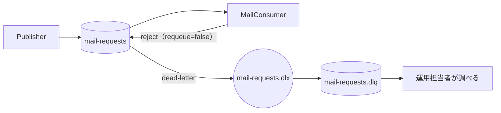

# 第13章: 処理できないメッセージとデッドレターキュー

## この章のゴール

何度処理しても失敗する「毒メッセージ」が、後続のメッセージをせき止める問題を体験します。処理できないメッセージを **デッドレターキュー（DLQ）** へ逃がす基本を学びます。

## Why: なぜこれを学ぶのか

第11章で、処理に失敗したメッセージは `basicNack(requeue=true)` でキューに戻せると紹介しました。しかし、宛先のメールアドレスが壊れているメッセージは、やり直しても失敗します。戻した同じメッセージが、失敗し続けます。

この「処理できないメッセージをどうするか」は、どのメッセージング製品を使っても、必ず設計が必要になる論点です。多くの製品が、DLQ という同じ考え方の仕組みを持っています。

## 前提

第12章で、重複が届いても安全な冪等なワーカーを作りました。

## ステップ1: 毒メッセージとは

メッセージの処理の失敗は、大きく2種類に分けられます。

| 種類 | 例 | リトライすると |
| :--- | :--- | :--- |
| 一時的エラー | メールサーバーのタイムアウト、DB の接続断、外部 API の混雑 | しばらく待てば成功することがある |
| 恒久的エラー | 宛先の形式が不正、本文の JSON が壊れている、存在しない顧客ID | 何度やっても失敗する |

恒久的エラーを起こすメッセージを **毒メッセージ（poison message）** と呼びます。

## ステップ2: 失敗したら戻す、を体験する

メール送信の依頼を扱います。まず、本キューと DLQ を宣言する部品を書きます。`src/main/java/com/example/async/dlq/MailQueues.java` を新規作成します。

<!-- code: answers/src/main/java/com/example/async/dlq/MailQueues.java -->
```java
package com.example.async.dlq;

import java.io.IOException;
import java.util.Map;

import com.rabbitmq.client.BuiltinExchangeType;
import com.rabbitmq.client.Channel;

/**
 * メール送信キューと、そのデッドレターキュー（DLQ）を宣言する部品。
 * 送信側・受信側・運用ツールのどれから呼んでも同じ設定になるよう、1か所にまとめている。
 */
public final class MailQueues {
    /** メール送信依頼のキュー */
    public static final String QUEUE = "mail-requests";
    /** 処理できなかったメッセージの送り先エクスチェンジ（Dead Letter Exchange） */
    public static final String DLX = "mail-requests.dlx";
    /** 処理できなかったメッセージがたまるキュー（Dead Letter Queue） */
    public static final String DLQ = "mail-requests.dlq";

    private MailQueues() {
    }

    /**
     * DLX・DLQ・本キューを宣言する。
     *
     * @param channel 使うチャネル
     * @throws IOException 宣言に失敗した場合（既存キューと設定が違うと 406 PRECONDITION_FAILED）
     */
    public static void declare(Channel channel) throws IOException {
        // 行き場をなくしたメッセージを受け取るエクスチェンジと、それをためるキュー
        channel.exchangeDeclare(DLX, BuiltinExchangeType.FANOUT, true);
        channel.queueDeclare(DLQ, true, false, false, null);
        channel.queueBind(DLQ, DLX, "");
        // 本キュー。x-dead-letter-exchange を指定すると、reject（requeue=false）されたメッセージが DLX へ送られる
        Map<String, Object> arguments = Map.of("x-dead-letter-exchange", DLX);
        channel.queueDeclare(QUEUE, true, false, false, arguments);
    }
}
```

**Why**: `queueDeclare` の最後の引数に `x-dead-letter-exchange` を渡します。すると、そのキューで **拒否された** メッセージ（`requeue=false` の `basicReject` や `basicNack`）が、指定したエクスチェンジ（DLX）へ転送されます。DLX に Binding した `mail-requests.dlq` が、処理できなかったメッセージのたまり場（DLQ）です。



次に、メール送信依頼を3件送るパブリッシャーを書きます。うち1件は宛先が不正です。`src/main/java/com/example/async/dlq/MailRequestPublisher.java` を新規作成します。

<!-- code: answers/src/main/java/com/example/async/dlq/MailRequestPublisher.java -->
```java
package com.example.async.dlq;

import java.nio.charset.StandardCharsets;

import com.example.async.common.Console;
import com.example.async.common.RabbitConnection;
import com.rabbitmq.client.Channel;
import com.rabbitmq.client.Connection;
import com.rabbitmq.client.MessageProperties;

/**
 * メール送信依頼を3件送る。うち1件は宛先が不正で、何度やっても失敗する（毒メッセージ）。
 */
public class MailRequestPublisher {

    /**
     * 3件のメール送信依頼を送る。
     *
     * @param args 使わない
     * @throws Exception 接続や送信に失敗した場合
     */
    public static void main(String[] args) throws Exception {
        String[] addresses = {"user1@example.com", "invalid-address", "user2@example.com"};
        try (Connection connection = RabbitConnection.open("mail-request-publisher");
                Channel channel = connection.createChannel()) {
            MailQueues.declare(channel);
            for (String address : addresses) {
                channel.basicPublish("", MailQueues.QUEUE, MessageProperties.PERSISTENT_TEXT_PLAIN,
                        address.getBytes(StandardCharsets.UTF_8));
                Console.log("送信依頼: " + address);
            }
        }
    }
}
```

失敗の扱いを切り替えられるコンシューマーを書きます。`src/main/java/com/example/async/dlq/MailConsumer.java` を新規作成します。

<!-- code: answers/src/main/java/com/example/async/dlq/MailConsumer.java -->
```java
package com.example.async.dlq;

import java.io.IOException;
import java.nio.charset.StandardCharsets;

import com.example.async.common.Console;
import com.example.async.common.RabbitConnection;
import com.rabbitmq.client.AMQP;
import com.rabbitmq.client.Channel;
import com.rabbitmq.client.Connection;
import com.rabbitmq.client.DefaultConsumer;
import com.rabbitmq.client.Envelope;

/**
 * メール送信依頼を処理するコンシューマー。
 * naive モードは失敗したらキューへ戻し、dlq モードは失敗したメッセージを DLQ へ逃がす。
 */
public class MailConsumer extends DefaultConsumer {
    // 失敗したメッセージを DLQ へ逃がすかどうか
    private final boolean useDlq;

    /**
     * @param channel 使うチャネル
     * @param useDlq  true なら失敗したメッセージを DLQ へ送る
     */
    public MailConsumer(Channel channel, boolean useDlq) {
        super(channel);
        this.useDlq = useDlq;
    }

    /**
     * メールを送り、成功なら ack、失敗なら戻すか DLQ へ送る。
     */
    @Override
    public void handleDelivery(String consumerTag, Envelope envelope,
            AMQP.BasicProperties properties, byte[] body) throws IOException {
        String address = new String(body, StandardCharsets.UTF_8);
        try {
            sendMail(address);
            Console.log("送信成功: " + address);
            getChannel().basicAck(envelope.getDeliveryTag(), false);
        } catch (IllegalArgumentException e) {
            Console.log("送信失敗: " + address + " / " + e.getMessage());
            if (useDlq) {
                // requeue=false で拒否すると、キューに戻らず DLX（そして DLQ）へ送られる
                getChannel().basicReject(envelope.getDeliveryTag(), false);
            } else {
                // 少し待ってから、requeue=true でキューへ戻す。すぐまた自分に届く
                Console.sleep(500);
                getChannel().basicNack(envelope.getDeliveryTag(), false, true);
            }
        }
    }

    // メール送信の代わり。宛先に @ がなければ、何度やっても失敗する
    private void sendMail(String address) {
        Console.sleep(200);
        if (!address.contains("@")) {
            throw new IllegalArgumentException("宛先の形式が不正です");
        }
    }

    /**
     * 指定したモードで購読を始める。
     *
     * @param args [0] naive / dlq（省略時は naive）
     * @throws Exception 接続に失敗した場合
     */
    public static void main(String[] args) throws Exception {
        boolean useDlq = args.length > 0 && args[0].equals("dlq");
        Connection connection = RabbitConnection.open("mail-consumer");
        Channel channel = connection.createChannel();
        MailQueues.declare(channel);
        channel.basicQos(1);
        channel.basicConsume(MailQueues.QUEUE, false, new MailConsumer(channel, useDlq));
        Console.log((useDlq ? "dlq" : "naive") + " モードで購読中です。Ctrl+C で終了します");
    }
}
```

3件を送り、`naive`（失敗したらキューへ戻す）で起動します。

```bash
./run.sh dlq.MailRequestPublisher
./run.sh dlq.MailConsumer naive
```

```text
[09:24:39.404][pool-1-thread-4] 送信成功: user1@example.com
[09:24:39.613][pool-1-thread-5] 送信失敗: invalid-address / 宛先の形式が不正です
[09:24:40.317][pool-1-thread-6] 送信失敗: invalid-address / 宛先の形式が不正です
[09:24:41.026][pool-1-thread-7] 送信失敗: invalid-address / 宛先の形式が不正です
...
```

`invalid-address` の失敗が延々と続き、3件目の `user2@example.com` はいつまでも処理されません。確認できたら Ctrl+C で止め、キューを空にしておきます。

```bash
./run.sh durability.QueueDrainer mail-requests
```

**Why**: `requeue=true` で戻されたメッセージは、キューの先頭に戻ります。prefetch が 1 なので、受け手は戻された `invalid-address` をすぐにまた受け取ります。後ろに並んでいるメッセージには、順番が回ってきません。これを **ヘッドオブラインブロッキング**（先頭の詰まり）と呼びます。たった1件の毒メッセージが、キュー全体を止めてしまいました。

**⚠️ よくある失敗・誤解**: このコードには、失敗のたびに500ミリ秒待つ `Console.sleep(500)` を入れています。待たずに本番で同じことをすると、CPU を使い切る速さで失敗と再配達を繰り返し、ログが一気に増えます。「障害の後でディスクを見たら、いっぱいになっていた」という二次被害の典型です。

## ステップ3: DLQ へ逃がす

3件送り直し、`dlq` モードで起動します。

```bash
./run.sh dlq.MailRequestPublisher
./run.sh dlq.MailConsumer dlq
```

```text
[09:24:02.244][pool-1-thread-4] 送信成功: user1@example.com
[09:24:02.447][pool-1-thread-5] 送信失敗: invalid-address / 宛先の形式が不正です
[09:24:02.854][pool-1-thread-6] 送信成功: user2@example.com
```

`invalid-address` は戻されずに DLQ へ移り、後ろの `user2@example.com` が処理されました。管理画面の `mail-requests.dlq` を見ると、`Ready` が 1 になっています。

## ステップ4: DLQ の中身を調べる

DLQ にたまったメッセージを、消さずにのぞき見る運用ツールを書きます。`src/main/java/com/example/async/dlq/DlqInspector.java` を新規作成します。

<!-- code: answers/src/main/java/com/example/async/dlq/DlqInspector.java -->
```java
package com.example.async.dlq;

import java.nio.charset.StandardCharsets;

import com.example.async.common.Console;
import com.example.async.common.RabbitConnection;
import com.rabbitmq.client.Channel;
import com.rabbitmq.client.Connection;
import com.rabbitmq.client.GetResponse;

/**
 * DLQ にたまったメッセージを「消さずに」のぞき見る運用ツール。
 */
public class DlqInspector {

    /**
     * DLQ のメッセージを本文とヘッダーつきで表示する。
     *
     * @param args 使わない
     * @throws Exception 接続に失敗した場合
     */
    public static void main(String[] args) throws Exception {
        try (Connection connection = RabbitConnection.open("dlq-inspector");
                Channel channel = connection.createChannel()) {
            MailQueues.declare(channel);
            int count = 0;
            while (true) {
                // autoAck=false で取り出す。ack しないまま接続を閉じれば DLQ に戻る
                GetResponse response = channel.basicGet(MailQueues.DLQ, false);
                if (response == null) {
                    break;
                }
                count++;
                Console.log("DLQ: " + new String(response.getBody(), StandardCharsets.UTF_8));
                // x-death ヘッダーには「いつ・どのキューで・なぜ」デッドレターになったかが記録されている
                Console.log("  headers=" + response.getProps().getHeaders());
            }
            Console.log("DLQ には " + count + " 件あります（ack していないので、閉じると元に戻ります）");
        }
    }
}
```

```bash
./run.sh dlq.DlqInspector
```

```text
[09:24:14.130][main] DLQ: invalid-address
[09:24:14.220][main]   headers={x-first-death-exchange=, x-death=[{reason=rejected, count=1, exchange=, time=Tue Nov 03 09:24:02 UTC 2026, routing-keys=[mail-requests], queue=mail-requests}], x-first-death-reason=rejected, x-first-death-queue=mail-requests}
[09:24:14.242][main] DLQ には 1 件あります（ack していないので、閉じると元に戻ります）
```

**Why**: デッドレターになったメッセージには、ブローカーが `x-death` ヘッダーを付けます。どのキューで（`queue`）、なぜ（`reason=rejected`）、いつ（`time`）デッドレターになったかがわかり、原因を調べる重要な手がかりです。RabbitMQ のバージョンによっては、`x-last-death-reason` など、ほかのヘッダーも付きます。

## ステップ5: 気をつけること

**DLQ は「ごみ箱」ではありません。** DLQ にメッセージが入ったということは、お客さまに届くべきメールが届いていないということです。本番では、DLQ の件数を監視して、1件でも入ったら担当者に通知するのが基本です。

**一時的エラーはすぐに諦めない**: メールサーバーの一時的な不調まで、すぐ DLQ に送ると、運用担当者の手間が増えます。一時的エラーは、リトライ回数に上限を設けて再試行します。回数は、メッセージのヘッダー（たとえば `x-retry-count`）に入れて、再投入のたびに1ずつ増やすのが一般的です。

```java
// リトライ回数を1増やしたコピーを、キューの末尾へ入れ直す（骨格）
Map<String, Object> headers = new HashMap<>(properties.getHeaders());
headers.put("x-retry-count", retryCount + 1);
channel.basicPublish("", "mail-requests", properties.builder().headers(headers).build(), body);
// 元のメッセージは ack して消す
channel.basicAck(envelope.getDeliveryTag(), false);
```

上限に達したら `basicReject(requeue=false)` で DLQ へ送ります。ただし「コピーを入れ直す」と「元を ack する」の間で落ちると、同じメッセージが2つ残ります。リトライも重複を生みうるので、受け手の冪等性（第12章）が前提です。

**待ってからリトライする**: 失敗の直後にすぐ再試行すると、不調の最中に何度も叩くことになります。1秒、2秒、4秒と間隔を広げる **指数バックオフ** が使われます。

**DLQ から本キューへ戻す**: 原因を直した後で、DLQ のメッセージを本キューへ戻して処理し直します。戻した後の本キューへの書き込みを確認してから、DLQ 側を ack する順番にします。逆の順だと、落ちたときにメッセージがどこにもなくなります。

**キューの設定は後から変えられない**: 第6章で、`queueDeclare` は「同じ設定なら何もしない」と学びました。すでにあるキューを **違う引数** で宣言すると、`406 PRECONDITION_FAILED` でチャネルが閉じられます。運用中のキューに後から DLQ を付けたい場合は、別名で作り直すか、RabbitMQ のポリシー機能を使います。

**順序への影響**: 失敗したメッセージをキューの末尾に入れ直すと、処理される順番が変わります。順序が重要なメッセージでは、慎重に扱います（第20章）。

**製品ごとの対応**:

| 製品 | リトライ上限と DLQ | 待ってからのリトライ |
| :--- | :--- | :--- |
| RabbitMQ | クォーラムキューの配達回数上限（`x-delivery-limit`）と DLX | TTL 付きの待機用キューと DLX の組み合わせ |
| Amazon SQS | リドライブポリシー（`maxReceiveCount`）と DLQ | 可視性タイムアウトの延長 |
| Google Cloud Pub/Sub | デッドレタートピックと最大配信試行回数 | 再試行ポリシー（指数バックオフ） |
| Azure Service Bus | 最大配信回数と、組み込みのデッドレターキュー | メッセージのスケジュール配信 |
| Apache Kafka | 組み込みの DLQ はない。別のトピックへ送る作りを用意する | リトライ用のトピックを分ける |

## 動作確認

次の2点を確認できたら完了です。

1. `naive` で、`invalid-address` が延々と失敗し、後続の `user2@example.com` が処理されなかった
2. `dlq` で、`invalid-address` だけが DLQ に移り、`user2@example.com` が処理された

## もっと良くしてみよう

### 理解確認

1. 毒メッセージを `requeue=true` で戻し続けると、後続のメッセージが処理されないのはなぜでしょうか。
2. 恒久的エラーのとき、リトライせずにすぐ DLQ へ送るのはなぜでしょうか。
3. DLQ にメッセージが入ったとき、運用担当者は最初に何を確認すればよいでしょうか。

### 発展改善クイズ

1. `MailConsumer` は、宛先の形式が不正な例外だけを捕まえています。想定していない例外（たとえば `NullPointerException`）が発生したら、`handleDelivery` はどうなるでしょうか。どう扱うのが安全か考えてみましょう。
2. 失敗したメッセージを末尾に入れ直す方式で、注文の「支払済」と「発送済」のように順番に意味があるメッセージを扱うと、何が起きるでしょうか。

---

| [← 第12章: 重複メッセージと冪等なコンシューマー](./12-idempotency.md) | [全章目次](./README.md) | [第14章: 定期バッチ　時刻がジョブを積む →](./14-batch.md) |
| - | :-: | --: |
