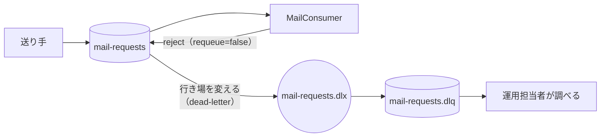

# 第13章: 処理できないメッセージとデッドレターキュー

## この章のゴール

何度処理しても失敗する「毒メッセージ」が、後続のメッセージをせき止める問題を体験します。処理できないメッセージを **デッドレターキュー（DLQ）**（処理できなかったメッセージを別に取っておく専用のキュー）へ逃がす基本を学びます。

## Why: なぜこれを学ぶのか

第11章で、処理に失敗したメッセージは `basicNack(requeue=true)` でキューに戻せると紹介しました。しかし、宛先のメールアドレスが壊れているメッセージは、やり直しても失敗します。戻した同じメッセージが、失敗し続けます。

この「処理できないメッセージをどうするか」は、どのメッセージング製品を使っても、必ず設計が必要になる論点です。多くの製品が、DLQ という同じ考え方の仕組みを持っています。

## 前提

第12章で、同じメッセージが2回届いても結果が変わらない（冪等な）ワーカーを作りました。

## ステップ1: 毒メッセージとは

メッセージの処理の失敗は、大きく2種類に分けられます。

| 種類 | 例 | やり直すと |
| :--- | :--- | :--- |
| 一時的エラー | メールサーバーの応答待ち切れ、DB の接続断、外部サービスの混雑 | しばらく待てば成功することがある |
| 恒久的エラー | 宛先の形式が不正、本文の JSON が壊れている、存在しない顧客ID | 何度やっても失敗する |

恒久的エラーを起こすメッセージを **毒メッセージ（poison message）** と呼びます。

## ステップ2: 失敗したら戻す、を体験する

メール送信の依頼を扱います。まず、本キューと DLQ を宣言する部品です。[MailQueues.java](../src/main/java/com/example/async/dlq/MailQueues.java) を開きます。中心となる部分を抜粋します。

<!-- code: src/main/java/com/example/async/dlq/MailQueues.java#declare -->
```java
/**
 * DLX・DLQ・本キューを宣言する。
 *
 * @param channel 使うチャネル
 * @throws IOException 宣言に失敗した場合（既存キューと設定が違うと 406 PRECONDITION_FAILED）
 */
public static void declare(Channel channel) throws IOException {
    // 行き場をなくしたメッセージを受け取るエクスチェンジと、それをためるキュー
    channel.exchangeDeclare(DLX, BuiltinExchangeType.FANOUT, true);
    channel.queueDeclare(DLQ, true, false, false, null);
    channel.queueBind(DLQ, DLX, "");
    // 本キュー。x-dead-letter-exchange を指定すると、reject（requeue=false）されたメッセージが DLX へ送られる
    Map<String, Object> arguments = Map.of("x-dead-letter-exchange", DLX);
    channel.queueDeclare(QUEUE, true, false, false, arguments);
}
```

**Why**: `queueDeclare` の最後の引数に `x-dead-letter-exchange` を渡します。すると、そのキューで **拒否された** メッセージ（`requeue=false` の `basicReject` や `basicNack`）が、指定したエクスチェンジ（DLX）へ転送されます。DLX に Binding した `mail-requests.dlq` が、処理できなかったメッセージのたまり場（DLQ）です。



次は、メール送信依頼を3件送る送り手（パブリッシャー）です。うち1件は宛先が不正です。[MailRequestPublisher.java](../src/main/java/com/example/async/dlq/MailRequestPublisher.java) を開いて、コードを読んでみましょう。

失敗の扱いを切り替えられる受け手（コンシューマー）です。[MailConsumer.java](../src/main/java/com/example/async/dlq/MailConsumer.java) を開きます。中心となる部分を抜粋します。

<!-- code: src/main/java/com/example/async/dlq/MailConsumer.java#handleDelivery -->
```java
/**
 * メールを送り、成功なら ack、失敗なら戻すか DLQ へ送る。
 */
@Override
public void handleDelivery(String consumerTag, Envelope envelope,
        AMQP.BasicProperties properties, byte[] body) throws IOException {
    String address = new String(body, StandardCharsets.UTF_8);
    try {
        sendMail(address);
        Console.log("送信成功: " + address);
        getChannel().basicAck(envelope.getDeliveryTag(), false);
    } catch (IllegalArgumentException e) {
        Console.log("送信失敗: " + address + " / " + e.getMessage());
        if (useDlq) {
            // requeue=false で拒否すると、キューに戻らず DLX（そして DLQ）へ送られる
            getChannel().basicReject(envelope.getDeliveryTag(), false);
        } else {
            // 少し待ってから、requeue=true でキューへ戻す。すぐまた自分に届く
            Console.sleep(500);
            getChannel().basicNack(envelope.getDeliveryTag(), false, true);
        }
    }
}
```

3件を送り、`naive`（失敗したらキューへ戻す）で起動します。

```bash
./run.sh dlq.MailRequestPublisher
./run.sh dlq.MailConsumer naive
```

```text
[09:24:39.404][pool-1-thread-4] 送信成功: user1@example.com
[09:24:39.613][pool-1-thread-5] 送信失敗: invalid-address / 宛先の形式が不正です
[09:24:40.317][pool-1-thread-6] 送信失敗: invalid-address / 宛先の形式が不正です
[09:24:41.026][pool-1-thread-7] 送信失敗: invalid-address / 宛先の形式が不正です
...
```

`invalid-address` の失敗が延々と続き、3件目の `user2@example.com` はいつまでも処理されません。確認できたら Ctrl+C で止め、キューを空にしておきます。

```bash
./run.sh durability.QueueDrainer mail-requests
```

**Why**: `requeue=true` で戻されたメッセージは、キューの先頭に戻ります。prefetch が 1 なので、受け手（コンシューマー）は戻された `invalid-address` をすぐにまた受け取ります。後ろに並んでいるメッセージには、順番が回ってきません。これを **ヘッドオブラインブロッキング**（先頭の詰まり）と呼びます。たった1件の毒メッセージが、キュー全体を止めてしまいました。

**⚠️ よくある失敗・誤解**: このコードには、失敗のたびに500ミリ秒待つ `Console.sleep(500)` を入れています。待たずに本番で同じことをすると、CPU を使い切る速さで失敗と再配達を繰り返し、ログが一気に増えます。「障害の後でディスクを見たら、いっぱいになっていた」という二次被害の典型です。

## ステップ3: DLQ へ逃がす

3件送り直し、`dlq` モードで起動します。

```bash
./run.sh dlq.MailRequestPublisher
./run.sh dlq.MailConsumer dlq
```

```text
[09:24:02.244][pool-1-thread-4] 送信成功: user1@example.com
[09:24:02.447][pool-1-thread-5] 送信失敗: invalid-address / 宛先の形式が不正です
[09:24:02.854][pool-1-thread-6] 送信成功: user2@example.com
```

`invalid-address` は戻されずに DLQ へ移り、後ろの `user2@example.com` が処理されました。管理画面の `mail-requests.dlq` を見ると、`Ready` が 1 になっています。

## ステップ4: DLQ の中身を調べる

DLQ にたまったメッセージを、消さずにのぞき見る運用ツールです。[DlqInspector.java](../src/main/java/com/example/async/dlq/DlqInspector.java) を開いて、コードを読んでみましょう。

```bash
./run.sh dlq.DlqInspector
```

```text
[09:24:14.130][main] DLQ: invalid-address
[09:24:14.220][main]   headers={x-first-death-exchange=, x-death=[{reason=rejected, count=1, exchange=, time=Tue Nov 03 09:24:02 UTC 2026, routing-keys=[mail-requests], queue=mail-requests}], x-first-death-reason=rejected, x-first-death-queue=mail-requests}
[09:24:14.242][main] DLQ には 1 件あります（ack していないので、閉じると元に戻ります）
```

**Why**: デッドレターになったメッセージには、ブローカーが `x-death` ヘッダーを付けます。どのキューで（`queue`）、なぜ（`reason=rejected`）、いつ（`time`）デッドレターになったかがわかり、原因を調べる重要な手がかりです。RabbitMQ のバージョンによっては、`x-last-death-reason` など、ほかのヘッダーも付きます。

## ステップ5: 気をつけること

**DLQ は「ごみ箱」ではありません。** DLQ にメッセージが入ったということは、お客さまに届くべきメールが届いていないということです。本番では、DLQ の件数を監視して、1件でも入ったら担当者に通知するのが基本です。

ほかにも、次の点に気をつけます。

| 気をつけること | 内容 |
| :--- | :--- |
| 一時的エラーはすぐに諦めない | メールサーバーの一時的な不調まで、すぐ DLQ に送ると、運用担当者の手間が増える。やり直しの回数に上限を決めて再試行し、上限に達したら DLQ へ送る |
| やり直しも重複を生む | やり直しの途中で落ちると、同じメッセージが2つ残ることがある。受け手（コンシューマー）が冪等であること（第12章）が前提 |
| 待ってからやり直す | 失敗の直後にすぐ再試行すると、不調の最中に何度も呼び出してしまう。1秒、2秒、4秒と間隔を倍々に広げる **指数バックオフ** がよく使われる |
| DLQ から本キューへ戻す順番 | 原因を直したら、DLQ のメッセージを本キューへ戻す。本キューに入ったのを確かめてから DLQ 側を消す。逆の順だと、途中で落ちたときにメッセージが消える |
| キューの設定は後から変えられない | すでにあるキューを違う引数で宣言すると、エラー（`406 PRECONDITION_FAILED`）でチャネルが閉じられる。運用中のキューに後から DLQ を付けるときは、作り直すか、RabbitMQ のポリシー機能を使う |
| 順序への影響 | 失敗したメッセージを入れ直すと、処理される順番が変わる（第19章） |

DLQ は、ほとんどの製品が持つ考え方です。製品ごとの呼び名は、第21章の対応表にまとめてあります。

## 動作確認

次の2点を確認できたら完了です。

1. `naive` で、`invalid-address` が延々と失敗し、後続の `user2@example.com` が処理されなかった
2. `dlq` で、`invalid-address` だけが DLQ に移り、`user2@example.com` が処理された

## もっと良くしてみよう

### 理解確認

1. 毒メッセージを `requeue=true` で戻し続けると、後続のメッセージが処理されないのはなぜでしょうか。
2. 恒久的エラーのとき、リトライせずにすぐ DLQ へ送るのはなぜでしょうか。
3. DLQ にメッセージが入ったとき、運用担当者は最初に何を確認すればよいでしょうか。

### 発展改善クイズ

1. `MailConsumer` は、宛先の形式が不正な例外だけを捕まえています。想定していない例外（たとえば `NullPointerException`）が発生したら、`handleDelivery` はどうなるでしょうか。どう扱うのが安全か考えてみましょう。
2. 失敗したメッセージを末尾に入れ直す方式で、注文の「支払済」と「発送済」のように順番に意味があるメッセージを扱うと、何が起きるでしょうか。

---

| [← 第12章: 重複メッセージと冪等なコンシューマー](./12-idempotency.md) | [全章目次](./README.md) | [第14章: 定期バッチ　時刻がジョブを積む →](./14-batch.md) |
| - | :-: | --: |
