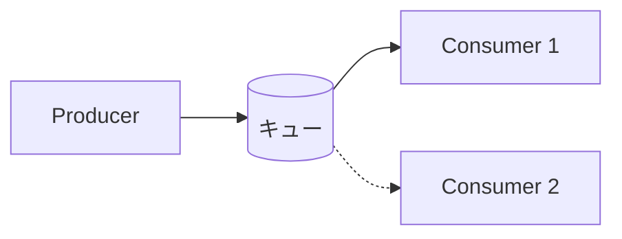
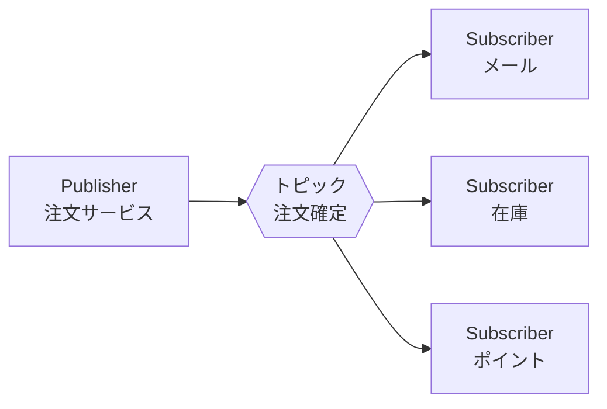
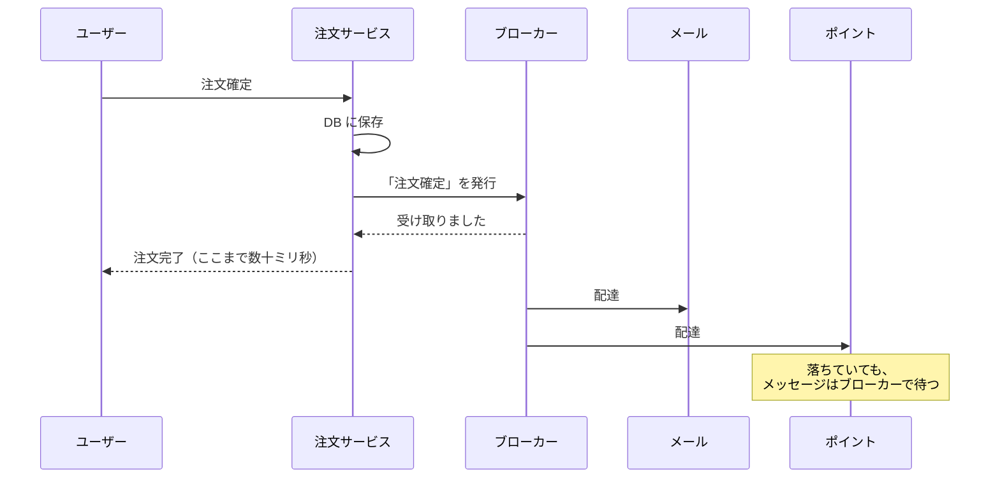
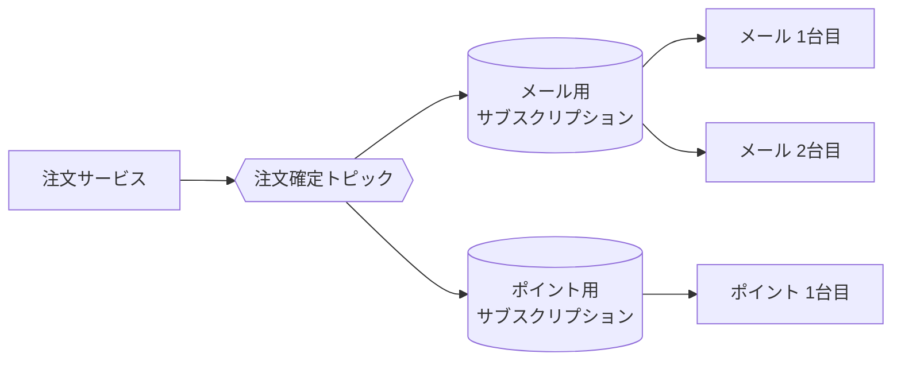

# 第15章: Pub/Subパターンとは

## この章のゴール

Publisher・Subscriber・Broker の役割と、Point-to-Point（キュー）モデルとの違いを説明できるようになります。第1章の3つの問題を、Pub/Sub がどう解くのかを図で理解します。

## Why: なぜこれを学ぶのか

メッセージングの製品はたくさんあり、用語も製品ごとに少しずつ違います。RabbitMQ では「エクスチェンジとキュー」、Kafka では「トピックとコンシューマーグループ」、Google Cloud Pub/Sub では「トピックとサブスクリプション」と呼びます。しかし土台にある考え方は共通です。土台を先に押さえておくと、どの製品を使うことになっても「この製品ではあの概念を何と呼ぶのか」と読み替えられます。

この章はコードを書きません。第10〜14章で作ったジョブキューと定期バッチは、ジョブを **ちょうど1つのワーカー** に渡す形でした。この章からは、1つの出来事を **複数の相手に知らせる** 形（第3章の地図の③）に進みます。図を見ながら、第1章のプログラムを頭の中で作り直します。

## 前提

第1章で同期呼び出しの問題を体験し、第10章でジョブキュー、第14章で定期バッチを作りました。第3章の地図の土台（キューとワーカー）が前提です。

## ステップ1: メッセージングの登場人物を知る

メッセージングでは、プログラム同士が直接呼び合う代わりに、**メッセージ** を間に置いてやり取りします。

| 用語 | 意味 | 第1章で言うと |
| :--- | :--- | :--- |
| メッセージ | やり取りするデータの1件分。本文（ペイロード）と、メタデータ（ヘッダー）から成る | 「注文 A-1 が確定した」という知らせ |
| Producer / Publisher | メッセージを送る側 | 注文サービス |
| Consumer / Subscriber | メッセージを受け取って処理する側 | メール・在庫・ポイントの各サービス |
| Broker | 送る側と受け取る側の間に立ち、メッセージを預かって届ける仲介役のサーバー | （第1章にはない。RabbitMQ がこれにあたる） |

**Why**: ブローカーは、郵便局にたとえるとわかりやすくなります。送る人は相手の家まで行かず、郵便局に預けた時点で自分の仕事を終えられます。受け取る人は、郵便受けに届いた手紙を都合のよいときに読みます。

## ステップ2: Point-to-Point モデルを知る

メッセージングには大きく2つのモデルがあります。1つめは **Point-to-Point（P2P）** です。

- 送り手はメッセージを **キュー** に入れる
- 1件のメッセージは、**どれか1つの** コンシューマーだけが受け取る
- コンシューマーを増やすと、キューのメッセージを分担して処理する（**競合コンシューマー**、Competing Consumers）

P2P は「この仕事を誰か1人にやってほしい」ときに使います。たとえば、領収書 PDF の作成依頼を複数のワーカーで分担する、といった使い方です。第7〜8章で作ります。

## ステップ3: Publish/Subscribe モデルを知る

2つめが **Publish/Subscribe（Pub/Sub）** です。

- 送り手はメッセージを **トピック**（話題）に向けて **発行（publish）** する
- トピックを **購読（subscribe）** しているすべての受け手に、**同じメッセージのコピー** が届く
- 送り手は、誰が購読しているかを知らない

Pub/Sub は「こういう出来事が起きた。関係する人は各自で対応してほしい」というときに使います。第9〜10章で作ります。

**⚠️ よくある失敗・誤解**: 「Pub/Sub ならキューは要らない」と思われがちですが、実際の製品ではほとんどの場合、購読者ごとにキュー（またはそれに相当するもの）を持ちます。購読者が一時的に止まっていても、その間のメッセージはキューにたまります。復帰後に処理できるのはこのためです。ステップ5で詳しく見ます。

## ステップ4: 第1章の問題がどう解けるかを確かめる

第1章の構成を Pub/Sub で描き直すと、次のようになります。

第1章の3つの問題は、次のように解けます。

| 第1章の問題 | Pub/Sub での解決 |
| :--- | :--- |
| 遅さ：応答時間が呼び出し先の合計になる | 注文サービスはブローカーに預けた時点で応答を返せる |
| 障害の波及：ポイントが落ちると注文も失敗する | ポイントサービスが落ちていても、メッセージはブローカーで待つ。復帰後に処理すればよい |
| 変更のしにくさ：連携先が増えるたびに改修が必要 | 分析基盤は自分でトピックを購読するだけ。注文サービスは変更不要 |

**Why**: Pub/Sub は、送り手と受け手を次の3つの意味で切り離します（疎結合にします）。

1. **空間の切り離し**: 送り手は受け手の場所や数を知らない
2. **時間の切り離し**: 送り手と受け手が同時に動いている必要がない
3. **同期の切り離し**: 送り手は受け手の処理が終わるのを待たない

**🔍 確認・実験してみよう**: 第1章のプログラムで、ポイントサービスが1時間止まったとします。同期呼び出しの場合と Pub/Sub の場合で、その1時間に入った注文はそれぞれどうなるでしょうか。図を見ながら考えてみましょう。

## ステップ5: サブスクリプションという考え方を知る

実際のサービスでは、メールサービスも負荷に応じて3台、5台と台数を増やします。このとき、同じ注文確定メッセージを3台すべてが処理すると、メールが3通届いてしまいます。

そこで多くの製品は、Pub/Sub と P2P を次のように組み合わせます。

- **サービスの間** は Pub/Sub：メールとポイントの両方に、同じメッセージのコピーが届く
- **同じサービスの中** は P2P：メールの1台目と2台目は、メッセージを分担して処理する

この「購読者ごとの受け口」を、製品ごとに次のように呼びます。

| 製品 | 購読者ごとの受け口 |
| :--- | :--- |
| RabbitMQ | エクスチェンジにバインドしたキュー |
| Apache Kafka | コンシューマーグループ |
| Google Cloud Pub/Sub | サブスクリプション |
| Amazon SNS + SQS | SNS トピックを購読する SQS キュー |

**💼 現場Tip**: 設計レビューでは「このサブスクリプション（キュー）は誰のものか」をはっきりさせることが重要です。1つのキューを複数のサービスで共有すると、P2P として分担されてしまい、それぞれのサービスには一部のメッセージしか届きません。原則として **1サービスにつき1つ** の受け口を作ります。

## ステップ6: イベントとコマンドを区別する

メッセージには、性質の違う2種類があります。

| 種類 | 意味 | 名前の付け方 | 例 | 受け手の数 |
| :--- | :--- | :--- | :--- | :--- |
| イベント | 起きた **事実** の通知 | 過去形 | 注文が確定した（OrderPlaced） | 0人以上、何人でもよい |
| コマンド | 誰かへの **依頼** | 命令形 | メールを送れ（SendMail） | ちょうど1人 |

Pub/Sub で流すのは、主にイベントです。注文サービスは「メールを送れ」と命令するのではなく、「注文が確定した」という事実を発表するだけです。それを聞いてメールを送るかどうかは、メールサービスが自分で決めます。

**Why**: イベントにしておくと、送り手は受け手の仕事内容を知らずに済みます。コマンドにしてしまうと、送り手が「誰に何をさせるか」を知っていることになり、第1章の密結合に逆戻りします。

## ステップ7: Pub/Sub の代償を知る

Pub/Sub は万能ではありません。導入すると、次のような新しい問題を引き受けることになります。

| 代償 | 内容 | 扱う章 |
| :--- | :--- | :--- |
| 結果整合性 | 注文完了の直後は、まだポイントが付与されていない瞬間がある | 本章 |
| メッセージの消失 | ブローカーやコンシューマーが落ちたとき、メッセージが消えることがある | 第11章 |
| メッセージの重複 | 同じメッセージが2回届くことがある | 第12章 |
| 処理できないメッセージ | 何度やっても失敗するメッセージが、後続をせき止める | 第13章 |
| 順序の乱れ | 送った順番と処理される順番が変わることがある | 第20章 |
| DB との不整合 | DB 更新は成功したのに、メッセージ送信だけ失敗することがある | 第23章 |
| 運用と調査の難しさ | 処理が複数のサービスにまたがり、どこで止まったか追いにくい | 第19章、第24章 |

**Why**: 「一瞬でもポイントが付いていない状態は許されない」という要件なら、同期呼び出しのほうが適切です。Pub/Sub は「少し遅れてもよいので、確実に、疎結合に」処理したい場面で力を発揮します。

**💼 現場Tip**: Webサービスでよく Pub/Sub を使う場面には次のようなものがあります。

- 通知：注文確定メール、プッシュ通知、Slack 連携
- 重い処理の後回し：画像のサムネイル作成、PDF 作成、CSV の取り込み
- データ連携：分析基盤、検索インデックス、基幹システムへの反映
- キャッシュの無効化：商品情報が更新されたら、各サーバーのキャッシュを捨てる
- 監査ログ：誰が何をしたかの記録を、業務処理とは別に蓄える

## 動作確認

この章ではプログラムを実行しません。次の3つを、何も見ずに説明できるか確認してください。

1. P2P と Pub/Sub で、1件のメッセージを受け取るコンシューマーの数はそれぞれいくつか
2. Pub/Sub で送り手と受け手を切り離す「3つの意味」
3. メールサービスを3台に増やしても、メールが3通届かないのはなぜか

## もっと良くしてみよう

### 理解確認

1. 「SendMail」と「OrderPlaced」は、どちらがイベントでどちらがコマンドでしょうか。
2. 購読者が一時的に止まっていても、メッセージが失われないのはなぜでしょうか。
3. メールサービスとポイントサービスが1つのキューを共有すると、何が起きるでしょうか。

### 発展改善クイズ

1. 注文完了画面に「付与予定ポイント 100pt」と表示したい場合、ポイントサービスがまだ処理を終えていないことをどう扱えばよいでしょうか。
2. ブローカー自体が止まると、Pub/Sub を使ったシステムはどうなるでしょうか。ブローカーが新たな「一番弱いところ」にならないためには、何が必要か考えてみましょう。

---

| [← 第14章: 定期バッチ　時刻がジョブを積む](./14-batch.md) | [全章目次](./README.md) | [第16章: Pub/Sub・キュー・イベントバスの違い →](./16-terms-event-bus.md) |
| - | :-: | --: |
