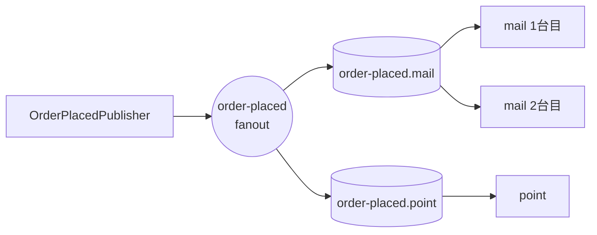

# 第16章: fanoutでPub/Subを実現する

## この章のゴール

fanout エクスチェンジを使い、「注文確定」イベントをメール・在庫・ポイントの各サービスへ同時に配る Pub/Sub を作ります。サービスごとの永続的な購読（キュー）と、起動中だけの一時的な購読の違いを体験します。

## Why: なぜこれを学ぶのか

第9〜10章の P2P では、1件のメッセージは1つの受け手（コンシューマー）にしか届きませんでした。第1章の注文確定では、同じ「注文確定」をメール・在庫・ポイントの **全員** に知らせたいはずです。いよいよ、第15章で学んだ Pub/Sub を実装します。

## 前提

第10章で、手動 ack と prefetch の使い方を学びました。

## ステップ1: イベントを発行する送り手（パブリッシャー）を読む

[OrderPlacedPublisher.java](../src/main/java/com/example/async/fanout/OrderPlacedPublisher.java) を開いて、コードを読んでみましょう。

**Why**: これまでは既定エクスチェンジ `""` にキュー名を指定して送っていました。今回は `order-placed` という名前の **fanout エクスチェンジ** に送っています。送り手（パブリッシャー）のコードには、キュー名が1つも出てきません。送り手（パブリッシャー）が知っているのは「注文確定イベントは `order-placed` に投げる」ということだけです。

## ステップ2: 購読者がいない状態で発行する

受け手（サブスクライバー）を起動する前に、送り手（パブリッシャー）だけを実行します。

```bash
./run.sh fanout.OrderPlacedPublisher 1
```

```text
[09:17:29.795][main] 発行: {"orderId":"A-1","amount":1000}
```

送信は成功しました。しかし管理画面の Queues and Streams タブを見ても、このメッセージがたまっているキューはありません。

**Why**: エクスチェンジはメッセージを保存しません。Binding されたキューが1つもなければ、メッセージは行き場がなく、**黙って捨てられます**。第9章で、受け手（コンシューマー）のいない `hello` キューにメッセージがたまったのとは対照的です。あのときは、送る側が先に `queueDeclare` でキューを作っていました。

**⚠️ よくある失敗・誤解**: 「新しいサービスをデプロイしたのに、デプロイ前に発行されたイベントが届かない」という問い合わせはよくあります。キュー型のブローカーでは、購読（キューと Binding）が作られた **後に** 発行されたメッセージしか届きません。過去のイベントを後から読み直したい場合は、第5章のログ型の製品を検討します。

## ステップ3: サービスごとに購読する受け手（サブスクライバー）を読む

[OrderPlacedSubscriber.java](../src/main/java/com/example/async/fanout/OrderPlacedSubscriber.java) を開きます。中心となる部分を抜粋します。起動引数でサービス名を受け取り、サービスごとに専用のキューを作ります。

<!-- code: src/main/java/com/example/async/fanout/OrderPlacedSubscriber.java#main -->
```java
/**
 * 指定したサービス名で購読を始める。
 *
 * @param args [0] サービス名（mail / inventory / point など。省略時は mail）
 * @throws Exception 接続に失敗した場合
 */
public static void main(String[] args) throws Exception {
    String service = args.length > 0 ? args[0] : "mail";
    Connection connection = RabbitConnection.open("subscriber-" + service);
    Channel channel = connection.createChannel();
    // パブリッシャーと同じ設定でエクスチェンジを宣言する（どちらが先に起動してもよいように）
    channel.exchangeDeclare(OrderPlacedPublisher.EXCHANGE, BuiltinExchangeType.FANOUT, true);
    // サービスごとに専用のキューを作る（例: order-placed.mail）
    String queue = OrderPlacedPublisher.EXCHANGE + "." + service;
    channel.queueDeclare(queue, true, false, false, null);
    // キューをエクスチェンジにバインドする。これが「購読の登録」にあたる
    channel.queueBind(queue, OrderPlacedPublisher.EXCHANGE, "");
    channel.basicConsume(queue, false, new OrderPlacedSubscriber(channel, service));
    Console.log("[" + service + "] " + queue + " を購読中です。Ctrl+C で終了します");
}
```

**Why**: 受け手（サブスクライバー）の起動時には、次の3つを行っています。

1. `exchangeDeclare`: 送り手（パブリッシャー）と同じエクスチェンジを宣言する
2. `queueDeclare`: 自分のサービス専用のキュー（例：`order-placed.mail`）を作る
3. `queueBind`: そのキューをエクスチェンジに結び付ける

3つめの `queueBind` が「購読の登録」にあたります。第15章の「サブスクリプション」は、RabbitMQ では **エクスチェンジに Binding したキュー** として表現されます。

## ステップ4: 2つのサービスで購読する

2つのターミナルで、`mail` と `point` の受け手（サブスクライバー）を起動します。

```bash
# ターミナル1
./run.sh fanout.OrderPlacedSubscriber mail
```

```bash
# ターミナル2
./run.sh fanout.OrderPlacedSubscriber point
```

3つめのターミナルで、2件発行します。

```bash
./run.sh fanout.OrderPlacedPublisher 2
```

両方の受け手（サブスクライバー）に、同じ2件が届きます。

```text
[09:17:37.776][pool-1-thread-4] [mail] 受信: {"orderId":"A-1","amount":1000}
[09:17:37.786][pool-1-thread-5] [mail] 受信: {"orderId":"A-2","amount":2000}
```

```text
[09:17:37.776][pool-1-thread-4] [point] 受信: {"orderId":"A-1","amount":1000}
[09:17:37.786][pool-1-thread-5] [point] 受信: {"orderId":"A-2","amount":2000}
```

管理画面の Exchanges タブで `order-placed` を開くと、Bindings 欄に `order-placed.mail` と `order-placed.point` の2つが表示されています。

**Why**: fanout エクスチェンジは、Binding されている **すべてのキューにメッセージのコピーを入れます**。メールとポイントは、それぞれ自分のキューから自分のペースで読みます。

## ステップ5: 購読者が止まっている間のメッセージを確かめる

`point` の受け手（サブスクライバー）だけを Ctrl+C で止めます。その状態で2件発行します。

```bash
./run.sh fanout.OrderPlacedPublisher 2
```

`mail` には届きます。管理画面で `order-placed.point` キューを見ると、`Ready` が 2 になっています。`point` の受け手（サブスクライバー）を起動し直すと、たまっていた2件がすぐに届きます。

**Why**: ポイントサービスが止まっていても、`order-placed.point` キューと Binding は残っています。そのため、止まっている間のイベントもキューにたまり、復帰後に処理できます。第1章で「ポイントサービスが落ちると注文が失敗した」問題が、ここで解決しました。

**🔍 確認・実験してみよう**: `inventory` の受け手（サブスクライバー）を新しく起動してから、もう一度2件発行してみましょう。`inventory` には、起動前に発行された分は届くでしょうか。送り手（パブリッシャー）のコードを1行も変えずに、購読者を増やせたことも確認しましょう。

## ステップ6: 同じサービスを2台に増やす

`mail` の受け手（サブスクライバー）を、2つのターミナルで起動します。

```bash
# ターミナル1 と ターミナル2 の両方で
./run.sh fanout.OrderPlacedSubscriber mail
```

4件発行すると、`mail` の2台には2件ずつ分かれて届きます。`point` には4件すべてが届きます。

**Why**: 2台の `mail` は同じキュー `order-placed.mail` を購読しているので、第9章の P2P と同じように分担します。第15章の図のとおり、「サービスの間は Pub/Sub、同じサービスの中は P2P」という構成になっています。



## ステップ7: 起動中だけの一時的な購読を作る

管理者向けの「注文がリアルタイムに流れていく画面」のように、**見ている間だけ** イベントを受け取れればよい場合もあります。[LiveMonitor.java](../src/main/java/com/example/async/fanout/LiveMonitor.java) を開きます。中心となる部分を抜粋します。

<!-- code: src/main/java/com/example/async/fanout/LiveMonitor.java#main -->
```java
/**
 * 使い捨てキューを作って購読を始める。
 *
 * @param args 使わない
 * @throws Exception 接続に失敗した場合
 */
public static void main(String[] args) throws Exception {
    Connection connection = RabbitConnection.open("live-monitor");
    Channel channel = connection.createChannel();
    channel.exchangeDeclare(OrderPlacedPublisher.EXCHANGE, BuiltinExchangeType.FANOUT, true);
    // 引数なしの queueDeclare は「名前はブローカー任せ・この接続専用・接続が切れたら削除」のキューを作る
    String queue = channel.queueDeclare().getQueue();
    channel.queueBind(queue, OrderPlacedPublisher.EXCHANGE, "");
    // 見るだけなので autoAck=true でよい
    channel.basicConsume(queue, true, new LiveMonitor(channel));
    Console.log("[monitor] 一時キュー " + queue + " で購読中です。Ctrl+C で終了します");
}
```

起動して、イベントを発行します。

```bash
./run.sh fanout.LiveMonitor
```

```text
[09:17:35.073][main] [monitor] 一時キュー amq.gen-ju_VG2-yoh9k-L3plPFGqg で購読中です。Ctrl+C で終了します
[09:17:37.774][pool-1-thread-4] [monitor] {"orderId":"A-1","amount":1000}
```

管理画面には `amq.gen-` で始まるキューが表示されます。`LiveMonitor` を Ctrl+C で止めると、このキューは自動で削除されます。

**Why**: 引数なしの `queueDeclare()` は、次の性質を持つキューを作ります。

| 性質 | 意味 |
| :--- | :--- |
| 名前はブローカーが自動で付ける | `amq.gen-...` のような重複しない名前 |
| exclusive | この接続だけが使える |
| autoDelete | 接続が切れると削除される |

モニターを止めている間のイベントは、キューごと消えているので届きません。見るだけの用途なら、それで問題ありません。止まっている間のイベントも失いたくない業務処理には、ステップ3のような名前付きの durable なキューを使います。

**💼 現場Tip**: 一時的な購読の典型的な使い道が **キャッシュの無効化** です。商品情報をメモリにキャッシュしている Web サーバーが3台あるとします。「商品が更新された」イベントは、3台 **すべて** に届かないと、どこかのサーバーに古いキャッシュが残ります。各サーバーが起動時に自分専用の一時キューを作って購読すれば、台数が増減しても全台に届きます。

| 購読の種類 | キュー | 止まっている間のイベント | 主な用途 |
| :--- | :--- | :--- | :--- |
| 永続的な購読 | 名前付き・durable | たまる。復帰後に処理できる | 業務処理（メール、ポイント） |
| 一時的な購読 | 自動命名・exclusive・autoDelete | 届かない | モニター、キャッシュ無効化、画面への通知 |

## 動作確認

次の3つを確認できたら完了です。

1. 購読者がいない状態で発行したイベントは、どのキューにも残らなかった
2. `mail` と `point` の両方に、同じイベントが届いた
3. `point` を止めている間のイベントが、`point` の再起動後に届いた

## もっと良くしてみよう

### 理解確認

1. fanout エクスチェンジに Binding されたキューが1つもないとき、発行したメッセージはどうなるでしょうか。
2. `mail` を2台起動したとき、メッセージが2台に分かれて届くのはなぜでしょうか。
3. `LiveMonitor` を止めている間に発行されたイベントが、再起動後に届かないのはなぜでしょうか。

### 発展改善クイズ

1. 今の構成では、全受け手（サブスクライバー）が「注文確定」をすべて受け取ります。「キャンセル」や「発送」のイベントも同じエクスチェンジに流すと、各サービスは自分に関係ないイベントも受け取ることになります。どうすれば、必要なイベントだけを受け取れるでしょうか。
2. 本文の JSON は、文字列をつなげて手で組み立てています。項目が増えたり、受け手（コンシューマー）が増えたりしたときに、何が問題になりそうでしょうか。

---

| [← 第15章: Pub/Subパターンとは](./15-what-is-pubsub.md) | [全章目次](./README.md) | [第17章: topicで受け取るイベントを選ぶ →](./17-topic.md) |
| - | :-: | --: |
