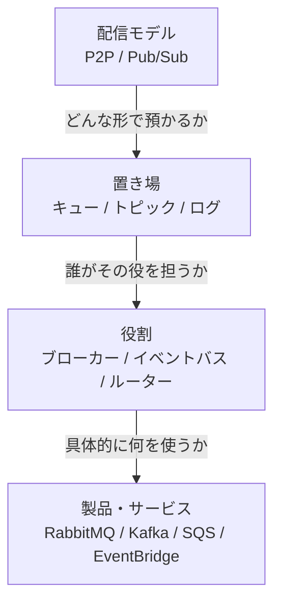
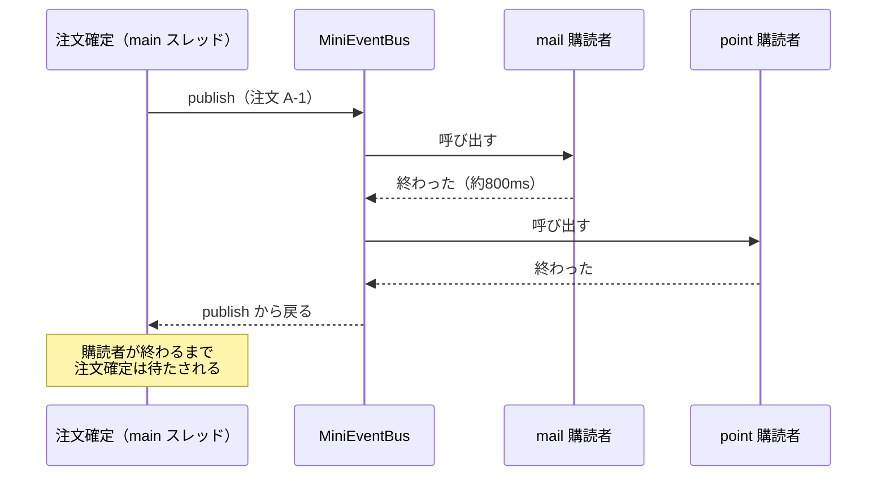

# 第16章: Pub/Sub・キュー・イベントバスの違い

## この章のゴール

「Pub/Sub」「キュー」「イベントバス」「ブローカー」「イベントストリーム」といった用語が、同じ階層の言葉ではないことを理解します。ごく小さなイベントバスを自作して、ブローカーなしでも Pub/Sub が成り立つことと、ブローカーが足してくれるものを確かめます。

## Why: なぜこれを学ぶのか

メッセージングの資料を読むと、用語が入り乱れて見えます。ある記事では「Pub/Sub」と書かれた機能が、別の記事では「イベントバス」と呼ばれ、さらに別の記事では「メッセージキュー」と呼ばれています。同じものを指すこともあれば、まったく別のものを指すこともあります。

混乱の原因は、**階層の違う言葉を同じ並びで比べている** ことです。この章で階層を整理しておくと、新しい製品の資料を読むときも、どの階層の話をしているのかを見分けられます。

## 前提

第15章で、P2P と Pub/Sub の違い、サブスクリプションという考え方を学びました。

## ステップ1: 用語を4つの階層に分ける

| 階層 | 問い | 用語の例 |
| :--- | :--- | :--- |
| 配信モデル | メッセージを何人の受け手に届けるか | P2P（Point-to-Point）、Pub/Sub |
| 置き場 | メッセージをどんな形で預かるか | キュー、トピック、ログ（ストリーム） |
| 役割（構成要素） | システムの中でどんな役を担うか | ブローカー、イベントバス、ルーター |
| 製品・サービス | 具体的に何を使うか | RabbitMQ、Kafka、Amazon SQS、Amazon EventBridge |

上の階層から下の階層へ進むほど、「何を実現するか」から「何で実現するか」へと具体的になります。



さらに、流すメッセージの **性質** を表す言葉があります。

| 性質 | 意味 | 用語の例 |
| :--- | :--- | :--- |
| イベント | 起きた事実の通知 | OrderPlaced |
| コマンド | 誰かへの依頼 | SendMail |

**Why**: 「Pub/Sub とキューのどちらを使うか」という問いは、実は階層をまたいでいます。Pub/Sub は **配信モデル**、キューは **置き場** です。Pub/Sub の配信モデルを実現するために、置き場としてキューを使うことは普通にあります（第15章のサブスクリプションがそれです）。

## ステップ2: 「キュー」の2つの意味を区別する

「キュー」は、文脈で2つの意味に分かれます。

| 意味 | 説明 | 例 |
| :--- | :--- | :--- |
| データ構造のキュー | 先入れ先出しで要素を並べて取り出す仕組み | 第2章の `ArrayDeque`、`BlockingQueue` |
| メッセージキュー | メッセージを預かり、受け手に1件ずつ渡す仕組み。ふつう1件は1人の受け手だけに渡す（P2P） | RabbitMQ のキュー、Amazon SQS |

メッセージキューの内部は、データ構造としてのキューにたまります。ただし、メッセージキューは単なる先入れ先出しの入れ物ではありません。次の機能が加わっています。

- 受け手のプロセスが落ちても、メッセージを預かり続ける（永続化）
- 受け手が ack を返すまで、メッセージを消さない
- 複数の受け手へ、1件ずつ振り分ける

**⚠️ よくある失敗・誤解**: 「キューだから先入れ先出しで、順番どおりに処理される」と考えるのは、データ構造のキューの性質をメッセージキューにそのまま当てはめた誤解です。受け手が複数いれば、処理が終わる順番は入れ替わります（第20章）。

## ステップ3: ブローカーなしの Pub/Sub を作る

Pub/Sub は配信モデルなので、ブローカーがなくても成り立ちます。同じプロセスの中だけで動く、最小のイベントバスを作ってみます。トピック名ごとに購読者を登録しておき、発行されたら全員に配るだけの作りです。

`src/main/java/com/example/async/inprocess/MiniEventBus.java` を新規作成します。

<!-- code: answers/src/main/java/com/example/async/inprocess/MiniEventBus.java -->
```java
package com.example.async.inprocess;

import java.util.ArrayList;
import java.util.HashMap;
import java.util.List;
import java.util.Map;
import java.util.function.Consumer;

/**
 * 同じプロセスの中だけで動く、最小のイベントバス。
 * トピック名ごとに購読者（ハンドラー）を登録しておき、発行されたら全員に配る。
 */
public class MiniEventBus {
    // トピック名 → 購読者の一覧
    private final Map<String, List<Consumer<String>>> subscribers = new HashMap<>();

    /**
     * トピックを購読する。
     *
     * @param topic   トピック名
     * @param handler イベントが届いたときに呼ばれる処理
     */
    public synchronized void subscribe(String topic, Consumer<String> handler) {
        // トピックの一覧がなければ作ってから、購読者を追加する
        subscribers.computeIfAbsent(topic, t -> new ArrayList<>()).add(handler);
    }

    /**
     * トピックにイベントを発行する。購読者がいなければ、何も起きない。
     *
     * @param topic   トピック名
     * @param payload イベントの本文
     */
    public void publish(String topic, String payload) {
        // 購読者の一覧をコピーして取り出す（配っている最中に subscribe されても壊れないように）
        List<Consumer<String>> targets;
        synchronized (this) {
            targets = new ArrayList<>(subscribers.getOrDefault(topic, List.of()));
        }
        // 全員に、呼び出し元のスレッドの中で順番に配る
        for (Consumer<String> handler : targets) {
            handler.accept(payload);
        }
    }
}
```

次に、これを使うデモを書きます。`src/main/java/com/example/async/inprocess/MiniEventBusDemo.java` を新規作成します。

<!-- code: answers/src/main/java/com/example/async/inprocess/MiniEventBusDemo.java -->
```java
package com.example.async.inprocess;

import com.example.async.common.Console;

/**
 * MiniEventBus を使って、注文確定イベントをメール・ポイントの2つの購読者へ配るデモ。
 */
public class MiniEventBusDemo {

    /**
     * 購読者を2つ登録して、イベントを2件発行する。
     *
     * @param args 使わない
     */
    public static void main(String[] args) {
        MiniEventBus bus = new MiniEventBus();
        // メールとポイントが、それぞれ注文確定を購読する
        bus.subscribe("order.placed", payload -> {
            Console.sleep(800);
            Console.log("  [mail] " + payload);
        });
        bus.subscribe("order.placed", payload -> Console.log("  [point] " + payload));

        for (int i = 1; i <= 2; i++) {
            long start = System.currentTimeMillis();
            // 注文サービスは、誰が購読しているかを知らずに発行する
            bus.publish("order.placed", "A-" + i);
            Console.log("注文 A-" + i + " 確定 OK（" + (System.currentTimeMillis() - start) + "ms）");
        }
    }
}
```

```bash
./run.sh inprocess.MiniEventBusDemo
```

```text
[12:44:25.264][main]   [mail] A-1
[12:44:25.272][main]   [point] A-1
[12:44:25.279][main] 注文 A-1 確定 OK（871ms）
[12:44:26.079][main]   [mail] A-2
[12:44:26.079][main]   [point] A-2
[12:44:26.080][main] 注文 A-2 確定 OK（801ms）
```

メールとポイントの両方に同じ注文が配られました。発行側（`publish` を呼ぶ側）は、誰が購読しているかを知りません。第15章の「空間の切り離し」は、この小さなコードでも実現できています。

`publish` の中で起きていることを図にすると、次のようになります。



**Why**: ログをよく見てください。注文の確定に871ミリ秒かかっています。購読者の処理は、`publish` を呼んだスレッドの中で **順番に同期的に** 実行されるからです。メール購読者が800ミリ秒かかれば、発行側もそれだけ待たされます。第15章の「時間の切り離し」「同期の切り離し」は、この作りでは実現できていません。

## ステップ4: ブローカーが足してくれるものを整理する

`MiniEventBus` は、同じプロセスの中でイベントを配る **プロセス内イベントバス** です。実際のライブラリにも同じ種類のものがあります。

- Java の Guava EventBus
- Spring Framework の `ApplicationEventPublisher`（既定では同期で配る）
- JavaScript の `EventEmitter` やブラウザの DOM イベント

これらとメッセージブローカーを比べると、ブローカーが足してくれるものが見えます。

| 観点 | プロセス内イベントバス | メッセージブローカー |
| :--- | :--- | :--- |
| 動く場所 | 1つのプロセスの中 | 独立したサーバー。複数のサービスをまたげる |
| 預かる | 預からない。プロセスが落ちれば消える | 預かる。永続化もできる |
| 受け手が止まっている間 | 取りこぼす | 預かっておき、復帰後に届ける |
| 配る方式 | 同期（呼び出し元が待つ）が多い | 非同期（預けたら戻れる） |
| 処理完了の確認 | なし | ack で確認し、失敗したら再配達する |
| 受け手の追加 | 同じプロセスのコードに登録する | 別のサービスが、自分で購読を始められる |

**Why**: プロセス内イベントバスは、1つのアプリの中の部品同士を疎結合にする用途で、今も広く使われています。ただし、**サービスをまたぐ連携や、落ちても消せない処理** には、ブローカーが必要です。どちらを使うかは、「この通知が消えても困らないか」「同じプロセスの中で完結するか」で決まります。

## ステップ5: 「イベントバス」という言葉の3つの使われ方

「イベントバス」は、文脈によって次の3つの意味で使われます。

| 意味 | 説明 | 例 |
| :--- | :--- | :--- |
| ① プロセス内のライブラリ | ステップ3の `MiniEventBus` と同じ種類。同じプロセスの中だけで動く | Guava EventBus、Spring のアプリケーションイベント |
| ② クラウドのイベントルーティングサービス | イベントを受け取り、ルール（条件）に従って配り先へ振り分ける。自社のアプリだけでなく、クラウドのサービスや SaaS が出すイベントも扱える | Amazon EventBridge（イベントバスという名前のリソースを作る）、Azure Event Grid、Google Cloud Eventarc |
| ③ アーキテクチャ上の役割 | すべてのサービスがつながる共通の通り道。ブローカーをこの役で使う | RabbitMQ や Kafka を「社内のイベントバス」として運用する |

②は、受け手を決めるルールをサービス側に登録する点が特徴です。「注文の金額が10万円以上のイベントだけを、不正検知サービスへ送る」といった条件を、アプリのコードではなく設定で書けます。ただしメッセージを長期間ためるのが主目的ではなく、振り分けと配達が中心です。

**💼 現場Tip**: 設計の会議で「イベントバスを使う」と言われたら、「①〜③のどれですか」「預かりますか」「受け手が止まっている間のイベントは残りますか」と聞き返しましょう。この確認だけで、認識のずれによる事故の多くを防げます。

## ステップ6: イベントストリームを位置付ける

第15章で紹介した **ログ型（イベントストリーム）** も、この整理に当てはめます。

| 観点 | キュー型 | ログ型（ストリーム） |
| :--- | :--- | :--- |
| 置き場 | キュー | 追記専用のログ |
| 読んだメッセージ | 消える | 保持期間内は残る（読み直せる） |
| 配信モデル | P2P でも Pub/Sub でも使える | 受け手のグループごとに読み位置を持つので、Pub/Sub の形になる |
| 向いている用途 | 仕事の分担、確実な通知 | 履歴の蓄積、分析、再処理 |

Kafka は「Pub/Sub か」と聞かれれば、**配信モデルとしては Pub/Sub を実現でき、置き場の性質はログ型** です。どちらの階層の話かを分ければ、矛盾しません。

## ステップ7: 同じ製品が複数の顔を持つことを知る

階層を分けると、「RabbitMQ はキューなのか、Pub/Sub なのか、イベントバスなのか」という問いの答えも整理できます。

| 使い方 | 階層 | RabbitMQ での形 |
| :--- | :--- | :--- |
| 仕事の分担 | 配信モデル: P2P | 1つのキューを複数のワーカーで共有する（第10章） |
| 通知の一斉配信 | 配信モデル: Pub/Sub | エクスチェンジに、サービスごとのキューを Binding する（第17章） |
| 社内の共通の通り道 | 役割: イベントバス | 上の構成を全サービスで共有し、命名規則で運用する（第18章） |

**Why**: 製品の名前だけで型を決めつけるのは危険です。大切なのは、**自分の使い方がどの階層のどれに当たるか** を言葉にできることです。この講座では、RabbitMQ を使ってこの3つの使い方をすべて体験します。

## 動作確認

`./run.sh inprocess.MiniEventBusDemo` を実行し、次の2点を確認できたら完了です。

1. メールとポイントの両方に、同じ注文が配られた
2. 注文の確定に、メール購読者の処理時間（800ミリ秒前後）がそのまま含まれている

## もっと良くしてみよう

### 理解確認

1. 「Pub/Sub」と「キュー」は、どの階層の言葉でしょうか。
2. 「イベントバス」の3つの使われ方を、それぞれ説明してみましょう。
3. `MiniEventBus` のような仕組みで、メール購読者が止まっていた間のイベントが、復帰後に届かないのはなぜでしょうか。

### 発展改善クイズ

1. `MiniEventBus` の購読者の1つが例外を投げると、後ろに登録された購読者には配られるでしょうか。確かめたうえで、どう直すとよいか考えてみましょう。
2. `MiniEventBus` を別スレッドで配る作りに変えると、第15章の「同期の切り離し」は実現できます。それでもブローカーが必要になるのは、どのような場合でしょうか。

---

| [← 第15章: Pub/Subパターンとは](./15-what-is-pubsub.md) | [全章目次](./README.md) | [第17章: fanoutでPub/Subを実現する →](./17-fanout.md) |
| - | :-: | --: |
