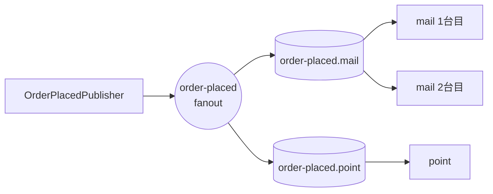

# 第17章: fanoutでPub/Subを実現する

## この章のゴール

fanout エクスチェンジを使い、「注文確定」イベントをメール・在庫・ポイントの各サービスへ同時に配る Pub/Sub を作ります。サービスごとの永続的な購読（キュー）と、起動中だけの一時的な購読の違いを体験します。

## Why: なぜこれを学ぶのか

第7〜8章の P2P では、1件のメッセージは1つのコンシューマーにしか届きませんでした。第1章の注文確定では、同じ「注文確定」をメール・在庫・ポイントの **全員** に知らせたいはずです。いよいよ、第15章で学んだ Pub/Sub を実装します。

## 前提

第10章で、手動 ack と prefetch の使い方を学びました。

## ステップ1: イベントを発行するパブリッシャーを書く

`src/main/java/com/example/async/fanout/OrderPlacedPublisher.java` を新規作成します。

<!-- code: answers/src/main/java/com/example/async/fanout/OrderPlacedPublisher.java -->
```java
package com.example.async.fanout;

import java.nio.charset.StandardCharsets;

import com.example.async.common.Console;
import com.example.async.common.RabbitConnection;
import com.rabbitmq.client.BuiltinExchangeType;
import com.rabbitmq.client.Channel;
import com.rabbitmq.client.Connection;
import com.rabbitmq.client.MessageProperties;

/**
 * 「注文が確定した」というイベントを order-placed エクスチェンジへ発行するパブリッシャー。
 * 誰が受け取るかは知らない。エクスチェンジに投げるだけ。
 */
public class OrderPlacedPublisher {
    // イベントを発行する先のエクスチェンジ名
    static final String EXCHANGE = "order-placed";

    /**
     * 引数で指定した件数（省略時は3件）の注文確定イベントを発行する。
     *
     * @param args 発行する件数
     * @throws Exception 接続や送信に失敗した場合
     */
    public static void main(String[] args) throws Exception {
        int count = args.length > 0 ? Integer.parseInt(args[0]) : 3;
        try (Connection connection = RabbitConnection.open("order-placed-publisher");
                Channel channel = connection.createChannel()) {
            // fanout 型のエクスチェンジを宣言する。fanout は「バインドされた全キューにコピーを配る」
            // 第3引数 durable=true でブローカー再起動後も残す
            channel.exchangeDeclare(EXCHANGE, BuiltinExchangeType.FANOUT, true);
            for (int i = 1; i <= count; i++) {
                String event = "{\"orderId\":\"A-" + i + "\",\"amount\":" + (1000 * i) + "}";
                // fanout ではルーティングキーは使われないので空文字でよい
                channel.basicPublish(EXCHANGE, "", MessageProperties.PERSISTENT_TEXT_PLAIN,
                        event.getBytes(StandardCharsets.UTF_8));
                Console.log("発行: " + event);
            }
        }
    }
}
```

**Why**: これまでは既定エクスチェンジ `""` にキュー名を指定して送っていました。今回は `order-placed` という名前の **fanout エクスチェンジ** に送っています。パブリッシャーのコードには、キュー名が1つも出てきません。パブリッシャーが知っているのは「注文確定イベントは `order-placed` に投げる」ということだけです。

## ステップ2: 購読者がいない状態で発行する

サブスクライバーを書く前に、パブリッシャーだけを実行します。

```bash
./run.sh fanout.OrderPlacedPublisher 1
```

```text
[09:17:29.795][main] 発行: {"orderId":"A-1","amount":1000}
```

送信は成功しました。しかし管理画面の Queues and Streams タブを見ても、このメッセージがたまっているキューはありません。

**Why**: エクスチェンジはメッセージを保存しません。Binding されたキューが1つもなければ、メッセージは行き場がなく、**黙って捨てられます**。第9章で、受け手のいない `hello` キューにメッセージがたまったのとは対照的です。あのときは、送る側が先に `queueDeclare` でキューを作っていました。

**⚠️ よくある失敗・誤解**: 「新しいサービスをデプロイしたのに、デプロイ前に発行されたイベントが届かない」という問い合わせはよくあります。キュー型のブローカーでは、購読（キューと Binding）が作られた **後に** 発行されたメッセージしか届きません。過去のイベントを後から読み直したい場合は、第5章のログ型の製品を検討します。

## ステップ3: サービスごとに購読するサブスクライバーを書く

`src/main/java/com/example/async/fanout/OrderPlacedSubscriber.java` を新規作成します。起動引数でサービス名を受け取り、サービスごとに専用のキューを作ります。

<!-- code: answers/src/main/java/com/example/async/fanout/OrderPlacedSubscriber.java -->
```java
package com.example.async.fanout;

import java.io.IOException;
import java.nio.charset.StandardCharsets;

import com.example.async.common.Console;
import com.example.async.common.RabbitConnection;
import com.rabbitmq.client.AMQP;
import com.rabbitmq.client.BuiltinExchangeType;
import com.rabbitmq.client.Channel;
import com.rabbitmq.client.Connection;
import com.rabbitmq.client.DefaultConsumer;
import com.rabbitmq.client.Envelope;

/**
 * 注文確定イベントを購読するサブスクライバー。
 * 起動引数のサービス名ごとに専用のキューを作り、エクスチェンジにバインドする。
 */
public class OrderPlacedSubscriber extends DefaultConsumer {
    // ログに出すサービス名
    private final String serviceName;

    /**
     * @param channel     使うチャネル
     * @param serviceName mail / inventory / point などのサービス名
     */
    public OrderPlacedSubscriber(Channel channel, String serviceName) {
        super(channel);
        this.serviceName = serviceName;
    }

    /**
     * イベントを受け取ったら、そのサービスの仕事をした「つもり」でログを出して ack する。
     */
    @Override
    public void handleDelivery(String consumerTag, Envelope envelope,
            AMQP.BasicProperties properties, byte[] body) throws IOException {
        String event = new String(body, StandardCharsets.UTF_8);
        Console.log("[" + serviceName + "] 受信: " + event);
        getChannel().basicAck(envelope.getDeliveryTag(), false);
    }

    /**
     * 指定したサービス名で購読を始める。
     *
     * @param args [0] サービス名（mail / inventory / point など。省略時は mail）
     * @throws Exception 接続に失敗した場合
     */
    public static void main(String[] args) throws Exception {
        String service = args.length > 0 ? args[0] : "mail";
        Connection connection = RabbitConnection.open("subscriber-" + service);
        Channel channel = connection.createChannel();
        // パブリッシャーと同じ設定でエクスチェンジを宣言する（どちらが先に起動してもよいように）
        channel.exchangeDeclare(OrderPlacedPublisher.EXCHANGE, BuiltinExchangeType.FANOUT, true);
        // サービスごとに専用のキューを作る（例: order-placed.mail）
        String queue = OrderPlacedPublisher.EXCHANGE + "." + service;
        channel.queueDeclare(queue, true, false, false, null);
        // キューをエクスチェンジにバインドする。これが「購読の登録」にあたる
        channel.queueBind(queue, OrderPlacedPublisher.EXCHANGE, "");
        channel.basicConsume(queue, false, new OrderPlacedSubscriber(channel, service));
        Console.log("[" + service + "] " + queue + " を購読中です。Ctrl+C で終了します");
    }
}
```

**Why**: サブスクライバーの起動時には、次の3つを行っています。

1. `exchangeDeclare`: パブリッシャーと同じエクスチェンジを宣言する
2. `queueDeclare`: 自分のサービス専用のキュー（例：`order-placed.mail`）を作る
3. `queueBind`: そのキューをエクスチェンジに結び付ける

3つめの `queueBind` が「購読の登録」にあたります。第15章の「サブスクリプション」は、RabbitMQ では **エクスチェンジに Binding したキュー** として表現されます。

## ステップ4: 2つのサービスで購読する

2つのターミナルで、`mail` と `point` のサブスクライバーを起動します。

```bash
# ターミナル1
./run.sh fanout.OrderPlacedSubscriber mail
```

```bash
# ターミナル2
./run.sh fanout.OrderPlacedSubscriber point
```

3つめのターミナルで、2件発行します。

```bash
./run.sh fanout.OrderPlacedPublisher 2
```

両方のサブスクライバーに、同じ2件が届きます。

```text
[09:17:37.776][pool-1-thread-4] [mail] 受信: {"orderId":"A-1","amount":1000}
[09:17:37.786][pool-1-thread-5] [mail] 受信: {"orderId":"A-2","amount":2000}
```

```text
[09:17:37.776][pool-1-thread-4] [point] 受信: {"orderId":"A-1","amount":1000}
[09:17:37.786][pool-1-thread-5] [point] 受信: {"orderId":"A-2","amount":2000}
```

管理画面の Exchanges タブで `order-placed` を開くと、Bindings 欄に `order-placed.mail` と `order-placed.point` の2つが表示されています。

**Why**: fanout エクスチェンジは、Binding されている **すべてのキューにメッセージのコピーを入れます**。メールとポイントは、それぞれ自分のキューから自分のペースで読みます。

## ステップ5: 購読者が止まっている間のメッセージを確かめる

`point` のサブスクライバーだけを Ctrl+C で止めます。その状態で2件発行します。

```bash
./run.sh fanout.OrderPlacedPublisher 2
```

`mail` には届きます。管理画面で `order-placed.point` キューを見ると、`Ready` が 2 になっています。`point` のサブスクライバーを起動し直すと、たまっていた2件がすぐに届きます。

**Why**: ポイントサービスが止まっていても、`order-placed.point` キューと Binding は残っています。そのため、止まっている間のイベントもキューにたまり、復帰後に処理できます。第1章で「ポイントサービスが落ちると注文が失敗した」問題が、ここで解決しました。

**🔍 確認・実験してみよう**: `inventory` のサブスクライバーを新しく起動してから、もう一度2件発行してみましょう。`inventory` には、起動前に発行された分は届くでしょうか。パブリッシャーのコードを1行も変えずに、購読者を増やせたことも確認しましょう。

## ステップ6: 同じサービスを2台に増やす

`mail` のサブスクライバーを、2つのターミナルで起動します。

```bash
# ターミナル1 と ターミナル2 の両方で
./run.sh fanout.OrderPlacedSubscriber mail
```

4件発行すると、`mail` の2台には2件ずつ分かれて届きます。`point` には4件すべてが届きます。

**Why**: 2台の `mail` は同じキュー `order-placed.mail` を購読しているので、第9章の P2P と同じように分担します。第15章の図のとおり、「サービスの間は Pub/Sub、同じサービスの中は P2P」という構成になっています。



## ステップ7: 起動中だけの一時的な購読を作る

管理者向けの「注文がリアルタイムに流れていく画面」のように、**見ている間だけ** イベントを受け取れればよい場合もあります。`src/main/java/com/example/async/fanout/LiveMonitor.java` を新規作成します。

<!-- code: answers/src/main/java/com/example/async/fanout/LiveMonitor.java -->
```java
package com.example.async.fanout;

import java.io.IOException;
import java.nio.charset.StandardCharsets;

import com.example.async.common.Console;
import com.example.async.common.RabbitConnection;
import com.rabbitmq.client.AMQP;
import com.rabbitmq.client.BuiltinExchangeType;
import com.rabbitmq.client.Channel;
import com.rabbitmq.client.Connection;
import com.rabbitmq.client.DefaultConsumer;
import com.rabbitmq.client.Envelope;

/**
 * 起動している間だけ注文確定イベントを眺める、一時的なサブスクライバー（管理者向けのライブ画面の想定）。
 * ブローカーが名前を付ける使い捨てのキューを使う。
 */
public class LiveMonitor extends DefaultConsumer {

    /**
     * @param channel 使うチャネル
     */
    public LiveMonitor(Channel channel) {
        super(channel);
    }

    /**
     * 受け取ったイベントを表示する（autoAck なので ack は不要）。
     */
    @Override
    public void handleDelivery(String consumerTag, Envelope envelope,
            AMQP.BasicProperties properties, byte[] body) throws IOException {
        Console.log("[monitor] " + new String(body, StandardCharsets.UTF_8));
    }

    /**
     * 使い捨てキューを作って購読を始める。
     *
     * @param args 使わない
     * @throws Exception 接続に失敗した場合
     */
    public static void main(String[] args) throws Exception {
        Connection connection = RabbitConnection.open("live-monitor");
        Channel channel = connection.createChannel();
        channel.exchangeDeclare(OrderPlacedPublisher.EXCHANGE, BuiltinExchangeType.FANOUT, true);
        // 引数なしの queueDeclare は「名前はブローカー任せ・この接続専用・接続が切れたら削除」のキューを作る
        String queue = channel.queueDeclare().getQueue();
        channel.queueBind(queue, OrderPlacedPublisher.EXCHANGE, "");
        // 見るだけなので autoAck=true でよい
        channel.basicConsume(queue, true, new LiveMonitor(channel));
        Console.log("[monitor] 一時キュー " + queue + " で購読中です。Ctrl+C で終了します");
    }
}
```

起動して、イベントを発行します。

```bash
./run.sh fanout.LiveMonitor
```

```text
[09:17:35.073][main] [monitor] 一時キュー amq.gen-ju_VG2-yoh9k-L3plPFGqg で購読中です。Ctrl+C で終了します
[09:17:37.774][pool-1-thread-4] [monitor] {"orderId":"A-1","amount":1000}
```

管理画面には `amq.gen-` で始まるキューが表示されます。`LiveMonitor` を Ctrl+C で止めると、このキューは自動で削除されます。

**Why**: 引数なしの `queueDeclare()` は、次の性質を持つキューを作ります。

| 性質 | 意味 |
| :--- | :--- |
| 名前はブローカーが自動で付ける | `amq.gen-...` のような重複しない名前 |
| exclusive | この接続だけが使える |
| autoDelete | 接続が切れると削除される |

モニターを止めている間のイベントは、キューごと消えているので届きません。見るだけの用途なら、それで問題ありません。止まっている間のイベントも失いたくない業務処理には、ステップ3のような名前付きの durable なキューを使います。

**💼 現場Tip**: 一時的な購読の典型的な使い道が **キャッシュの無効化** です。商品情報をメモリにキャッシュしている Web サーバーが3台あるとします。「商品が更新された」イベントは、3台 **すべて** に届かないと、どこかのサーバーに古いキャッシュが残ります。各サーバーが起動時に自分専用の一時キューを作って購読すれば、台数が増減しても全台に届きます。

| 購読の種類 | キュー | 止まっている間のイベント | 主な用途 |
| :--- | :--- | :--- | :--- |
| 永続的な購読 | 名前付き・durable | たまる。復帰後に処理できる | 業務処理（メール、ポイント） |
| 一時的な購読 | 自動命名・exclusive・autoDelete | 届かない | モニター、キャッシュ無効化、画面への通知 |

## 動作確認

次の3つを確認できたら完了です。

1. 購読者がいない状態で発行したイベントは、どのキューにも残らなかった
2. `mail` と `point` の両方に、同じイベントが届いた
3. `point` を止めている間のイベントが、`point` の再起動後に届いた

## もっと良くしてみよう

### 理解確認

1. fanout エクスチェンジに Binding されたキューが1つもないとき、発行したメッセージはどうなるでしょうか。
2. `mail` を2台起動したとき、メッセージが2台に分かれて届くのはなぜでしょうか。
3. `LiveMonitor` を止めている間に発行されたイベントが、再起動後に届かないのはなぜでしょうか。

### 発展改善クイズ

1. 今の構成では、全サブスクライバーが「注文確定」をすべて受け取ります。「キャンセル」や「発送」のイベントも同じエクスチェンジに流すと、各サービスは自分に関係ないイベントも受け取ることになります。どうすれば、必要なイベントだけを受け取れるでしょうか。
2. 本文の JSON は、文字列をつなげて手で組み立てています。項目が増えたり、受け手が増えたりしたときに、何が問題になりそうでしょうか。

---

| [← 第16章: Pub/Sub・キュー・イベントバスの違い](./16-terms-event-bus.md) | [全章目次](./README.md) | [第18章: topicで受け取るイベントを選ぶ →](./18-topic.md) |
| - | :-: | --: |
