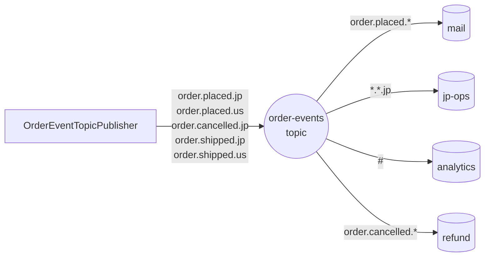

# 第17章: topicで受け取るイベントを選ぶ

## この章のゴール

topic エクスチェンジとルーティングキーのワイルドカード（`*` と `#`）を使い、サービスごとに必要なイベントだけを受け取れるようにします。ルーティングキーの命名規則を設計する考え方を学びます。

## Why: なぜこれを学ぶのか

第16章の fanout では、Binding されたキューにすべてのイベントが届きました。注文には「確定」のほかに「キャンセル」「発送」などの出来事があり、地域（日本・米国）によって担当チームも違います。受け取りたいイベントはサービスごとに違います。たとえばメールサービスは確定だけ、返金サービスはキャンセルだけを受け取りたいはずです。日本の運用チームは日本の注文すべてを、集計用システムは全部を受け取りたいでしょう。

受け取ってから読み捨てることもできますが、不要なメッセージの転送と処理は無駄です。ブローカーの段階で振り分けるのが topic エクスチェンジです。

## 前提

第16章で、fanout エクスチェンジでサービスごとのキューへイベントを配りました。

## ステップ1: ルーティングキーの命名規則を決める

topic エクスチェンジでは、ルーティングキーを `.` で区切った単語の並びとして扱います。この章では、次の命名規則にします。

```text
<集約>.<出来事>.<地域>
例: order.placed.jp / order.cancelled.jp / order.shipped.us
```

**Why**: 「集約」は、注文や商品のように、出来事の主語になるもののまとまりです。命名規則を先に決めておくと、受け手（コンシューマー）は「注文のことは全部」「キャンセルだけ」「日本のものだけ」といった条件を、ワイルドカードで表現できます。命名規則は、送り手（パブリッシャー）と受け手（コンシューマー）の間の **契約** です。後から変えると全受け手（コンシューマー）に影響するので、最初に慎重に決めます。

## ステップ2: いろいろなイベントを発行する送り手（パブリッシャー）を読む

[OrderEventTopicPublisher.java](../src/main/java/com/example/async/topic/OrderEventTopicPublisher.java) を開いて、コードを読んでみましょう。

**Why**: エクスチェンジ名の定数 `EXCHANGE` を `public` にしているのは、第18章以降のクラスからも、この `order-events` エクスチェンジを使うためです。

## ステップ3: バインディングキーを指定して購読する受け手（サブスクライバー）を読む

[TopicSubscriber.java](../src/main/java/com/example/async/topic/TopicSubscriber.java) を開きます。中心となる部分を抜粋します。2つめ以降の起動引数を、バインディングキー（受け取りたいパターン）として扱います。バインディングキーは、第6章の Binding に付ける「条件」のことです。

<!-- code: src/main/java/com/example/async/topic/TopicSubscriber.java#main -->
```java
/**
 * サービス名とバインディングキーを指定して購読を始める。
 *
 * @param args [0] サービス名, [1..] バインディングキー（例: order.placed.* や order.#）
 * @throws Exception 接続に失敗した場合
 */
public static void main(String[] args) throws Exception {
    if (args.length < 2) {
        System.err.println("使い方: ./run.sh topic.TopicSubscriber <サービス名> <バインディングキー>...");
        return;
    }
    String service = args[0];
    // 2つめ以降の引数をすべてバインディングキーとして扱う
    String[] bindingKeys = Arrays.copyOfRange(args, 1, args.length);
    Connection connection = RabbitConnection.open("topic-subscriber-" + service);
    Channel channel = connection.createChannel();
    channel.exchangeDeclare(OrderEventTopicPublisher.EXCHANGE, BuiltinExchangeType.TOPIC, true);
    String queue = OrderEventTopicPublisher.EXCHANGE + "." + service;
    channel.queueDeclare(queue, true, false, false, null);
    // 1つのキューに複数のバインディングを張れる。どれか1つにマッチすれば届く
    for (String key : bindingKeys) {
        channel.queueBind(queue, OrderEventTopicPublisher.EXCHANGE, key);
    }
    channel.basicConsume(queue, false, new TopicSubscriber(channel, service));
    Console.log("[" + service + "] " + queue + " を購読中 bindingKeys=" + Arrays.toString(bindingKeys));
}
```

**Why**: バインディングキーに使えるワイルドカードは次の2つです。

| 記号 | 意味 | 例 | 一致するルーティングキー |
| :--- | :--- | :--- | :--- |
| `*` | ちょうど1つの単語 | `order.placed.*` | `order.placed.jp`、`order.placed.us` |
| `#` | 0個以上の単語 | `order.#` | `order`、`order.placed`、`order.placed.jp` |

`envelope.getRoutingKey()` を見ると、どのルーティングキーで発行されたメッセージかがわかります。

## ステップ4: 4つのサービスで購読して発行する

4つのターミナルで、それぞれ次の受け手（サブスクライバー）を起動します。バインディングキーはシングルクォートで囲みます。

```bash
# メール: 確定だけ（地域は問わない）
./run.sh topic.TopicSubscriber mail 'order.placed.*'
```

```bash
# 日本の運用チーム: 日本の出来事すべて
./run.sh topic.TopicSubscriber jp-ops '*.*.jp'
```

```bash
# 集計用システム: すべて
./run.sh topic.TopicSubscriber analytics '#'
```

```bash
# 返金: キャンセルだけ
./run.sh topic.TopicSubscriber refund 'order.cancelled.*'
```

5つめのターミナルで発行します。

```bash
./run.sh topic.OrderEventTopicPublisher
```

各サービスに届くイベントは次のとおりです。

エクスチェンジとキューの Binding を図にすると、次のようになります。



| サービス | バインディングキー | 届く件数 | 届くルーティングキー |
| :--- | :--- | :--- | :--- |
| mail | `order.placed.*` | 2 | `order.placed.jp`、`order.placed.us` |
| jp-ops | `*.*.jp` | 3 | `order.placed.jp`、`order.cancelled.jp`、`order.shipped.jp` |
| analytics | `#` | 5 | すべて |
| refund | `order.cancelled.*` | 1 | `order.cancelled.jp` |

**⚠️ よくある失敗・誤解**: バインディングキーをシングルクォートで囲まないと、Bash が `*` や `#` を特別な記号として解釈してしまいます。`*` はカレントディレクトリのファイル名に展開され、`#` 以降はコメントとして無視されます。

**🔍 確認・実験してみよう**: バインディングキー `order.*` で購読すると、`order.placed.jp` は届くでしょうか。`*` と `#` の違いを思い出し、予想してから確かめてみましょう。

## ステップ5: 1つのキューに複数の Binding を張る

返金サービスが「キャンセル」に加えて「発送」も受け取りたくなったとします。`refund` を Ctrl+C で止め、バインディングキーを2つ指定して起動し直します。

```bash
./run.sh topic.TopicSubscriber refund 'order.cancelled.*' 'order.shipped.*'
```

発行すると、`refund` には3件が届きます。

**Why**: 1つのキューに複数の Binding を張ると、**どれか1つに一致すれば** そのキューに届きます。1件のメッセージが同じキューの複数の Binding に一致しても、キューに入るのは1件だけです。

**⚠️ よくある失敗・誤解**: 今度は `refund` を止めて、`order.cancelled.*` だけで起動し直してみましょう。発行すると、まだ「発送」も届きます。`queueBind` は Binding を **追加** するだけで、以前の Binding を消さないためです。durable なキューの Binding は、プログラムを止めても残り続けます。不要になった Binding は、`channel.queueUnbind(...)` を呼ぶか、管理画面のキュー詳細の Bindings 欄にある「Unbind」ボタンで消します。

## ステップ6: direct と headers エクスチェンジを知る

topic のほかに、第6章で紹介した2種類のエクスチェンジがあります。

| 種類 | 振り分けの規則 | 向いている場面 |
| :--- | :--- | :--- |
| direct | ルーティングキーの完全一致 | 振り分け先が決まった数しかない場合（第19章で使う） |
| topic | `.` 区切りのパターン一致 | 階層的な分類で、受け手（コンシューマー）ごとに粒度を変えたい場合 |
| headers | ヘッダーの値の一致（全部一致 `x-match=all` か、どれか一致 `x-match=any`） | 振り分け条件が1つの階層に並べにくい場合 |

**💼 現場Tip**: 「受け手（コンシューマー）ごとに必要なイベントだけを受け取る」機能は、多くの製品にあります。製品ごとの呼び名は、第21章の対応表にまとめてあります。

## 動作確認

4つの受け手（サブスクライバー）を起動して `OrderEventTopicPublisher` を実行し、ステップ4の表のとおりの件数が各サービスに届いたら完了です。

## もっと良くしてみよう

### 理解確認

1. `order.*` と `order.#` の違いは何でしょうか。
2. 1つのキューに張った2つの Binding の両方に一致したメッセージは、そのキューに何件入るでしょうか。
3. 受け手（サブスクライバー）のバインディングキーを変えて起動し直しても、以前のイベントが届き続けるのはなぜでしょうか。

### 発展改善クイズ

1. 将来「店舗受け取り」のような新しい注文の種類が増え、`order.placed.jp.store` のように単語を1つ増やしたくなったとします。今のバインディングキー `order.placed.*` や `*.*.jp` で購読しているサービスには、どのような影響が出るでしょうか。
2. 今の受け手（サブスクライバー）は、受け取った本文をそのまま表示しているだけです。本文がどのような形式なのか、どの版の項目構成なのかを、受け手（コンシューマー）はどうやって知ればよいでしょうか。

---

| [← 第16章: fanoutでPub/Subを実現する](./16-fanout.md) | [全章目次](./README.md) | [第18章: メッセージを設計する →](./18-message-design.md) |
| - | :-: | --: |
