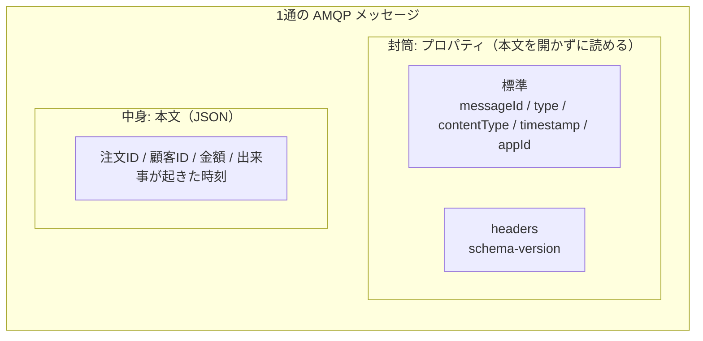
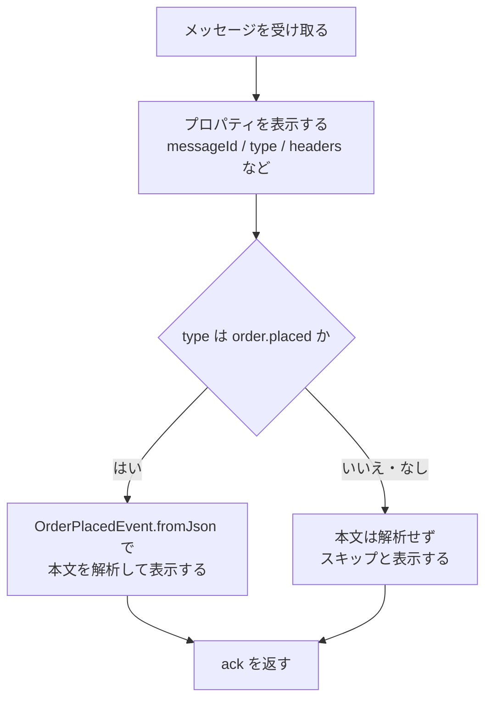

# 第18章: メッセージを設計する

## この章のゴール

「注文確定」イベントを表す `OrderPlacedEvent` クラスを作り、`messageId`・`type`・`contentType`・`timestamp`・独自ヘッダーなどのメタデータを付けて発行します。受け手（コンシューマー）がメタデータを見てイベントを解釈し、知らない種類のイベントを安全に読み飛ばす作りにします。

## Why: なぜこれを学ぶのか

これまでの章では、本文の JSON を文字列連結で手作りしていました。受け手（コンシューマー）は「この JSON にはこういう項目があるはず」と思い込んで読むしかありません。送り手（パブリッシャー）と受け手（コンシューマー）が別のチームになり、受け手（コンシューマー）の数が増えていくと、この思い込みは事故のもとになります。

メッセージは、送り手（パブリッシャー）と受け手（コンシューマー）の間の **約束事（契約）** です。HTTP の API に仕様書があるように、メッセージにも「何のイベントか」「どの形式か」「どの版か」「いつ起きたか」を明示する必要があります。この章では、そのための `OrderPlacedEvent` と `EventPublisher` を作ります。

## 前提

第17章で、`order-events` という topic エクスチェンジを作りました。`common/SimpleJson.java` は配布済みです。

## ステップ1: メッセージの「封筒」と「中身」を分けて考える

メッセージの情報は、AMQP のプロパティ（封筒）と本文（中身）に分けて持たせます。

| 置き場所 | 入れるもの | この章での例 |
| :--- | :--- | :--- |
| プロパティ（標準） | 配送や処理の振り分けに必要な情報 | `messageId`、`type`、`contentType`、`timestamp`、`appId` |
| プロパティ（headers） | 標準にない、配送や処理に関わる情報 | `schema-version` |
| 本文 | 業務の情報そのもの | 注文ID、顧客ID、金額、出来事が起きた時刻 |

1通のメッセージを封筒にたとえると、次のようになります。



**Why**: プロパティに置いた情報は、本文を解析しなくても読めます。受け手（コンシューマー）は、知らない `type` のイベントを本文を開かずに読み飛ばせます。ブローカーや周辺の仕組みも、プロパティを見て動きます。

## ステップ2: イベントクラスを読む

[OrderPlacedEvent.java](../src/main/java/com/example/async/message/OrderPlacedEvent.java) を開いて、コードを読んでみましょう。「注文が確定した」という出来事を表すクラスです。

**Why**: このクラスには、設計上の判断がいくつか入っています。

- **eventId**: イベント1件ごとに `UUID` で一意な ID を振る。第12章で、同じイベントが2回届いたことを見分けるために使う
- **occurredAt**: 送信した時刻ではなく、**出来事が起きた時刻** を持たせる。送信が遅れたり再送されたりしても、いつの出来事かがわかる
- **amount を long にする**: 金額を `double` で持つと、`0.1 + 0.2` が `0.30000000000000004` になるような誤差が出る。円なら整数で持つ
- **イミュータブル（作ったあとで書き換えられない作り）**: 一度発行したイベントは「過去の事実」なので、後から書き換えられないようにする
- **fromJson が知らない項目を無視する**: 送り手（パブリッシャー）が項目を追加しても、受け手（コンシューマー）は壊れない（ステップ6で扱う）

## ステップ3: メタデータを付けて発行する部品を読む

[EventPublisher.java](../src/main/java/com/example/async/message/EventPublisher.java) を開きます。中心となる部分を抜粋します。

<!-- code: src/main/java/com/example/async/message/EventPublisher.java#publish -->
```java
/**
 * イベントをルーティングキー order.placed.jp で発行する。
 *
 * @param event 発行するイベント
 * @throws IOException 送信に失敗した場合
 */
public void publish(OrderPlacedEvent event) throws IOException {
    // メッセージのプロパティ（AMQP が定める標準のメタデータ）を組み立てる
    AMQP.BasicProperties props = new AMQP.BasicProperties.Builder()
            // 受信側が重複を見分けるための一意なID
            .messageId(event.eventId())
            // 何のイベントか
            .type(OrderPlacedEvent.TYPE)
            // 本文の形式と文字コード
            .contentType("application/json")
            .contentEncoding("UTF-8")
            // 発行した時刻（AMQP の timestamp は秒単位）
            .timestamp(new Date())
            // どのアプリが発行したか
            .appId("order-service")
            // 2 = persistent（ディスクに保存してほしい）
            .deliveryMode(2)
            // 標準プロパティにない情報は headers に入れる
            .headers(Map.of("schema-version", OrderPlacedEvent.SCHEMA_VERSION))
            .build();
    // 本文は JSON を UTF-8 のバイト列にしたもの
    channel.basicPublish(exchange, "order.placed.jp", props, event.toJson().getBytes(StandardCharsets.UTF_8));
}
```

**Why**: `AMQP.BasicProperties.Builder` で、ステップ1の表のプロパティを組み立てています。`messageId` にイベントの `eventId` を入れているのがポイントです。受け手（コンシューマー）は本文を解析しなくても、プロパティだけで「このメッセージは何者か」を判断できます。

**⚠️ よくある失敗・誤解**: AMQP の `timestamp` プロパティは **秒単位** です。`new Date()` を渡してもミリ秒は切り捨てられます。ミリ秒以下の精度が必要な時刻は、本文の `occurredAt` のように別に持たせます。

## ステップ4: 発行するアプリを読む

[OrderPlacedEventPublisher.java](../src/main/java/com/example/async/message/OrderPlacedEventPublisher.java) を開いて、コードを読んでみましょう。

## ステップ5: メタデータを読んで解釈する受け手（サブスクライバー）を読む

[EventInspector.java](../src/main/java/com/example/async/message/EventInspector.java) を開いて、コードを読んでみましょう。`handleDelivery` は、次の順で処理します。



起動して、別のターミナルから発行します。

```bash
./run.sh message.EventInspector
```

```bash
./run.sh message.OrderPlacedEventPublisher 1
```

```text
[09:18:51.923][pool-1-thread-4] messageId=116b65b6-5168-4197-a6a9-2104d5616b49 type=order.placed contentType=application/json appId=order-service timestamp=Tue Nov 03 09:18:51 UTC 2026
[09:18:51.924][pool-1-thread-4] headers={schema-version=1}
[09:18:51.931][pool-1-thread-4] 注文確定イベント orderId=A-1 amount=1000 occurredAt=2026-11-03T09:18:51.902885929Z
```

管理画面でも確認できます。`EventInspector` を止めた状態で発行し、Queues and Streams タブで `order-events.inspector` キューを開きます。「Get messages」欄の「Get Message(s)」ボタンを押すと、プロパティと本文を見られます。

**Why**: `EventInspector` は、本文を解析する前に `type` を確かめています。第17章の `OrderEventTopicPublisher` のように `type` を付けずに発行されたメッセージは、解析せずに読み飛ばします。

**🔍 確認・実験してみよう**: `EventInspector` を起動したまま `./run.sh topic.OrderEventTopicPublisher` を実行すると、どう表示されるでしょうか。`type` がないメッセージを、もし `OrderPlacedEvent.fromJson` で解析しようとしたら何が起きるかも考えてみましょう。

## ステップ6: 項目の変更（スキーマの変更）に備える

本文に入れる項目の構成を **スキーマ** と呼びます。サービスを運用していると、イベントの項目は必ず変わります。どのような変更なら受け手（コンシューマー）を壊さないかを整理しておきます。

| 変更 | 受け手（コンシューマー）への影響 | 対応 |
| :--- | :--- | :--- |
| 項目を **追加** する | 知らない項目を無視する受け手（コンシューマー）なら壊れない | そのまま追加してよい |
| 項目を **削除・改名** する | その項目を読む受け手（コンシューマー）が壊れる | `schema-version` を上げる。旧版と新版をしばらく並行して発行する |
| 項目の **意味や型** を変える | 受け手（コンシューマー）が誤った処理をする（壊れたことに気づきにくい） | 新しい `type` のイベントとして別に定義する |

**Why**: 「受け手（コンシューマー）は知らない項目を無視し、必要な項目だけを読む」という作り方を **寛容な読み手（Tolerant Reader）** と呼びます。`OrderPlacedEvent.fromJson` は、`SimpleJson.parse` が返した Map から必要なキーだけを取り出しているので、項目が増えても壊れません。

**💼 現場Tip**: イベントの仕様を組織で管理するための標準やツールもあります（CloudEvents、AsyncAPI など）。チームで扱うイベントが増えてきたら、調べてみてください。

## ステップ7: 本文に何を入れるかを決める

イベントの本文にどこまで情報を入れるかには、2つの考え方があります。

| 方式 | 本文の中身 | 利点 | 欠点 |
| :--- | :--- | :--- | :--- |
| 通知型（薄いイベント） | 注文IDだけ | 本文が小さい。最新の情報は API で取りに行く | 受け手（コンシューマー）が注文サービスの API を呼ぶ必要があり、結局つながりが残る |
| 状態転送型（厚いイベント） | 注文の内容（顧客・金額・明細など） | 受け手（コンシューマー）は本文だけで処理できる | 本文が大きくなる。個人情報が多くの受け手（コンシューマー）に広がる |

この講座の `OrderPlacedEvent` は、ポイント付与に必要な情報を持つ状態転送型です。

**💼 現場Tip**: メッセージはブローカーに保存され、管理画面や DLQ（第13章）から中身を見られます。クレジットカード番号やパスワードなどの機密情報は、本文に入れないのが原則です。画像や CSV のような大きなファイルも本文には入れず、保存場所だけを送ります。

## 動作確認

`EventInspector` を起動して `OrderPlacedEventPublisher` を実行し、次の3つが表示されたら完了です。

1. `messageId`・`type=order.placed`・`contentType=application/json` などのプロパティ
2. `headers={schema-version=1}`
3. 本文から復元した `orderId`・`amount`・`occurredAt`

## もっと良くしてみよう

### 理解確認

1. `messageId` と `type` を、本文ではなくプロパティに入れるのはなぜでしょうか。
2. イベントに、送信時刻ではなく「出来事が起きた時刻」を持たせるのはなぜでしょうか。
3. イベントの項目を追加しても受け手（コンシューマー）が壊れないようにするには、受け手（コンシューマー）をどう作ればよいでしょうか。

### 発展改善クイズ

1. `OrderPlacedEvent` に「割引額」を追加することになりました。古い受け手（コンシューマー）と新しい受け手（コンシューマー）が混在する期間に、問題が起きないようにするには、どう進めればよいでしょうか。
2. 今の `EventPublisher` は、`basicPublish` が例外を投げなければ「送れた」とみなしています。ブローカーが本当にメッセージを受け取ったかどうかは、どうすれば確かめられるでしょうか。

---

| [← 第17章: topicで受け取るイベントを選ぶ](./17-topic.md) | [全章目次](./README.md) | [第19章: メッセージの順序を考える →](./19-ordering.md) |
| - | :-: | --: |
