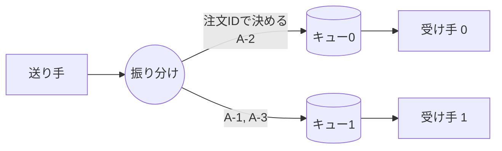

# 第19章: メッセージの順序を考える

## この章のゴール

注文のステータス変更イベント（作成→支払済→発送済→配達済）を2つの受け手（コンシューマー）で並行に処理し、順序が逆転して最終状態が古くなる問題を体験します。バージョン番号で古いイベントを捨てる基本の対処を試し、ほかの対処の考え方を知ります。

## Why: なぜこれを学ぶのか

「キューは先入れ先出し（FIFO）なので、順番は守られる」と思われがちです。確かにキューの中では順番が保たれます。しかし、そこから取り出して **処理する** 段階で、順番は簡単に崩れます。

注文が「発送済」になった後で、遅れて処理された「支払済」が上書きしたとします。お客さまの画面には、いつまでも「支払済」と表示されます。順序の問題は、エラーや例外を出さずに **静かにデータを壊す** ので、気づいたときには影響が広がっています。

## 前提

第13章で、やり直しのためにメッセージをキューの末尾へ入れ直すと、順番が変わりうることに触れました。

## ステップ1: 順序が崩れる原因を知る

RabbitMQ が保証するのは、「1つのチャネルから1つのキューへ発行したメッセージは、その順番でキューに並ぶ」ということです。次のような場合、**処理される順番** は発行した順番と変わります。

| 原因 | 何が起きるか |
| :--- | :--- |
| 受け手（コンシューマー）が複数いる | v1 を A が、v2 を B が受け取り、B のほうが先に終わる |
| 再配達・やり直し | v1 の処理に失敗してキューに戻る間に、v2 が先に処理される |
| 送り手（パブリッシャー）が複数いる | 別々のサーバーから送られたイベントの間には、決まった順番がない |
| 1つの受け手（コンシューマー）の中で並行に処理する | スレッドプールで同時に処理すると、終わる順番はばらばらになる |

**Why**: 順序を守るには「同時に処理しない」必要があります。一方、大量のメッセージを速く処理するには「同時に処理する」必要があります。**順序と並列性は、そのままでは両立しない** のです。

## ステップ2: 順序の逆転を体験する

この章で使うクラスは次のとおりです。

| クラス | 役割 |
| :--- | :--- |
| [StatusQueues.java](../src/main/java/com/example/async/ordering/StatusQueues.java) | 実験に使うキューを宣言する |
| [StatusEventPublisher.java](../src/main/java/com/example/async/ordering/StatusEventPublisher.java) | 注文ごとに、ステータス変更イベントを4つ（作成→支払済→発送済→配達済）順番に発行する。本文に **バージョン番号**（1〜4）を入れて、受け手（コンシューマー）が新旧を判断できるようにしている |
| [StatusConsumer.java](../src/main/java/com/example/async/ordering/StatusConsumer.java) | 2つの受け手（コンシューマー）で並行に処理し、注文ごとの最終状態を表示する |

`StatusConsumer` の中心となる部分を抜粋します。

<!-- code: src/main/java/com/example/async/ordering/StatusConsumer.java#handleDelivery -->
```java
/**
 * 処理時間をばらつかせてからステータスを更新する。
 */
@Override
public void handleDelivery(String consumerTag, Envelope envelope,
        AMQP.BasicProperties properties, byte[] body) throws IOException {
    // 「注文ID,バージョン,ステータス」を分解する
    String[] parts = new String(body, StandardCharsets.UTF_8).split(",");
    String orderId = parts[0];
    int version = Integer.parseInt(parts[1]);
    String status = parts[2];
    // 外部API呼び出しなどで処理時間がばらつく、という想定
    Console.sleep(100 + RANDOM.nextInt(700));
    // compute は同じキーに対して排他的に実行されるので、読んで比べて書くまでが割り込まれない
    VERSIONS.compute(orderId, (id, current) -> {
        int now = current == null ? 0 : current;
        if (checkVersion && version <= now) {
            Console.log(name + " 破棄: " + orderId + " " + status + "(v" + version + ") は現在の v" + now + " より古い");
            return now;
        }
        if (version < now) {
            Console.log(name + " ⚠ 逆転: " + orderId + " v" + now + " の後に " + status + "(v" + version + ") を適用した");
        } else {
            Console.log(name + " 更新: " + orderId + " → " + status + "(v" + version + ")");
        }
        STATUSES.put(orderId, status);
        return version;
    });
    getChannel().basicAck(envelope.getDeliveryTag(), false);
}
```

**Why**: 2つの受け手（コンシューマー）にはそれぞれ別のチャネルを使わせています。1つのチャネルの `handleDelivery` は1件ずつ順番に呼ばれるので、並行に処理させるにはチャネルを分ける必要があります。処理時間は100〜800ミリ秒の乱数にして、外部 API の呼び出し時間がばらつく状況を再現しています。

イベントを発行して、`plain`（届いた順に上書きするモード）で処理します。

```bash
./run.sh ordering.StatusEventPublisher
./run.sh ordering.StatusConsumer plain
```

15秒後に終了します。乱数を使っているので、結果は実行のたびに変わります。

```text
[10:00:08.137][pool-1-thread-4] consumer-0 ⚠ 逆転: A-1 v2 の後に CREATED(v1) を適用した
[10:00:08.934][pool-1-thread-8] consumer-1 ⚠ 逆転: A-2 v4 の後に PAID(v2) を適用した
[10:00:09.344][pool-1-thread-6] consumer-0 ⚠ 逆転: A-3 v4 の後に SHIPPED(v3) を適用した
[10:00:23.358][main] 最終状態: {A-1=DELIVERED, A-2=PAID, A-3=SHIPPED}
```

A-2 と A-3 は配達まで終わっているのに、最終状態が古いまま（`PAID`、`SHIPPED`）になりました。

**Why**: キューには A-3 の v3 と v4 が順番に並んでいました。v3 を consumer-0 が、v4 を consumer-1 が受け取り、v3 の処理のほうが長くかかったため、v4 の後に v3 が書き込まれました。キューの順番は守られていても、処理の **終わる** 順番は守られません。

**🔍 確認・実験してみよう**: `Console.sleep(100 + RANDOM.nextInt(700))` を `Console.sleep(300)` のように固定値にすると、逆転は減るでしょうか、なくなるでしょうか。動かす前に予想してから確かめてみましょう。

## ステップ3: 対処①　バージョン番号で古いイベントを捨てる

「順番どおりに届かなくてもよいので、**古いイベントで上書きしない**」という対処です。受け手（コンシューマー）が今のバージョンを覚えておき、それ以下のバージョンのイベントは捨てます。

キューを空にしてから、`versioned` モードで処理します。

```bash
./run.sh durability.QueueDrainer order-status
./run.sh ordering.StatusEventPublisher
./run.sh ordering.StatusConsumer versioned
```

```text
[10:01:18.802][pool-1-thread-4] consumer-0 破棄: A-1 CREATED(v1) は現在の v2 より古い
[10:01:20.411][pool-1-thread-9] consumer-0 破棄: A-2 PAID(v2) は現在の v4 より古い
[10:01:20.629][pool-1-thread-4] consumer-0 破棄: A-3 PAID(v2) は現在の v4 より古い
[10:01:33.032][main] 最終状態: {A-1=DELIVERED, A-2=DELIVERED, A-3=DELIVERED}
```

2つの受け手（コンシューマー）は並行に動いたまま、最終状態は正しくなりました。

**Why**: この方法は、イベントが「この時点の状態はこれ」という **状態の上書き** である場合に使えます。最終的な状態さえ正しければよいので、途中のイベントを捨てても問題ありません。第12章の「条件付きで更新する」冪等性の方法と同じ考え方なので、重複にも強くなります。

**⚠️ よくある失敗・誤解**: この方法は、イベントが **差分** の場合には使えません。「ポイントを100加算」というイベントを、古いからといって捨てるとポイントが消えます。また、v2 が届く前に v3 が届くと、v2 は捨てられます。「支払済になったら領収書を送る」のように、途中のイベントで何かをする受け手（コンシューマー）には向きません。

**💼 現場Tip**: 実務では、バージョン番号を DB の更新条件にします。たとえば `UPDATE orders SET status = ?, version = ? WHERE order_id = ? AND version < ?` と書くと、古いイベントによる上書きを DB が防ぎます。複数のサーバーで動く受け手（コンシューマー）でも、正しく動きます。

## ステップ4: ほかの対処を知る（紹介）

バージョン番号のほかにも、順序を守る方法があります。ここでは考え方だけを紹介します。

| 対処 | 考え方 | 順序の保証 | 処理の速さ | 向いている場面 |
| :--- | :--- | :--- | :--- | :--- |
| 受け手を1つにする | 1人で1件ずつ処理すれば、順番は崩れない | 全体の順序 | 並行に処理できない | 件数が少なく、厳密な順序が必要 |
| キーごとに分ける（パーティション分け） | 同じ注文のイベントは必ず同じキューに入れ、そのキューは1人だけが処理する | 注文ごとの順序 | キューの数まで並行に処理できる | 注文・口座など、まとまりごとに順序が必要 |
| バージョン番号で古いものを捨てる（ステップ3） | 順番は気にせず、古いイベントで上書きしない | なし（結果だけ正しくする） | 制限なし | 状態の上書き型のイベント |
| 通知だけを送る | 「注文 A-3 が更新された」とだけ送り、受け手が最新の状態を取りに行く | 不要になる | 制限なし | 受け手が送り手の API を呼べる場合 |

キーごとに分ける方法を図にすると、次のようになります。



**Why**: 順序の保証は高くつきます。設計の段階で「本当に順序が必要か」「何の単位で必要か」を問い直すことが大切です。多くの製品が、キーごとに順序を守る機能を持っています。製品ごとの呼び名は、第21章の対応表にまとめてあります。

## 動作確認

次の2点を確認できたら完了です。

1. `plain` モードで順序の逆転を確認し、最終状態の古い注文を見つけた（何回か実行して確認する）
2. `versioned` モードでは古いイベントが破棄され、最終状態がすべて `DELIVERED` になった

## もっと良くしてみよう

### 理解確認

1. キューの中の順番が守られていても、処理の順番が崩れるのはなぜでしょうか。
2. バージョン番号で古いイベントを捨てる方法が、差分型のイベントに使えないのはなぜでしょうか。
3. 注文IDごとにパーティションへ分けると、同じ注文の中の順番が守られるのはなぜでしょうか。

### 発展改善クイズ

1. 順序を守るために受け手（コンシューマー）を1つにしたとします。その受け手が落ちたら、注文の処理はどうなるでしょうか。止まらないようにするにはどうすればよいでしょうか。
2. 注文サービスが、DB の注文の更新には成功したのに、ステータス変更イベントの送信には失敗したとします。受け手（コンシューマー）から見ると、何が起きるでしょうか。第21章で名前を紹介する問題です。

---

| [← 第18章: メッセージを設計する](./18-message-design.md) | [全章目次](./README.md) | [第20章: ジョブの連鎖　ワークフロー →](./20-workflow-chain.md) |
| - | :-: | --: |
