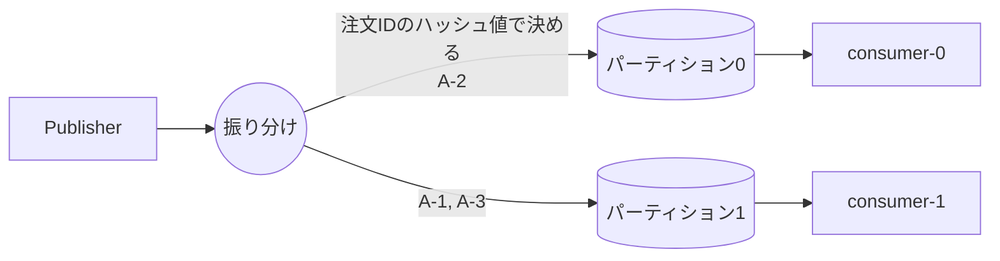

# 第20章: メッセージの順序を考える

## この章のゴール

注文のステータス変更イベント（作成→支払済→発送済→配達済）を2つのコンシューマーで並行に処理し、順序が逆転して最終状態が古くなる問題を体験します。バージョン番号で古いイベントを捨てる基本の対処と、キーごとのパーティション分けの考え方を知ります。

## Why: なぜこれを学ぶのか

「キューは先入れ先出し（FIFO）なので、順番は守られる」と思われがちです。確かにキューの中では順番が保たれます。しかし、そこから取り出して **処理する** 段階で、順番は簡単に崩れます。

注文が「発送済」になった後で、遅れて処理された「支払済」が上書きしたとします。お客さまの画面には、いつまでも「支払済」と表示されます。順序の問題は、エラーや例外を出さずに **静かにデータを壊す** ので、気づいたときには影響が広がっています。

## 前提

第13章で、リトライのためにメッセージをキューの末尾へ入れ直すと、順番が変わりうることに触れました。

## ステップ1: 順序が崩れる原因を知る

RabbitMQ が保証するのは、「1つのチャネルから1つのキューへ発行したメッセージは、その順番でキューに並ぶ」ということです。次のような場合、**処理される順番** は発行した順番と変わります。

| 原因 | 何が起きるか |
| :--- | :--- |
| コンシューマーが複数いる | v1 を A が、v2 を B が受け取り、B のほうが先に終わる |
| 再配達・リトライ | v1 の処理に失敗してキューに戻る間に、v2 が先に処理される |
| 送り手が複数いる | 別々のサーバーから送られたイベントの間には、決まった順番がない |
| 1つの受け手の中で並行に処理する | スレッドプールで同時に処理すると、終わる順番はばらばらになる |

**Why**: 順序を守るには「同時に処理しない」必要があります。一方、大量のメッセージを速く処理するには「同時に処理する」必要があります。**順序と並列性は、そのままでは両立しない** のです。

## ステップ2: 順序の逆転を体験する

まず、ステータス変更イベントを発行するプログラムを書きます。本文に **バージョン番号**（1〜4）を入れていて、受け手が新旧を判断できるようにしています。

`src/main/java/com/example/async/ordering/StatusQueues.java` を新規作成します。

<!-- code: answers/src/main/java/com/example/async/ordering/StatusQueues.java -->
```java
package com.example.async.ordering;

import java.io.IOException;

import com.rabbitmq.client.Channel;

/**
 * 注文ステータス変更イベント用のキューを宣言する部品。
 */
public final class StatusQueues {
    /** 全注文のステータス変更イベントを集めるキュー */
    public static final String QUEUE = "order-status";

    private StatusQueues() {
    }

    /**
     * キューを宣言する。
     *
     * @param channel 使うチャネル
     * @throws IOException 宣言に失敗した場合
     */
    public static void declare(Channel channel) throws IOException {
        channel.queueDeclare(QUEUE, true, false, false, null);
    }
}
```

`src/main/java/com/example/async/ordering/StatusEventPublisher.java` を新規作成します。

<!-- code: answers/src/main/java/com/example/async/ordering/StatusEventPublisher.java -->
```java
package com.example.async.ordering;

import java.nio.charset.StandardCharsets;

import com.example.async.common.Console;
import com.example.async.common.RabbitConnection;
import com.rabbitmq.client.Channel;
import com.rabbitmq.client.Connection;
import com.rabbitmq.client.MessageProperties;

/**
 * 3件の注文について、ステータス変更イベント（作成→支払済→発送済→配達済）を正しい順番で発行する。
 */
public class StatusEventPublisher {
    // 注文がたどるステータス。配列の添字+1 がバージョン番号になる
    private static final String[] STATUSES = {"CREATED", "PAID", "SHIPPED", "DELIVERED"};

    /**
     * イベントを発行する。
     *
     * @param args 使わない
     * @throws Exception 接続や送信に失敗した場合
     */
    public static void main(String[] args) throws Exception {
        String[] orderIds = {"A-1", "A-2", "A-3"};
        try (Connection connection = RabbitConnection.open("status-event-publisher");
                Channel channel = connection.createChannel()) {
            StatusQueues.declare(channel);
            // 注文ごとに、バージョン1（CREATED）から4（DELIVERED）まで続けて発行する
            for (String orderId : orderIds) {
                for (int v = 1; v <= STATUSES.length; v++) {
                    // 本文は「注文ID,バージョン,ステータス」
                    String body = orderId + "," + v + "," + STATUSES[v - 1];
                    channel.basicPublish("", StatusQueues.QUEUE, MessageProperties.PERSISTENT_TEXT_PLAIN,
                            body.getBytes(StandardCharsets.UTF_8));
                    Console.log("発行: " + body);
                }
            }
        }
    }
}
```

次に、2つのコンシューマーで並行に処理するプログラムを書きます。`src/main/java/com/example/async/ordering/StatusConsumer.java` を新規作成します。

<!-- code: answers/src/main/java/com/example/async/ordering/StatusConsumer.java -->
```java
package com.example.async.ordering;

import java.io.IOException;
import java.nio.charset.StandardCharsets;
import java.util.Map;
import java.util.Random;
import java.util.TreeMap;
import java.util.concurrent.ConcurrentHashMap;

import com.example.async.common.Console;
import com.example.async.common.RabbitConnection;
import com.rabbitmq.client.AMQP;
import com.rabbitmq.client.Channel;
import com.rabbitmq.client.Connection;
import com.rabbitmq.client.DefaultConsumer;
import com.rabbitmq.client.Envelope;

/**
 * 注文ステータスを更新するコンシューマー。1つのプロセスの中で2つのコンシューマーを並行に動かす。
 * plain モードは届いた順に上書きし、versioned モードは古いバージョンのイベントを捨てる。
 */
public class StatusConsumer extends DefaultConsumer {
    // 処理時間をばらつかせるための乱数
    private static final Random RANDOM = new Random();
    // 注文ID → 現在のバージョン。2つのコンシューマーで共有する
    private static final Map<String, Integer> VERSIONS = new ConcurrentHashMap<>();
    // 注文ID → 現在のステータス
    private static final Map<String, String> STATUSES = new ConcurrentHashMap<>();
    // ログに出すコンシューマー名
    private final String name;
    // 古いイベントを捨てるかどうか
    private final boolean checkVersion;

    /**
     * @param channel      使うチャネル
     * @param name         ログに出す名前
     * @param checkVersion true なら、今より古いバージョンのイベントを捨てる
     */
    public StatusConsumer(Channel channel, String name, boolean checkVersion) {
        super(channel);
        this.name = name;
        this.checkVersion = checkVersion;
    }

    /**
     * 処理時間をばらつかせてからステータスを更新する。
     */
    @Override
    public void handleDelivery(String consumerTag, Envelope envelope,
            AMQP.BasicProperties properties, byte[] body) throws IOException {
        // 「注文ID,バージョン,ステータス」を分解する
        String[] parts = new String(body, StandardCharsets.UTF_8).split(",");
        String orderId = parts[0];
        int version = Integer.parseInt(parts[1]);
        String status = parts[2];
        // 外部API呼び出しなどで処理時間がばらつく、という想定
        Console.sleep(100 + RANDOM.nextInt(700));
        // compute は同じキーに対して排他的に実行されるので、読んで比べて書くまでが割り込まれない
        VERSIONS.compute(orderId, (id, current) -> {
            int now = current == null ? 0 : current;
            if (checkVersion && version <= now) {
                Console.log(name + " 破棄: " + orderId + " " + status + "(v" + version + ") は現在の v" + now + " より古い");
                return now;
            }
            if (version < now) {
                Console.log(name + " ⚠ 逆転: " + orderId + " v" + now + " の後に " + status + "(v" + version + ") を適用した");
            } else {
                Console.log(name + " 更新: " + orderId + " → " + status + "(v" + version + ")");
            }
            STATUSES.put(orderId, status);
            return version;
        });
        getChannel().basicAck(envelope.getDeliveryTag(), false);
    }

    /**
     * 2つのコンシューマーを起動し、15秒後に各注文の最終ステータスを表示して終了する。
     *
     * @param args [0] plain / versioned（省略時は plain）
     * @throws Exception 接続に失敗した場合
     */
    public static void main(String[] args) throws Exception {
        boolean checkVersion = args.length > 0 && args[0].equals("versioned");
        Connection connection = RabbitConnection.open("status-consumer");
        for (int i = 0; i < 2; i++) {
            // コンシューマーごとにチャネルを分ける（チャネル単位で並行に配達される）
            Channel channel = connection.createChannel();
            StatusQueues.declare(channel);
            channel.basicQos(1);
            channel.basicConsume(StatusQueues.QUEUE, false, new StatusConsumer(channel, "consumer-" + i, checkVersion));
        }
        Console.log((checkVersion ? "versioned" : "plain") + " モードで購読中です。15秒後に最終状態を表示して終了します");
        Thread.sleep(15_000);
        // 注文ID順に並べて表示する
        Console.log("最終状態: " + new TreeMap<>(STATUSES));
        connection.close();
    }
}
```

**Why**: 2つのコンシューマーにはそれぞれ別のチャネルを使わせています。1つのチャネルの `handleDelivery` は1件ずつ順番に呼ばれるので、並行に処理させるにはチャネルを分ける必要があります。処理時間は100〜800ミリ秒の乱数にして、外部 API の呼び出し時間がばらつく状況を再現しています。

イベントを発行して、`plain`（届いた順に上書きするモード）で処理します。

```bash
./run.sh ordering.StatusEventPublisher
./run.sh ordering.StatusConsumer plain
```

15秒後に終了します。乱数を使っているので、結果は実行のたびに変わります。

```text
[10:00:08.137][pool-1-thread-4] consumer-0 ⚠ 逆転: A-1 v2 の後に CREATED(v1) を適用した
[10:00:08.934][pool-1-thread-8] consumer-1 ⚠ 逆転: A-2 v4 の後に PAID(v2) を適用した
[10:00:09.344][pool-1-thread-6] consumer-0 ⚠ 逆転: A-3 v4 の後に SHIPPED(v3) を適用した
[10:00:23.358][main] 最終状態: {A-1=DELIVERED, A-2=PAID, A-3=SHIPPED}
```

A-2 と A-3 は配達まで終わっているのに、最終状態が古いまま（`PAID`、`SHIPPED`）になりました。

**Why**: キューには A-3 の v3 と v4 が順番に並んでいました。v3 を consumer-0 が、v4 を consumer-1 が受け取り、v3 の処理のほうが長くかかったため、v4 の後に v3 が書き込まれました。キューの順番は守られていても、処理の **終わる** 順番は守られません。

**🔍 確認・実験してみよう**: `Console.sleep(100 + RANDOM.nextInt(700))` を `Console.sleep(300)` のように固定値にすると、逆転は減るでしょうか、なくなるでしょうか。動かす前に予想してから確かめてみましょう。

## ステップ3: 対処①　バージョン番号で古いイベントを捨てる

「順番どおりに届かなくてもよいので、**古いイベントで上書きしない**」という対処です。受け手が今のバージョンを覚えておき、それ以下のバージョンのイベントは捨てます。

キューを空にしてから、`versioned` モードで処理します。

```bash
./run.sh durability.QueueDrainer order-status
./run.sh ordering.StatusEventPublisher
./run.sh ordering.StatusConsumer versioned
```

```text
[10:01:18.802][pool-1-thread-4] consumer-0 破棄: A-1 CREATED(v1) は現在の v2 より古い
[10:01:20.411][pool-1-thread-9] consumer-0 破棄: A-2 PAID(v2) は現在の v4 より古い
[10:01:20.629][pool-1-thread-4] consumer-0 破棄: A-3 PAID(v2) は現在の v4 より古い
[10:01:33.032][main] 最終状態: {A-1=DELIVERED, A-2=DELIVERED, A-3=DELIVERED}
```

2つのコンシューマーは並行に動いたまま、最終状態は正しくなりました。

**Why**: この方法は、イベントが「この時点の状態はこれ」という **状態の上書き** である場合に使えます。最終的な状態さえ正しければよいので、途中のイベントを捨てても問題ありません。第12章の「条件付きで更新する」冪等性の方法と同じ考え方なので、重複にも強くなります。

**⚠️ よくある失敗・誤解**: この方法は、イベントが **差分** の場合には使えません。「ポイントを100加算」というイベントを、古いからといって捨てるとポイントが消えます。また、v2 が届く前に v3 が届くと、v2 は捨てられます。「支払済になったら領収書を送る」のように、途中のイベントで何かをする受け手には向きません。

**💼 現場Tip**: 実務では、バージョン番号を DB の更新条件にします。たとえば `UPDATE orders SET status = ?, version = ? WHERE order_id = ? AND version < ?` と書くと、古いイベントによる上書きを DB が防ぎます。複数のサーバーで動く受け手でも、正しく動きます。

## ステップ4: 対処②　キーごとのパーティション分け（紹介）

もう1つの考え方は、「全注文の順番」は守らなくても、「**同じ注文の中の順番**」さえ守れれば十分、というものです。注文IDごとに別のキュー（パーティション）へ振り分け、1つのキューを1つのコンシューマーだけが担当します。



同じ注文のイベントは必ず同じキューに入り、そのキューは1つのコンシューマーが1件ずつ処理するので、同じ注文の中の順番は守られます。別のパーティションの注文は並行に処理されるので、パーティションの数だけ処理能力を増やせます。

このキー（注文IDなど）ごとに順序を守る考え方は、製品の機能として提供されています。

| 製品 | キーごとの順序の仕組み |
| :--- | :--- |
| Apache Kafka | メッセージのキーでパーティションを決める。パーティション内の順序を保証 |
| Amazon SQS（FIFO キュー） | メッセージグループID ごとに順序を保証 |
| Google Cloud Pub/Sub | 順序指定キー（ordering key）ごとに順序を保証 |
| Azure Service Bus | セッションID ごとに順序を保証 |
| RabbitMQ | キューを分けて自分で振り分ける。Consistent Hash Exchange プラグインや、Super Stream という機能もある |

**気をつけること**:

- **偏り**: 特定のキー（大口顧客など）にイベントが集中すると、そのパーティションだけが詰まります
- **数の変更**: パーティション数を変えると、同じ注文が別のパーティションへ入るようになり、切り替えの瞬間に順番が入れ替わりえます
- **1件の失敗が全体を止める**: 順番を守るために失敗したメッセージで待つと、同じパーティションの他の注文も止まります（第13章のヘッドオブラインブロッキング）

**💼 現場Tip**: コンシューマーを1つだけにすれば、全体の順序は確実に守られます。RabbitMQ の **Single Active Consumer** という設定を使うと、複数のコンシューマーがつながっていても、実際に受け取るのは1つだけで、残りは待機します。落ちると、待機していたものが自動で引き継ぎます。件数が少ない場合の、いちばん単純な方法です。

## ステップ5: そもそも順序に頼らない設計を考える

| 対処 | 順序の保証 | 並列性 | 向いている場面 |
| :--- | :--- | :--- | :--- |
| コンシューマーを1つにする | 全体の順序 | なし | 件数が少なく、厳密な順序が必要 |
| キーでパーティションに分ける | キーごとの順序 | パーティション数まで | 注文・口座など、キーごとに順序が必要 |
| バージョン番号で古いものを捨てる | なし（結果だけ正しくする） | 制限なし | 状態の上書き型のイベント |

**Why**: 順序の保証は高くつきます。設計の段階で「本当に順序が必要か」を問い直すことが大切です。たとえば、ステータスを全部持たせる代わりに「注文 A-3 が更新された」という通知だけを送り、受け手が API で最新の状態を取りに行けば、順序は問題になりません（第19章の通知型のイベント）。

## 動作確認

次の2点を確認できたら完了です。

1. `plain` モードで順序の逆転を確認し、最終状態の古い注文を見つけた（何回か実行して確認する）
2. `versioned` モードでは古いイベントが破棄され、最終状態がすべて `DELIVERED` になった

## もっと良くしてみよう

### 理解確認

1. キューの中の順番が守られていても、処理の順番が崩れるのはなぜでしょうか。
2. バージョン番号で古いイベントを捨てる方法が、差分型のイベントに使えないのはなぜでしょうか。
3. 注文IDごとにパーティションへ分けると、同じ注文の中の順番が守られるのはなぜでしょうか。

### 発展改善クイズ

1. パーティション分けの構成で、コンシューマーが落ちたら、そのパーティションの注文はどうなるでしょうか。順序を守ったまま、止まらないようにするにはどうすればよいでしょうか。
2. 注文サービスが、DB の注文の更新には成功したのに、ステータス変更イベントの送信には失敗したとします。受け手から見ると、何が起きるでしょうか。次の章で、この問題を扱います。

---

| [← 第19章: メッセージを設計する](./19-message-design.md) | [全章目次](./README.md) | [第21章: ジョブの連鎖　ワークフロー →](./21-workflow-chain.md) |
| - | :-: | --: |
