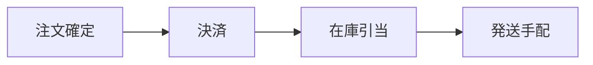
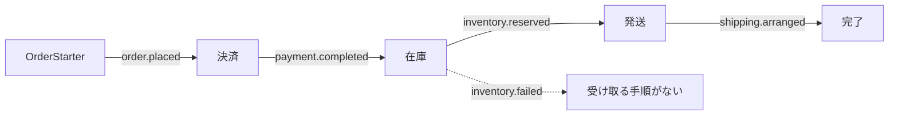

# 第20章: ジョブの連鎖　ワークフロー

## この章のゴール

注文確定から、決済・在庫・発送へと進む処理を、各手順が前の手順の結果を聞いて次のジョブを積む **連鎖** として作ります。途中で在庫切れが起きると「決済は済んだのに在庫がない」状態になり、しかも誰も全体の状況を把握していないことを体験します。

## Why: なぜこれを学ぶのか

第16章の fanout では、1つの出来事（注文確定）を、メール・在庫・ポイントの全員に **同時に、別々に** 知らせました。それぞれの処理は独立していて、順番も関係ありませんでした。

ところが現場には、順番に意味のある処理があります。決済が済むまで在庫は確保できず、在庫を確保するまで発送はできません。**1つの出来事から、ジョブが次々とつながっていく** この形が、ワークフロー（またはパイプライン）です。Pub/Sub との違いを、体験して確かめましょう。

## 前提

第10〜13章でジョブキューの基本を、第16〜17章で、合図（ルーティングキー）で配り先を決める topic エクスチェンジを学びました。第3章の地図の④にあたる章です。

## ステップ1: ワークフローとは何か



| 観点 | Pub/Sub（第16章の fanout） | ワークフロー（この章） |
| :--- | :--- | :--- |
| 受け手（コンシューマー）どうしの関係 | 独立している。同時に動いてよい | **依存している**。前の手順が終わってから動く |
| 順序 | 関係ない | 手順の順序が業務の意味を持つ |
| 全体で見ると | 別々の処理の集まり | **1つの業務** を、複数の手順で実現している |
| 失敗したとき | その受け手（コンシューマー）の問題 | 前の手順の結果を元に戻す必要が出る |

**Why**: 土台（ジョブキュー）に **「ジョブが終わったら次のジョブを積む」** が加わった形です。第3章の地図で、④ ワークフローは「ジョブが連鎖する」と整理しました。

## ステップ2: 連鎖を作る

各手順は、同じ形をしています。「ある合図（ルーティングキー）を受け取る → 手順を実行する → 結果の合図を発行する」です。この共通の形をまとめたのが `StepConsumer` です。[StepConsumer.java](../src/main/java/com/example/async/workflow/StepConsumer.java) を開きます。中心となる部分を抜粋します。

<!-- code: src/main/java/com/example/async/workflow/StepConsumer.java#handleDelivery -->
```java
/**
 * 注文IDを受け取って手順を実行し、結果を次のメッセージとして発行する。
 */
@Override
public void handleDelivery(String consumerTag, Envelope envelope,
        AMQP.BasicProperties properties, byte[] body) throws IOException {
    String orderId = new String(body, StandardCharsets.UTF_8);
    // 手順を実行して、次に発行するルーティングキーを得る
    String next = action.apply(orderId);
    if (next != null) {
        getChannel().basicPublish(EXCHANGE, next, null, orderId.getBytes(StandardCharsets.UTF_8));
        Console.log("  [" + stepName + "] " + orderId + " → " + next + " を発行");
    }
    getChannel().basicAck(envelope.getDeliveryTag(), false);
}
```

**Why**: `action` は、注文IDを受け取って、次に発行する合図（ルーティングキー）を返す関数です。手順が成功したか失敗したかは、**返す合図が違う** ことで表します。たとえば在庫の手順は、成功なら `inventory.reserved`、在庫切れなら `inventory.failed` を返します。

キューを「接続専用（exclusive）・切断時に自動削除」で作っているのは、実験を繰り返しても前回の残りのメッセージが混ざらないようにするためです。そのぶん、**ワーカーを先に起動してから** 注文を開始する必要があります。本番のワークフローで使うキューは、第11章のとおり永続化します。

次に、2つのプログラムを開きます。

| クラス | 役割 |
| :--- | :--- |
| [ChoreographyWorkers.java](../src/main/java/com/example/async/workflow/ChoreographyWorkers.java) | `StepConsumer.start(...)` を3回呼び、決済・在庫・発送の3つの手順を起動する |
| [OrderStarter.java](../src/main/java/com/example/async/workflow/OrderStarter.java) | 注文確定のイベント（`order.placed`）を発行して、連鎖を始める |

クラス名の `Choreography`（振り付け）は、「手順どうしが直接呼び合わず、前の手順の結果の合図を聞いて動く形」を指す言葉です。ステップ6で、名前だけ紹介します。3つの手順が受け取る合図と返す合図は、次のとおりです。

| 手順 | 受け取る合図 | 成功したとき返す合図 | 失敗したとき返す合図 |
| :--- | :--- | :--- | :--- |
| 決済 | `order.placed` | `payment.completed` | （この章では失敗しない） |
| 在庫 | `payment.completed` | `inventory.reserved` | `inventory.failed` |
| 発送 | `inventory.reserved` | `shipping.arranged` | （この章では失敗しない） |

合図のつながりを図にすると、次のようになります。`inventory.failed` を受け取る手順がないことにも注目してください。



## ステップ3: 連鎖を動かす

在庫が2個しかない設定で、手順のワーカーを起動します。

```bash
# ターミナル1
./run.sh workflow.ChoreographyWorkers 2
```

別のターミナルで、3件の注文を開始します。

```bash
# ターミナル2
./run.sh workflow.OrderStarter 3
```

ターミナル1に、次のような出力が出ます（時刻とスレッド名は省略しています）。

```text
決済 完了 A-1
  [payment] A-1 → payment.completed を発行
在庫引当 完了 A-1（残り 1）
  [inventory] A-1 → inventory.reserved を発行
決済 完了 A-2
  [payment] A-2 → payment.completed を発行
発送手配 完了 A-1
  [shipping] A-1 → shipping.arranged を発行
在庫引当 完了 A-2（残り 0）
  [inventory] A-2 → inventory.reserved を発行
決済 完了 A-3
  [payment] A-3 → payment.completed を発行
発送手配 完了 A-2
  [shipping] A-2 → shipping.arranged を発行
在庫切れ A-3
  [inventory] A-3 → inventory.failed を発行
```

A-1 と A-2 は、決済→在庫→発送と順に進みました。複数の注文の手順が、交互に進んでいる様子にも注目してください。手順どうしは、キューを通じてつながっているだけで、互いを直接呼び出してはいません。

## ステップ4: 途中で失敗するとどうなるか

A-3 を見てください。決済は **完了** しました。しかし在庫は **切れていて**、`inventory.failed` が発行されました。この合図を聞いている手順は、**どこにもありません**。

結果として、次の状態になっています。

| 項目 | 状態 |
| :--- | :--- |
| 決済 | 完了（お客さまのカードに請求が立っている） |
| 在庫 | 引き当てられていない |
| 発送 | 手配されない |
| 返金 | **誰もしない** |

**Why**: この連鎖には、次の3つの問題があります。

1. **全体の状況を知る者がいない**: 「A-3 は今どこまで進んだか」を、誰も把握していません。各手順は、自分の前後しか見ていません
2. **失敗の後始末をする者がいない**: 在庫切れを知っても、決済を取り消す役の手順が存在しません
3. **流れがコードに散らばる**: 「決済→在庫→発送」という業務の流れは、3つの手順の「受け取る合図」の組み合わせとして、**暗黙に** 決まっているだけです。流れを変えたいとき、どのコードを直せばよいかがわかりにくくなります

**⚠️ よくある失敗・誤解**: 在庫切れの注文は、お客さまへ連絡されるはず、と考えるのは誤解です。このコードには、お客さまへ連絡する手順がありません。ログに `在庫切れ A-3` と1行出るだけです。静かに起きる障害ほど、気づくのが遅れます。

**💼 現場Tip**: 現場では、この種の問題が「決済は成功したのに注文が存在しない」という、お客さまからの問い合わせとして発覚します。お金が絡む連鎖では、**途中で失敗したときの後始末を、最初に設計する** のが鉄則です。

## ステップ5: 連鎖を作るときに気をつけること

- **各手順は冪等にする**: メッセージは重複して届くことがあるので（第12章）、同じ注文の決済が2回実行されないようにします。決済 API の冪等キーに、注文IDを使うのが定石です
- **手順が応答しないときのタイムアウトを決める**: 在庫の手順が落ちていると、成功の合図も失敗の合図も返ってきません。何分待っても進まない注文を見つけ、人が調べる仕組みを用意します
- **取り消しにくい処理は最後に置く**: 発送手配や、お客さまへのメール送信は、実行してしまうと取り消せません。取り消せる処理（決済、在庫の引当）を先に済ませ、取り消せない処理を最後に置くと、後始末が減ります
- **手順の数が増えるほど、全体が見えなくなる**: 5手順、10手順になったとき、「流れを一目で確認できる場所」が欲しくなります

## ステップ6: この先で学ぶとよいこと（紹介）

この章で体験した「途中で失敗したときの後始末」には、定番の考え方があります。どれも、それだけで1つの講座になるほど奥が深いテーマです。この講座では名前だけ紹介します。実務でワークフローを任されたときに、ぜひ学んでください。

| 名前 | ひとことで言うと |
| :--- | :--- |
| 補償 | 済んでしまった手順を、別の操作で打ち消すこと。決済に対する返金、在庫引当に対する引当の解除など |
| Saga（サーガ）パターン | 補償を組み込んだ、手順の連鎖の設計 |
| コレオグラフィ | この章の形。各手順が、前の手順の結果を聞いて動く。全体の指揮者はいない |
| オーケストレーション | 流れを管理する指揮者（オーケストレーター）を1つ置き、各手順に命令を出す形 |
| ワークフロー製品 | Temporal、AWS Step Functions など。状態の保存・再試行・タイムアウトを引き受ける |

**Why**: この章の連鎖に「在庫切れを聞いたら返金する手順」を足すと、それが補償です。ただし、返金そのものが失敗したら、手順が増えたらと考えていくと、設計の論点が一気に増えます。まずは「途中で失敗すると、状態が宙に浮く」ことを体験として覚えておけば十分です。

## 動作確認

次の3点を確認できたら完了です。

1. A-1 と A-2 が、決済→在庫→発送の順に完了した
2. A-3 は決済が済んだ後、在庫切れで止まった
3. `inventory.failed` を聞く手順がなく、決済の取り消しが行われなかった

## もっと良くしてみよう

### 理解確認

1. Pub/Sub の fanout で配る処理と、ワークフローの連鎖は、何が違うのでしょうか。
2. A-3 の在庫切れが、誰にも対処されずに終わったのはなぜでしょうか。
3. 取り消しにくい処理を、連鎖の最後に置くのはなぜでしょうか。

### 発展改善クイズ

1. 在庫の手順が落ちていて、何も返ってこないとします。注文 A-4 が「止まっている」ことに、どうすれば気づけるでしょうか。
2. 手順を1つ追加して、お客さまに「在庫切れでした」とメールを送りたくなりました。`inventory.failed` を聞く手順を足せば実現できます。では、返金の手順と、メールの手順の、どちらが先に動くべきでしょうか。その順番は、どこに書かれるべきでしょうか。

---

| [← 第19章: メッセージの順序を考える](./19-ordering.md) | [全章目次](./README.md) | [第21章: まとめと次のステップ →](./21-wrap-up.md) |
| - | :-: | --: |
