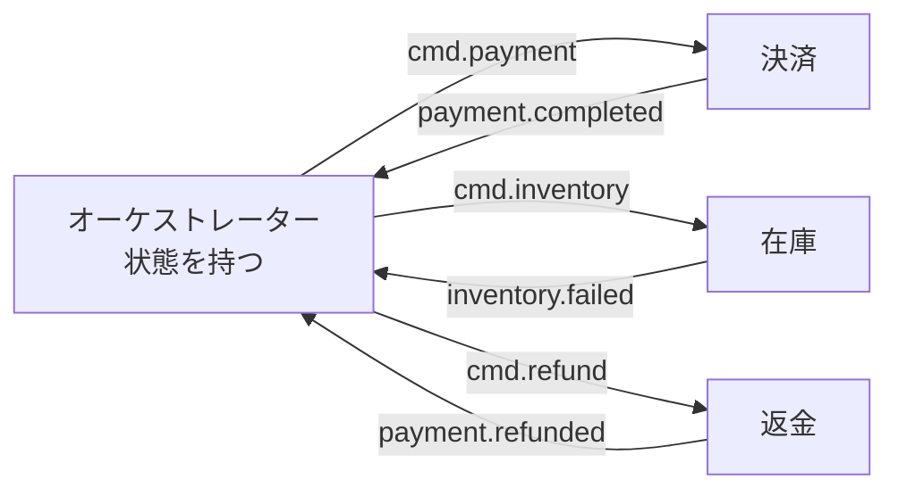

# 第22章: 連鎖の失敗と補償

## この章のゴール

連鎖の途中で失敗したとき、すでに済んだ手順を取り消す **補償** を実装します。最初は各手順が互いの結果を聞く形（コレオグラフィ）で補償を足し、次に流れを1か所で管理する **オーケストレーター** を自作して、2つの組み立て方の違いを体験します。

## Why: なぜこれを学ぶのか

第21章で、連鎖の途中で在庫切れが起きると、決済だけが済んだ状態で止まることを体験しました。ふつうのデータベースなら、トランザクションをロールバックすれば、すべて元に戻ります。しかし決済・在庫・発送は、**別々のサービス** です。1つのトランザクションにまとめられません。

そこで「取り消すための別の操作」（返金、引当の解除など）を用意し、失敗したらそれを実行して元の状態に近づけます。これを **補償** と呼び、補償を組み込んだ連鎖の設計を **Saga（サーガ）パターン** と呼びます。この章は、ワークフローの核心です。

## 前提

第21章で、決済→在庫→発送の連鎖を作り、在庫切れで止まる様子を確かめました。

## ステップ1: 補償とは何か

| 手順 | 実行する操作 | 補償（取り消す操作） | 補償できるか |
| :--- | :--- | :--- | :--- |
| 決済 | カードに請求する | 返金する | できる |
| 在庫引当 | 在庫を確保する | 引当を解除する | できる |
| 発送手配 | 配送業者に依頼する | 発送を取り消す | 出荷前なら可能。出荷後は不可 |
| お客さまへのメール | 注文完了を知らせる | （取り消せない。訂正メールを送るのみ） | 完全には不可 |

**Why**: 補償は、「なかったことにする」ロールバックとは違います。決済してから返金すれば、お客さまの明細には「請求」と「返金」の両方が残ります。補償は **新しい操作を追加して、結果を打ち消すもの** です。そのため、補償できない処理は、連鎖の後ろに置いて、実行する前に確認を済ませる設計にします（第21章）。

## ステップ2: コレオグラフィで補償を足す

まず、第21章のコードに、補償の手順を1つ足してみます。「在庫切れ（`inventory.failed`）を聞いたら、返金して `payment.refunded` を発行する」手順です。`ChoreographyWorkers` には、`compensate` を渡すとこの手順を起動する分岐がすでに入っています。

ワーカーを `compensate` つきで起動し直し、注文を開始します。

```bash
# ターミナル1（第21章のワーカーを Ctrl+C で止めてから）
./run.sh workflow.ChoreographyWorkers 2 compensate
```

```bash
# ターミナル2
./run.sh workflow.OrderStarter 3
```

```text
決済 完了 A-3
  [payment] A-3 → payment.completed を発行
在庫切れ A-3
  [inventory] A-3 → inventory.failed を発行
返金 完了 A-3
  [refund] A-3 → payment.refunded を発行
```

A-3 は返金されました。補償が動きました。

**Why**: 各手順が「他の手順の結果の合図」を聞いて動く形を、**コレオグラフィ（振り付け）** と呼びます。ダンサーが互いの動きを見て踊るように、全体を指揮する者はいません。小さな連鎖なら、仕組みが単純で、追加の部品も要りません。

ただし、手順や補償が増えると、次の問題が目立ってきます。

- 「返金手順が `inventory.failed` を聞く」という **業務のルール** が、返金手順のコードの中に隠れている。流れを知るには、全部の手順の「受け取る合図」を読み比べる必要がある
- 「在庫切れの後、お客さまへのメールと返金のどちらを先にするか」といった順序が、**どこにも書かれていない**
- 「A-3 は今どの状態か」を知るには、各手順のログを集めて突き合わせるしかない

## ステップ3: オーケストレーターで流れを1か所に集める

別の組み立て方が、**オーケストレーション（指揮）** です。流れを管理する指揮者（オーケストレーター）を1つ置き、各手順は「命令を受けて実行し、結果を返す」だけにします。次に何をするかは、指揮者だけが知っています。



まず、命令を受けて実行する手順たちを書きます。`src/main/java/com/example/async/workflow/CommandWorkers.java` を新規作成します。

<!-- code: answers/src/main/java/com/example/async/workflow/CommandWorkers.java -->
```java
package com.example.async.workflow;

import java.util.concurrent.atomic.AtomicInteger;

import com.example.async.common.Console;
import com.example.async.common.RabbitConnection;
import com.rabbitmq.client.Connection;

/**
 * オーケストレーターからの「命令」を受けて実行する手順たち。
 * 決済・在庫・発送・返金のそれぞれが、命令（cmd.○○）を受け、結果（○○.completed など）を返すだけで、
 * 次に何をするかは知らない。
 */
public class CommandWorkers {

    /**
     * 手順ごとのコンシューマーを起動する。
     *
     * @param args [0] 在庫数（省略時は 2）
     * @throws Exception 接続に失敗した場合
     */
    public static void main(String[] args) throws Exception {
        AtomicInteger stock = new AtomicInteger(args.length > 0 ? Integer.parseInt(args[0]) : 2);
        Connection connection = RabbitConnection.open("command-workers");

        StepConsumer.start(connection.createChannel(), "cmd-payment", "cmd.payment", orderId -> {
            Console.sleep(300);
            Console.log("決済 完了 " + orderId);
            return "payment.completed";
        });
        StepConsumer.start(connection.createChannel(), "cmd-inventory", "cmd.inventory", orderId -> {
            Console.sleep(300);
            if (stock.decrementAndGet() < 0) {
                Console.log("在庫切れ " + orderId);
                return "inventory.failed";
            }
            Console.log("在庫引当 完了 " + orderId + "（残り " + stock.get() + "）");
            return "inventory.reserved";
        });
        StepConsumer.start(connection.createChannel(), "cmd-shipping", "cmd.shipping", orderId -> {
            Console.sleep(300);
            Console.log("発送手配 完了 " + orderId);
            return "shipping.arranged";
        });
        StepConsumer.start(connection.createChannel(), "cmd-refund", "cmd.refund", orderId -> {
            Console.sleep(300);
            Console.log("返金 完了 " + orderId);
            return "payment.refunded";
        });
        Console.log("コマンドワーカー起動（在庫 " + stock.get() + "）。Ctrl+C で終了します");
    }
}
```

**Why**: 第21章の `ChoreographyWorkers` との違いに注目してください。受け取る合図が、前の手順の結果（`payment.completed`）から **命令**（`cmd.inventory`）に変わっています。手順は、自分の前後に何があるかを知りません。

次に、指揮者を書きます。`src/main/java/com/example/async/workflow/OrderOrchestrator.java` を新規作成します。

<!-- code: answers/src/main/java/com/example/async/workflow/OrderOrchestrator.java -->
```java
package com.example.async.workflow;

import java.io.IOException;
import java.nio.charset.StandardCharsets;
import java.util.Map;
import java.util.concurrent.ConcurrentHashMap;

import com.example.async.common.Console;
import com.example.async.common.RabbitConnection;
import com.rabbitmq.client.AMQP;
import com.rabbitmq.client.BuiltinExchangeType;
import com.rabbitmq.client.Channel;
import com.rabbitmq.client.Connection;
import com.rabbitmq.client.DefaultConsumer;
import com.rabbitmq.client.Envelope;

/**
 * 注文ワークフローの進行を一手に管理するオーケストレーター。
 * 各注文の「今どこまで進んだか」を覚えておき、結果に応じて次の命令を出す。失敗したら補償（返金）も命じる。
 */
public class OrderOrchestrator extends DefaultConsumer {

    /** 注文の進行状況 */
    enum State {
        /** 開始した（決済を命じた） */
        STARTED,
        /** 決済が済んだ（在庫を命じた） */
        PAID,
        /** 在庫を引き当てた（発送を命じた） */
        STOCKED,
        /** 在庫切れで返金中 */
        REFUNDING,
        /** すべて完了 */
        COMPLETED,
        /** 取り消しが完了 */
        CANCELLED
    }

    // 注文ID → 進行状況。どの注文がどこまで進んだかは、ここを見ればわかる
    private final Map<String, State> states = new ConcurrentHashMap<>();

    /**
     * @param channel 使うチャネル
     */
    public OrderOrchestrator(Channel channel) {
        super(channel);
    }

    /**
     * 届いた知らせ（ルーティングキー）と現在の進行状況から、次の命令を決める。
     */
    @Override
    public void handleDelivery(String consumerTag, Envelope envelope,
            AMQP.BasicProperties properties, byte[] body) throws IOException {
        String orderId = new String(body, StandardCharsets.UTF_8);
        switch (envelope.getRoutingKey()) {
            case "order.placed" -> advance(orderId, State.STARTED, "cmd.payment");
            case "payment.completed" -> advance(orderId, State.PAID, "cmd.inventory");
            case "inventory.reserved" -> advance(orderId, State.STOCKED, "cmd.shipping");
            // 補償: 在庫切れなら、すでに済んだ決済を取り消す
            case "inventory.failed" -> advance(orderId, State.REFUNDING, "cmd.refund");
            case "shipping.arranged" -> advance(orderId, State.COMPLETED, null);
            case "payment.refunded" -> advance(orderId, State.CANCELLED, null);
            default -> Console.log("未知の知らせ: " + envelope.getRoutingKey());
        }
        getChannel().basicAck(envelope.getDeliveryTag(), false);
    }

    // 進行状況を更新し、次の命令があれば発行する
    private void advance(String orderId, State next, String command) throws IOException {
        State before = states.put(orderId, next);
        Console.log("[orchestrator] " + orderId + ": " + (before == null ? "(新規)" : before) + " → " + next);
        if (command != null) {
            getChannel().basicPublish(StepConsumer.EXCHANGE, command, null, orderId.getBytes(StandardCharsets.UTF_8));
        }
    }

    /**
     * オーケストレーターを起動する。
     *
     * @param args 使わない
     * @throws Exception 接続に失敗した場合
     */
    public static void main(String[] args) throws Exception {
        Connection connection = RabbitConnection.open("order-orchestrator");
        Channel channel = connection.createChannel();
        channel.exchangeDeclare(StepConsumer.EXCHANGE, BuiltinExchangeType.TOPIC, false);
        channel.queueDeclare("wf.orchestrator", false, true, true, null);
        // 開始の合図と、各手順の結果をすべて聞く
        for (String key : new String[] {"order.placed", "payment.completed", "inventory.reserved",
            "inventory.failed", "shipping.arranged", "payment.refunded"}) {
            channel.queueBind("wf.orchestrator", StepConsumer.EXCHANGE, key);
        }
        channel.basicConsume("wf.orchestrator", false, new OrderOrchestrator(channel));
        Console.log("オーケストレーター起動。Ctrl+C で終了します");
    }
}
```

**Why**: `handleDelivery` の `switch` が、この業務の流れそのものです。

| 届いた知らせ | 進行状況を更新 | 次に出す命令 |
| :--- | :--- | :--- |
| `order.placed` | STARTED | `cmd.payment`（決済して） |
| `payment.completed` | PAID | `cmd.inventory`（在庫を取って） |
| `inventory.reserved` | STOCKED | `cmd.shipping`（発送して） |
| `inventory.failed` | REFUNDING | `cmd.refund`（**補償**: 返金して） |
| `shipping.arranged` | COMPLETED | なし |
| `payment.refunded` | CANCELLED | なし |

注文ごとの進行状況は、`states` の `Map` に入っています。「A-3 は今どこ」という問いの答えが、ここを見れば得られます。

## ステップ4: オーケストレーターを動かす

第21章のワーカーを止め、命令を受けるワーカーと指揮者を起動します。

```bash
# ターミナル1
./run.sh workflow.CommandWorkers 2
```

```bash
# ターミナル2
./run.sh workflow.OrderOrchestrator
```

```bash
# ターミナル3
./run.sh workflow.OrderStarter 3
```

指揮者のログに、注文ごとの進行状況の変化が出ます（時刻とスレッド名は省略しています）。

```text
[orchestrator] A-1: (新規) → STARTED
[orchestrator] A-1: STARTED → PAID
[orchestrator] A-2: (新規) → STARTED
[orchestrator] A-1: PAID → STOCKED
[orchestrator] A-2: STARTED → PAID
[orchestrator] A-1: STOCKED → COMPLETED
[orchestrator] A-3: (新規) → STARTED
[orchestrator] A-2: PAID → STOCKED
[orchestrator] A-3: STARTED → PAID
[orchestrator] A-2: STOCKED → COMPLETED
[orchestrator] A-3: PAID → REFUNDING
[orchestrator] A-3: REFUNDING → CANCELLED
```

A-1 と A-2 は `COMPLETED`、在庫切れの A-3 は `PAID → REFUNDING → CANCELLED` と、**補償を経て取り消し** になりました。

**Why**: 流れと補償が、`OrderOrchestrator` 1つに書かれています。「在庫切れのとき、返金の後でメールを送りたい」といった変更も、この `switch` に分岐を足すだけで済みます。進行状況は `states` に集約されているので、「止まっている注文」を見つけるのも簡単です。

## ステップ5: コレオグラフィとオーケストレーションを比べる

| 観点 | コレオグラフィ | オーケストレーション |
| :--- | :--- | :--- |
| 流れを管理する者 | いない（各手順が互いの合図を聞く） | オーケストレーター |
| 流れが書かれている場所 | 各手順の「受け取る合図」に分散 | オーケストレーターの1か所 |
| 全体の状況の把握 | 各ログを集めて突き合わせる | オーケストレーターの状態を見る |
| 手順の追加・変更 | 影響する手順をすべて直す | オーケストレーターを直す |
| 手順どうしの結合 | 他の手順の結果の合図を知っている | 命令を受けるだけで独立している |
| 追加の部品 | 不要 | オーケストレーター（と状態の保存先）が必要。単一の障害点になりうる |
| 向いている場面 | 手順が少なく、単純な連鎖 | 手順が多い、分岐や補償がある、全体の状況を追いたい |

**💼 現場Tip**: どちらが正解ということはありません。小さな連鎖はコレオグラフィで始め、手順が増えて流れを追えなくなったらオーケストレーションへ移る、という進め方が現実的です。

## ステップ6: 本番ではワークフロー製品を使う

この章の `OrderOrchestrator` は、学習用の最小版です。次の点が足りません。

- **状態がメモリ上にある**: オーケストレーターが落ちると、どの注文がどこまで進んだかを忘れます。本番では DB に保存し、再起動したら続きから再開します
- **タイムアウトがない**: 在庫の手順が応答しなくても、いつまでも待ち続けます
- **再試行がない**: 一時的な失敗を、自動でやり直す仕組みがありません
- **補償の失敗を扱っていない**: 返金そのものが失敗したら、どうなるでしょうか
- **履歴と可視化がない**: 「いつ、何が起きたか」を後から確認できません
- **重複への備えがない**: 同じ知らせを2回受け取ると、命令を二重に出します（第12章）

これらをまとめて引き受けるのが、ワークフロー製品です。

| 製品 | 特徴 |
| :--- | :--- |
| Temporal | プログラムとして書いたワークフローの状態を、自動で保存・再開する。再試行やタイムアウトも標準 |
| AWS Step Functions | 流れを状態遷移図として定義する。AWS のサービスとつなぎやすい |
| Azure Durable Functions | コードで流れを書き、状態は自動で保存される |
| Camunda | 業務の流れの図（BPMN）を、そのまま実行する |
| Apache Airflow | データ処理の連鎖（DAG）を、定期バッチで実行する。第14章の延長 |

**Why**: 製品の機能名は違っても、骨格は共通です。この章で作った、状態を持ち、結果に応じて次の命令を出し、失敗したら補償する形です。

## 動作確認

次の3点を確認できたら完了です。

1. `compensate` つきのコレオグラフィで、在庫切れの A-3 が返金された
2. オーケストレーターで、A-3 が `PAID → REFUNDING → CANCELLED` と遷移した
3. 流れが書かれている場所が、コレオグラフィでは分散し、オーケストレーションでは1か所であることを説明できる

## もっと良くしてみよう

### 理解確認

1. 補償が、ロールバックと違うのはなぜでしょうか。
2. コレオグラフィで手順が増えたとき、どのような問題が大きくなるでしょうか。
3. オーケストレーターが落ちたら、進行中の注文はどうなるでしょうか。

### 発展改善クイズ

1. 返金の手順が失敗したら、どうすればよいでしょうか。ここまでの章で学んだ、再試行・DLQ・冪等性を、どう組み合わせるか考えてみましょう。
2. 発送手配のあとで、お客さまが注文をキャンセルしたとします。補償の順序は、どうあるべきでしょうか。取り消せない処理があるときの設計を考えてみましょう。

---

| [← 第21章: ジョブの連鎖　ワークフロー](./21-workflow-chain.md) | [全章目次](./README.md) | [第23章: Outboxパターンで「DB更新とイベント送信」を両立する →](./23-outbox.md) |
| - | :-: | --: |
