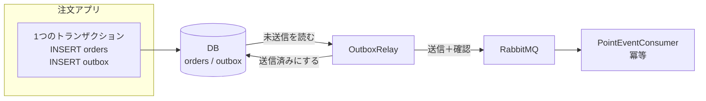

# 第23章: Outboxパターンで「DB更新とイベント送信」を両立する

## この章のゴール

「DB に注文を保存してから RabbitMQ にイベントを送る」素朴な実装で、RabbitMQ が止まるとイベントだけが失われる **二重書き込み問題** を再現します。注文と送るべきイベントを同じトランザクションで DB に保存し、別のプロセス（リレー）が RabbitMQ へ送り出す **Outbox パターン** で解決します。

## Why: なぜこれを学ぶのか

第15〜18章で、メッセージの消失・重複・毒メッセージ・順序の乱れという基本のトラブルを紹介しました。しかし、まだ穴が1つ残っています。**DB の更新とメッセージの送信を、両方とも成功させる（またはどちらも失敗させる）方法がない** ことです。

DB と RabbitMQ は別々のシステムなので、1つのトランザクションにまとめられません。注文は保存されたのにイベントが送られなければ、メールとポイントは永遠に処理されません。Outbox パターンは、この問題に対する定番の解決策で、マイクロサービスやイベント駆動の設計で広く使われています。

**この章は発展編です。** 内容は Part D よりも実装が多く、難しめです。まず読み物として全体の流れをつかみ、実際に動かすのは余裕があるときで構いません。

## 前提

第12章で学んだ冪等な作りと、第19章の `OrderPlacedEvent`・`EventPublisher` を使います。

## ステップ0: H2 を依存ライブラリに追加する

注文と Outbox の行を保存するため、`pom.xml` の `<dependencies>` に H2 データベースを追加します。

```xml
        <!-- 注文や Outbox を保存する組み込みDB -->
        <dependency>
            <groupId>com.h2database</groupId>
            <artifactId>h2</artifactId>
            <version>2.3.232</version>
        </dependency>
```

**Why**: H2 は、ファイルに保存できる組み込みのデータベースです。接続 URL に `AUTO_SERVER=TRUE` を付けると、注文アプリとリレーという別々のプロセスから、同じファイルを同時に開けます。第2章の「DB のジョブテーブル」と同じ発想を、ここでブローカーと組み合わせます。

## ステップ1: 二重書き込み問題を知る

注文確定の処理で、DB の保存とイベントの送信を順番に行うと、次の2通りの失敗が起こりえます。

| 順番 | 途中で失敗すると | 結果 |
| :--- | :--- | :--- |
| DB 保存 → イベント送信 | DB 保存は成功、送信だけ失敗 | 注文はあるのに、メールもポイントも処理されない（**イベントの消失**） |
| イベント送信 → DB 保存 | 送信は成功、DB 保存だけ失敗 | 存在しない注文のメールが届き、ポイントが付く（**幽霊イベント**） |

**Why**: どちらの順番にしても、2つめの操作が失敗したときに1つめを取り消せません。DB のトランザクションの外にある RabbitMQ への送信は、ロールバックできないからです。複数のシステムをまたぐトランザクション（2相コミット）という仕組みもありますが、RabbitMQ は対応しておらず、対応する製品でも性能や運用の難しさから避けられることが多いです。

## ステップ2: 注文サービスの DB を用意する

`src/main/java/com/example/async/outbox/ShopDatabase.java` を新規作成します。

<!-- code: answers/src/main/java/com/example/async/outbox/ShopDatabase.java -->
```java
package com.example.async.outbox;

import java.sql.Connection;
import java.sql.DriverManager;
import java.sql.SQLException;
import java.sql.Statement;

/**
 * 注文サービスの DB（orders テーブルと outbox テーブル）を開く部品。
 */
public final class ShopDatabase {
    // 注文アプリとリレーが別プロセスから同時に開けるよう AUTO_SERVER=TRUE にする
    private static final String URL = "jdbc:h2:file:./data/shop;AUTO_SERVER=TRUE";

    private ShopDatabase() {
    }

    /**
     * DB を開き、テーブルがなければ作る。
     *
     * @return JDBC 接続（使い終わったら close すること）
     * @throws SQLException 接続や DDL に失敗した場合
     */
    public static Connection open() throws SQLException {
        Connection conn = DriverManager.getConnection(URL, "sa", "");
        try (Statement st = conn.createStatement()) {
            // 注文そのもの
            st.execute("CREATE TABLE IF NOT EXISTS orders ("
                    + "order_id VARCHAR(50) PRIMARY KEY, customer_id VARCHAR(50) NOT NULL, amount BIGINT NOT NULL)");
            // 送るべきイベント。published_at が NULL の行が「まだ送っていない」イベント
            st.execute("CREATE TABLE IF NOT EXISTS outbox ("
                    + "id BIGINT AUTO_INCREMENT PRIMARY KEY, "
                    + "event_id VARCHAR(100) NOT NULL, "
                    + "payload VARCHAR(2000) NOT NULL, "
                    + "created_at TIMESTAMP DEFAULT CURRENT_TIMESTAMP, "
                    + "published_at TIMESTAMP NULL)");
        }
        return conn;
    }
}
```

**Why**: `outbox` テーブルが、この章の主役です。「送るべきイベント」を1行ずつ保存し、送り終わったら `published_at` に時刻を記録します。`published_at` が `NULL` の行が、まだ送っていないイベントです。

## ステップ3: 素朴な注文アプリを書く

`src/main/java/com/example/async/outbox/NaiveOrderApp.java` を新規作成します。

<!-- code: answers/src/main/java/com/example/async/outbox/NaiveOrderApp.java -->
```java
package com.example.async.outbox;

import java.sql.Connection;
import java.sql.PreparedStatement;
import java.sql.SQLException;

import com.example.async.common.Console;
import com.example.async.common.RabbitConnection;
import com.example.async.message.EventPublisher;
import com.example.async.message.OrderPlacedEvent;
import com.example.async.topic.OrderEventTopicPublisher;
import com.rabbitmq.client.BuiltinExchangeType;
import com.rabbitmq.client.Channel;

/**
 * 「DB に注文を保存してから、RabbitMQ にイベントを送る」を素朴に書いた注文アプリ。
 * 2つの別々のシステムへの書き込み（二重書き込み）が、片方だけ成功する問題を体験する。
 */
public class NaiveOrderApp {

    /**
     * 2秒ごとに注文を1件確定させる。途中で RabbitMQ を止めてみる。
     *
     * @param args [0] 注文件数（省略時は15件）
     * @throws Exception 起動時の接続に失敗した場合
     */
    public static void main(String[] args) throws Exception {
        int count = args.length > 0 ? Integer.parseInt(args[0]) : 15;
        // イベントを送れなかった件数
        int lost = 0;
        com.rabbitmq.client.Connection mq = RabbitConnection.open("naive-order-app");
        try (Connection db = ShopDatabase.open()) {
            Channel channel = mq.createChannel();
            channel.exchangeDeclare(OrderEventTopicPublisher.EXCHANGE, BuiltinExchangeType.TOPIC, true);
            channel.confirmSelect();
            EventPublisher publisher = new EventPublisher(channel, OrderEventTopicPublisher.EXCHANGE);
            // 起動時刻を注文IDに入れて、再実行しても ID がぶつからないようにする
            String prefix = "N" + (System.currentTimeMillis() / 1000 % 100000) + "-";
            for (int i = 1; i <= count; i++) {
                String orderId = prefix + i;
                // (1) DB に注文を保存する（自動コミットなので、ここで確定する）
                insertOrder(db, orderId, "C-1", 1000);
                try {
                    // (2) イベントを送り、ブローカーの確認を待つ
                    publisher.publish(OrderPlacedEvent.create(orderId, "C-1", 1000));
                    channel.waitForConfirmsOrDie(5000);
                    Console.log("注文 " + orderId + " : DB保存 OK / イベント送信 OK");
                } catch (Exception e) {
                    // (1) は確定済みなので、注文はあるのにイベントは誰にも届かない
                    lost++;
                    Console.log("注文 " + orderId + " : DB保存 OK / イベント送信 NG（" + e.getClass().getSimpleName() + "）");
                }
                Thread.sleep(2000);
            }
        } finally {
            // close() は切断中だと例外を投げるので、エラーを無視して閉じる abort() を使う
            mq.abort();
        }
        Console.log("終了: 注文 " + count + " 件のうち、イベントが失われたのは " + lost + " 件");
    }

    // 注文を1件 INSERT する
    private static void insertOrder(Connection db, String orderId, String customerId, long amount) throws SQLException {
        try (PreparedStatement ps = db.prepareStatement("INSERT INTO orders (order_id, customer_id, amount) VALUES (?, ?, ?)")) {
            ps.setString(1, orderId);
            ps.setString(2, customerId);
            ps.setLong(3, amount);
            ps.executeUpdate();
        }
    }
}
```

**Why**: 第11章で紹介したパブリッシャー確認も使っているので、送信の失敗は検知できます。それでも、**検知できたところで、DB の注文はもう確定している** ので取り消せません。「送信に失敗したら注文もロールバックする」ように書き換えても、今度は「ブローカーが止まっている間は注文を受けられない」ことになり、第1章の障害の波及に逆戻りします。

切断中の接続は `close()` で閉じようとすると例外を投げるため、`finally` でエラーを無視して閉じる `abort()` を使っています。

## ステップ4: RabbitMQ を止めて二重書き込み問題を体験する

素朴な注文アプリを、8件の注文で起動します。

```bash
./run.sh outbox.NaiveOrderApp 8
```

2件ほど「イベント送信 OK」が表示されたら、別のターミナルで RabbitMQ を止めます。

```bash
./broker.sh stop
```

```text
[09:29:22.407][main] 注文 N98162-1 : DB保存 OK / イベント送信 OK
[09:29:24.419][main] 注文 N98162-2 : DB保存 OK / イベント送信 OK
[RabbitMQ Error On Write Thread] WARN com.rabbitmq.client.impl.ForgivingExceptionHandler - An unexpected connection driver error occurred (Exception message: Connection reset by peer)
[09:29:26.427][main] 注文 N98162-3 : DB保存 OK / イベント送信 NG（AlreadyClosedException）
[09:29:28.430][main] 注文 N98162-4 : DB保存 OK / イベント送信 NG（AlreadyClosedException）
...
[09:29:36.451][main] 注文 N98162-8 : DB保存 OK / イベント送信 NG（AlreadyClosedException）
[09:29:36.460][main] 終了: 注文 8 件のうち、イベントが失われたのは 6 件
```

確認できたら、RabbitMQ を起動し直します。

```bash
./broker.sh start
```

**Why**: 3件目以降の注文は DB に保存されましたが、イベントは誰にも届いていません。ログに残っているだけです。RabbitMQ が復旧しても、失われたイベントを自動で送り直す仕組みはありません。

**🔍 確認・実験してみよう**: 「送信に失敗したら、成功するまでループで送り直す」ように `NaiveOrderApp` を直すと、問題は解決するでしょうか。送り直している最中に、注文アプリのプロセス自体が落ちた（デプロイで再起動された）場合を考えてみましょう。

## ステップ5: Outbox パターンの考え方を知る

Outbox パターンでは、注文アプリは RabbitMQ に **一切送りません**。代わりに、送るべきイベントを、注文と同じ DB の `outbox` テーブルに、**同じトランザクションで** 書き込みます。RabbitMQ への送信は、別のプロセスである **リレー** が担当します。



**Why**: 注文と outbox の行は1つのトランザクションでコミットされるので、「注文はあるのにイベントの記録がない」状態は起こりえません。RabbitMQ が止まっていても、注文アプリは DB だけで処理を終えられます。送れていないイベントは、DB に残っている限り、リレーがいつか必ず送ります。

## ステップ6: Outbox を使う注文アプリを書く

`src/main/java/com/example/async/outbox/OutboxOrderApp.java` を新規作成します。

<!-- code: answers/src/main/java/com/example/async/outbox/OutboxOrderApp.java -->
```java
package com.example.async.outbox;

import java.sql.Connection;
import java.sql.PreparedStatement;
import java.sql.SQLException;

import com.example.async.common.Console;
import com.example.async.message.OrderPlacedEvent;

/**
 * Outbox パターンの注文アプリ。RabbitMQ には一切接続しない。
 * 注文と「送るべきイベント」を、同じ DB の同じトランザクションで保存する。
 */
public class OutboxOrderApp {

    /**
     * 2秒ごとに注文を1件確定させる。
     *
     * @param args [0] 注文件数（省略時は15件）
     * @throws Exception DB 操作に失敗した場合
     */
    public static void main(String[] args) throws Exception {
        int count = args.length > 0 ? Integer.parseInt(args[0]) : 15;
        try (Connection db = ShopDatabase.open()) {
            String prefix = "X" + (System.currentTimeMillis() / 1000 % 100000) + "-";
            for (int i = 1; i <= count; i++) {
                String orderId = prefix + i;
                placeOrder(db, OrderPlacedEvent.create(orderId, "C-1", 1000));
                Console.log("注文 " + orderId + " : 注文と outbox を1トランザクションで保存 OK");
                Thread.sleep(2000);
            }
        }
    }

    // 注文の INSERT と outbox の INSERT を1つのトランザクションで行う
    private static void placeOrder(Connection db, OrderPlacedEvent event) throws SQLException {
        // トランザクションを開始する
        db.setAutoCommit(false);
        try {
            try (PreparedStatement ps = db.prepareStatement(
                    "INSERT INTO orders (order_id, customer_id, amount) VALUES (?, ?, ?)")) {
                ps.setString(1, event.orderId());
                ps.setString(2, event.customerId());
                ps.setLong(3, event.amount());
                ps.executeUpdate();
            }
            // 送るべきイベントを JSON のまま保存する。送信はリレーに任せる
            try (PreparedStatement ps = db.prepareStatement("INSERT INTO outbox (event_id, payload) VALUES (?, ?)")) {
                ps.setString(1, event.eventId());
                ps.setString(2, event.toJson());
                ps.executeUpdate();
            }
            // 両方まとめて確定する。注文だけ・イベントだけ、という中途半端な状態にはならない
            db.commit();
        } catch (SQLException e) {
            db.rollback();
            throw e;
        }
    }
}
```

**Why**: import に `com.rabbitmq` が1つもないことを確かめてください。注文アプリは、RabbitMQ の存在すら知りません。イベントは `toJson()` で JSON にして保存します。`eventId` もこの時点で決まって DB に残るので、リレーが何回送り直しても、同じ `messageId` で送られます（第12章のステップ9）。

## ステップ7: リレーを書く

`src/main/java/com/example/async/outbox/OutboxRelay.java` を新規作成します。

<!-- code: answers/src/main/java/com/example/async/outbox/OutboxRelay.java -->
```java
package com.example.async.outbox;

import java.sql.Connection;
import java.sql.PreparedStatement;
import java.sql.ResultSet;
import java.sql.SQLException;
import java.util.ArrayList;
import java.util.List;

import com.example.async.common.Console;
import com.example.async.common.RabbitConnection;
import com.example.async.message.EventPublisher;
import com.example.async.message.OrderPlacedEvent;
import com.example.async.topic.OrderEventTopicPublisher;
import com.rabbitmq.client.BuiltinExchangeType;
import com.rabbitmq.client.Channel;

/**
 * outbox テーブルの未送信イベントを読み出し、RabbitMQ へ送るリレー（中継役）。
 * 送れなければ何度でもやり直す。送れたら published_at を記録する。
 */
public class OutboxRelay {
    // 1回の読み出しで扱う最大件数
    private static final int BATCH_SIZE = 10;

    /**
     * Ctrl+C で止めるまで、1秒ごとに未送信イベントを送る。
     *
     * @param args 使わない
     * @throws Exception 起動時の接続に失敗した場合
     */
    public static void main(String[] args) throws Exception {
        try (Connection db = ShopDatabase.open();
                com.rabbitmq.client.Connection mq = RabbitConnection.open("outbox-relay")) {
            Channel channel = mq.createChannel();
            channel.exchangeDeclare(OrderEventTopicPublisher.EXCHANGE, BuiltinExchangeType.TOPIC, true);
            channel.confirmSelect();
            EventPublisher publisher = new EventPublisher(channel, OrderEventTopicPublisher.EXCHANGE);
            Console.log("リレーを開始しました。Ctrl+C で終了します");
            while (true) {
                try {
                    relayOnce(db, channel, publisher);
                } catch (Exception e) {
                    // RabbitMQ が止まっていても落ちずに、次の周回でやり直す
                    Console.log("送信失敗。1秒後にやり直します（" + e.getClass().getSimpleName() + "）");
                }
                Thread.sleep(1000);
            }
        }
    }

    // 未送信のイベントを古い順に読み、1件ずつ送って送信済みにする
    private static void relayOnce(Connection db, Channel channel, EventPublisher publisher) throws Exception {
        List<OutboxRow> rows = selectUnpublished(db);
        for (OutboxRow row : rows) {
            // 保存しておいた JSON からイベントを復元して送る（messageId には event_id が入る）
            publisher.publish(OrderPlacedEvent.fromJson(row.payload));
            // ブローカーが受け取ったことを確認する
            channel.waitForConfirmsOrDie(5000);
            // 確認できてから送信済みにする。ここで落ちると次の周回でもう一度送る（＝重複はありうる）
            markPublished(db, row.id);
            Console.log("送信済み outbox.id=" + row.id + " eventId=" + row.eventId);
        }
    }

    // 未送信の行を古い順に BATCH_SIZE 件まで読む
    private static List<OutboxRow> selectUnpublished(Connection db) throws SQLException {
        List<OutboxRow> rows = new ArrayList<>();
        String sql = "SELECT id, event_id, payload FROM outbox WHERE published_at IS NULL ORDER BY id LIMIT ?";
        try (PreparedStatement ps = db.prepareStatement(sql)) {
            ps.setInt(1, BATCH_SIZE);
            try (ResultSet rs = ps.executeQuery()) {
                while (rs.next()) {
                    rows.add(new OutboxRow(rs.getLong("id"), rs.getString("event_id"), rs.getString("payload")));
                }
            }
        }
        return rows;
    }

    // 送信済みの時刻を記録する
    private static void markPublished(Connection db, long id) throws SQLException {
        try (PreparedStatement ps = db.prepareStatement("UPDATE outbox SET published_at = CURRENT_TIMESTAMP WHERE id = ?")) {
            ps.setLong(1, id);
            ps.executeUpdate();
        }
    }

    // outbox の1行ぶんのデータ
    private static final class OutboxRow {
        private final long id;
        private final String eventId;
        private final String payload;

        private OutboxRow(long id, String eventId, String payload) {
            this.id = id;
            this.eventId = eventId;
            this.payload = payload;
        }
    }
}
```

**Why**: リレーは1秒ごとに次のことを繰り返します。

1. `published_at` が `NULL` の行を、`id` の古い順に最大10件読む
2. 1件ずつ発行し、パブリッシャー確認で受け取りを確かめる
3. 確認できたら `published_at` を記録する

RabbitMQ が止まっていて発行に失敗しても、例外を捕まえて次の周回でやり直します。この広い `catch (Exception e)` は、「どんな失敗でもリレーを止めない」ための、最上位の境界にだけ置いています。

**⚠️ よくある失敗・誤解**: 3の前（発行して確認できた後、`published_at` を記録する前）にリレーが落ちると、そのイベントは次の起動時にもう一度送られます。Outbox パターンは **at-least-once** です。受け手が冪等でなければ、二重処理が起きます。Outbox パターンは、第12章の冪等なコンシューマーと **セットで** 使います。

確認用のツールも作ります。`src/main/java/com/example/async/outbox/OutboxStatus.java` を新規作成します。

<!-- code: answers/src/main/java/com/example/async/outbox/OutboxStatus.java -->
```java
package com.example.async.outbox;

import java.sql.Connection;
import java.sql.ResultSet;
import java.sql.Statement;

import com.example.async.common.Console;

/**
 * 注文件数と、outbox の送信済み・未送信の件数を表示する確認用ツール。
 */
public class OutboxStatus {

    /**
     * 件数を表示する。
     *
     * @param args 使わない
     * @throws Exception DB 操作に失敗した場合
     */
    public static void main(String[] args) throws Exception {
        try (Connection db = ShopDatabase.open(); Statement st = db.createStatement()) {
            Console.log("orders 全件       : " + count(st, "SELECT COUNT(*) FROM orders"));
            Console.log("  うち Outbox 経由 : " + count(st, "SELECT COUNT(*) FROM orders WHERE order_id LIKE 'X%'"));
            Console.log("outbox 送信済み   : " + count(st, "SELECT COUNT(*) FROM outbox WHERE published_at IS NOT NULL"));
            Console.log("outbox 未送信     : " + count(st, "SELECT COUNT(*) FROM outbox WHERE published_at IS NULL"));
        }
    }

    // COUNT(*) の結果を返す
    private static long count(Statement st, String sql) throws Exception {
        try (ResultSet rs = st.executeQuery(sql)) {
            rs.next();
            return rs.getLong(1);
        }
    }
}
```

## ステップ8: 冪等な受け手を書く

Outbox パターンは at-least-once なので、受け手は重複に強くなければなりません。第12章の考え方（処理済みのメッセージIDを記録する）を、注文確定イベントの受け取りに使います。`PointStore` は第12章で書いたものを使います。

`src/main/java/com/example/async/outbox/PointEventConsumer.java` を新規作成します。

<!-- code: answers/src/main/java/com/example/async/outbox/PointEventConsumer.java -->
```java
package com.example.async.outbox;

import java.io.IOException;
import java.nio.charset.StandardCharsets;

import com.example.async.common.Console;
import com.example.async.common.RabbitConnection;
import com.example.async.idempotency.PointStore;
import com.example.async.message.OrderPlacedEvent;
import com.example.async.topic.OrderEventTopicPublisher;
import com.rabbitmq.client.AMQP;
import com.rabbitmq.client.BuiltinExchangeType;
import com.rabbitmq.client.Channel;
import com.rabbitmq.client.Connection;
import com.rabbitmq.client.DefaultConsumer;
import com.rabbitmq.client.Envelope;

/**
 * 注文確定イベントを購読して、金額の1%をポイントとして付与する、冪等な受け手。
 * 第17章の冪等な作りを、Pub/Sub のイベント（OrderPlacedEvent）の受け取りに使ったもの。
 */
public class PointEventConsumer extends DefaultConsumer {
    // ポイントを保存する場所
    private final PointStore store;

    /**
     * @param channel 使うチャネル
     * @param store   ポイントの保存先
     */
    public PointEventConsumer(Channel channel, PointStore store) {
        super(channel);
        this.store = store;
    }

    /**
     * イベントを解釈し、処理済みのメッセージIDでなければポイントを付与して、ack する。
     */
    @Override
    public void handleDelivery(String consumerTag, Envelope envelope,
            AMQP.BasicProperties properties, byte[] body) throws IOException {
        OrderPlacedEvent event = OrderPlacedEvent.fromJson(new String(body, StandardCharsets.UTF_8));
        long points = event.amount() / 100;
        boolean applied = store.addPointsOnce(properties.getMessageId(), event.customerId(), points);
        Console.log((applied ? "付与 " : "重複のためスキップ ") + event.orderId() + " +" + points
                + "pt → 残高 " + store.balance(event.customerId()) + "pt");
        getChannel().basicAck(envelope.getDeliveryTag(), false);
    }

    /**
     * order-events の注文確定イベントを購読する。
     *
     * @param args 使わない
     * @throws Exception 接続に失敗した場合
     */
    public static void main(String[] args) throws Exception {
        Connection connection = RabbitConnection.open("point-event-consumer");
        Channel channel = connection.createChannel();
        channel.exchangeDeclare(OrderEventTopicPublisher.EXCHANGE, BuiltinExchangeType.TOPIC, true);
        String queue = OrderEventTopicPublisher.EXCHANGE + ".point";
        channel.queueDeclare(queue, true, false, false, null);
        // 地域を問わず、注文確定イベントだけを受け取る
        channel.queueBind(queue, OrderEventTopicPublisher.EXCHANGE, "order.placed.*");
        channel.basicQos(10);
        channel.basicConsume(queue, false, new PointEventConsumer(channel, new PointStore()));
        Console.log("注文確定イベントを購読中です。Ctrl+C で終了します");
    }
}
```

**Why**: リレーが `OrderPlacedEvent` を発行するとき、`messageId` に `eventId` が入ります（第19章）。その `messageId` を `PointStore.addPointsOnce` に渡すので、リレーが同じイベントを再送しても、ポイントは二重に付与されません。

## ステップ9: RabbitMQ を止めても注文とイベントが失われないことを確かめる

前の実験の影響を消すため、ポイントのキューを空にし、DB を削除します。

```bash
./run.sh durability.QueueDrainer order-events.point
rm -rf data
```

3つのターミナルで、次の順に起動します。

```bash
# ターミナル1: 冪等なポイント付与（第12章の考え方を、イベントの受け取りに使ったもの）
./run.sh outbox.PointEventConsumer
```

```bash
# ターミナル2: リレー
./run.sh outbox.OutboxRelay
```

```bash
# ターミナル3: Outbox を使う注文アプリ（2秒ごとに12件）
./run.sh outbox.OutboxOrderApp 12
```

リレーが2件ほど送ったところで、4つめのターミナルで RabbitMQ を止めます。

```bash
./broker.sh stop
```

注文アプリは止まらずに注文を受け続け、リレーは「送信失敗。1秒後にやり直します」を繰り返します。この状態で件数を確かめます。

```bash
./run.sh outbox.OutboxStatus
```

```text
[09:30:48.338][main] orders 全件       : 12
[09:30:48.345][main]   うち Outbox 経由 : 12
[09:30:48.346][main] outbox 送信済み   : 2
[09:30:48.347][main] outbox 未送信     : 10
```

RabbitMQ を起動し直します。

```bash
./broker.sh start
```

10〜20秒ほどすると、リレーの自動再接続が終わり、たまっていたイベントが一気に送られます。

```text
[09:30:53.785][main] 送信失敗。1秒後にやり直します（AlreadyClosedException）
[09:30:54.793][main] 送信済み outbox.id=3 eventId=cb7e3960-792f-4d4a-8b0b-48244b55e21c
[09:30:54.797][main] 送信済み outbox.id=4 eventId=589af5a5-616b-42f2-a5b7-d69ded9d3d4e
...
[09:30:54.823][main] 送信済み outbox.id=12 eventId=619b71db-cd0a-4934-980c-16d1b06ba65f
```

ターミナル1のポイント付与にも12件が届き、残高は 120pt（1000円 × 1% × 12件）になります。

```bash
./run.sh outbox.OutboxStatus
```

```text
[09:31:26.358][main] orders 全件       : 12
[09:31:26.362][main]   うち Outbox 経由 : 12
[09:31:26.363][main] outbox 送信済み   : 12
[09:31:26.364][main] outbox 未送信     : 0
```

**Why**: RabbitMQ が止まっていた間も、注文アプリは1件も失敗せずに注文を受けました。送れなかったイベントは `outbox` に残り、RabbitMQ の復旧後にリレーがすべて送りました。第1章から追いかけてきた「ポイントサービスやブローカーの障害が注文に波及する」「イベントが消える」という問題が、ここで両方とも解決しました。

**🔍 確認・実験してみよう**: イベントの送信中にリレーを Ctrl+C で止めて、すぐに起動し直してみましょう。同じ `eventId` が2回送られることはあるでしょうか。もし送られた場合、ポイント付与の残高は正しいままでしょうか。

## ステップ10: Outbox パターンを本番で使うときの注意を知る

**💼 現場Tip**: 実際のシステムで Outbox パターンを使うときは、次の点も設計します。

- **リレーを複数台にする場合**: 2台のリレーが同じ行を同時に読むと、二重に送ります。`SELECT ... FOR UPDATE SKIP LOCKED`（ロック中の行を飛ばして読む SQL。PostgreSQL や MySQL 8 などで使える）で、読んだ行をロックして分担させます
- **順序**: リレーは `id` の順に送るので、1台なら発行順は保たれます。複数台にすると、第20章の順序の問題が起こりえます
- **遅延**: ポーリング間隔の分だけ、イベントの送信が遅れます。間隔を短くすると DB の負荷が増えます
- **掃除**: 送信済みの行は増え続けるので、一定期間が過ぎたら削除します

**💼 現場Tip**: ポーリングの代わりに、DB の変更履歴（トランザクションログ）を読み取ってイベントとして送る **CDC（Change Data Capture）** という方法もあります。Debezium が代表的なツールです。アプリが outbox テーブルに書き込むところは同じで、「未送信の行を探して送る」部分をツールに任せられます。

**💼 現場Tip**: 送信側の Outbox パターンと、受け手側で処理済みのIDを記録する Inbox パターン（第12章）を組み合わせると、「DB の更新」から「別サービスの DB の更新」までを、消失と二重処理なしでつなげられます。メッセージング単体では難しい exactly-once を、アプリの設計で実現する方法の1つです。

## 動作確認

次の3点を確認できたら完了です。

1. `NaiveOrderApp` で RabbitMQ を止めると、DB に保存済みなのにイベントの失われた注文が出た
2. `OutboxOrderApp` は、RabbitMQ を止めている間も注文を受け続けた
3. RabbitMQ の復旧後、`OutboxStatus` の「outbox 未送信」が 0 になり、ポイント残高が 120pt になった

## もっと良くしてみよう

### 理解確認

1. 「DB 保存 → イベント送信」の順番で、送信に失敗したら DB をロールバックする、という方法がうまくいかないのはなぜでしょうか。
2. Outbox パターンで、注文と outbox の行を同じトランザクションで書き込むのはなぜでしょうか。
3. Outbox パターンを使うとき、受け手を冪等にしなければならないのはなぜでしょうか。

### 発展改善クイズ

1. `OutboxRelay` は、10件を読んだ後に1件ずつ確認を待ちながら送っています。イベントが大量にたまったとき、もっと速く送るにはどう直せばよいでしょうか。第11章の確認の待ち方を思い出してみましょう。
2. 何度送っても RabbitMQ に拒否される行（たとえば payload が壊れている行）が `outbox` に1件あると、リレーはどうなるでしょうか。第13章の考え方を Outbox に当てはめると、どう扱えばよいでしょうか。

---

| [← 第22章: 連鎖の失敗と補償](./22-workflow-compensation.md) | [全章目次](./README.md) | [第24章: まとめと次のステップ →](./24-wrap-up.md) |
| - | :-: | --: |
