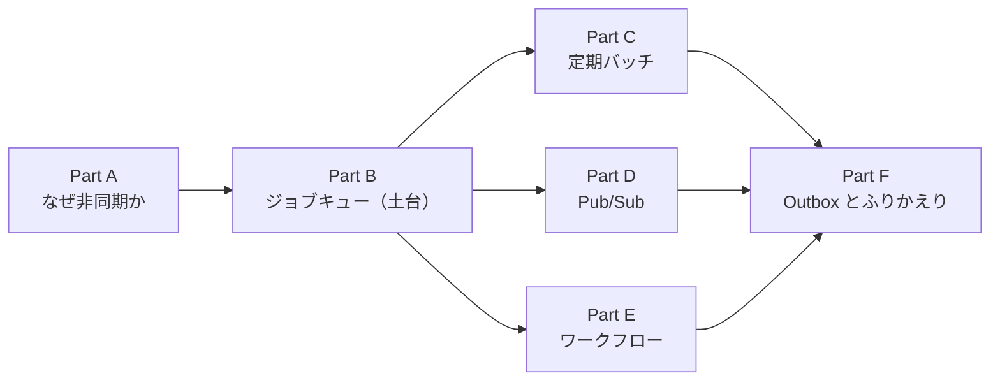

# 第24章: まとめと次のステップ

## この章のゴール

この講座で学んだ考え方を、RabbitMQ・Kafka・Amazon SQS/SNS・Google Cloud Pub/Sub の機能に対応付けて整理します。非同期処理を使う機能を設計するときのチェックリストを手に入れ、次に学ぶべきテーマを知ります。

## Why: なぜこれを学ぶのか

この講座では RabbitMQ を使いましたが、現場で使う製品は会社やシステムによって違います。大切なのは、RabbitMQ の操作を覚えたことではなく、「消失」「重複」「毒メッセージ」「順序」「連鎖の途中失敗」「DB との不整合」という問題と、その解き方を体験したことです。最後に、その体験をどの製品でも使える形に整理します。

## 前提

第23章までで、ジョブキュー・定期バッチ・Pub/Sub・ワークフローの基本から Outbox パターンまでを実装しました。

## ステップ1: 講座全体をふりかえる

| Part | 体験したこと | 学んだ考え方 |
| :--- | :--- | :--- |
| A（01〜06章） | 同期呼び出しの問題を体験し、メモリ・ファイル・DB・UDP の代替案の限界を試した | 非同期処理の土台（キューとワーカー）と5つのパターンの地図。同期と非同期の判断。製品の分類。AMQP の部品 |
| B（07〜13章）ジョブキュー | HTTP のポーリングの限界を知り、`DefaultConsumer` で受信し、ワーカーで分担した。再起動・強制終了・重複・毒メッセージを体験した | プッシュ型の受信、prefetch、永続化、ack、冪等性、DLQ |
| C（14章）定期バッチ | スケジューラーを2台にして二重投入を起こし、処理が遅れて滞留した | 時刻がジョブを積む。周期ごとのジョブIDと重複排除 |
| D（15〜20章）Pub/Sub | fanout と topic で配り分け、メッセージを設計し、順序の逆転を体験した | サブスクリプション、メッセージは契約、バージョン番号とパーティション |
| E（21〜22章）ワークフロー | ジョブを連鎖させ、在庫切れで途中失敗し、補償とオーケストレーターで直した | コレオグラフィとオーケストレーション、補償（Saga） |
| F（23〜24章） | RabbitMQ を止めても、注文とイベントが失われなかった | Outbox パターンと Inbox パターン、設計チェックリスト |

講座の流れを図にすると、次のようになります。土台のジョブキューの上に、定期バッチ・Pub/Sub・ワークフローを積み上げました。

**Why**: 消失（第11章）、重複（第12章）、二重投入（第14章）、連鎖の失敗（第21〜22章）は、すべて同じ結論に向かっていたことに気づいたでしょうか。**消失をなくそうとすると重複が起きる。だから受け手は冪等に作る**。これが、非同期処理でもっとも重要な原則です。

## ステップ2: 概念を製品の機能に対応付ける

この講座で学んだ概念は、製品ごとに次のような名前で提供されています。新しい製品を使うときは、この表の行を1つずつ埋めるつもりでドキュメントを読むと、理解が速くなります。

| 概念 | 章 | RabbitMQ | Apache Kafka | Amazon SQS / SNS | Google Cloud Pub/Sub |
| :--- | :--- | :--- | :--- | :--- | :--- |
| 発行先 | 17 | エクスチェンジ | トピック | SNS トピック | トピック |
| 購読者ごとの受け口 | 15, 17 | Binding したキュー | コンシューマーグループ | SNS を購読する SQS キュー | サブスクリプション |
| 受け取るイベントの絞り込み | 18 | topic / headers エクスチェンジ | トピックを分ける | SNS のフィルターポリシー | サブスクリプションのフィルター |
| 処理完了の通知 | 11 | `basicAck` | オフセットのコミット | `DeleteMessage` | `ack` |
| ack の期限 | 11 | `consumer_timeout` | `max.poll.interval.ms` | 可視性タイムアウト | 確認応答期限 |
| 手元に受け取る件数 | 10 | `basicQos`（prefetch） | `max.poll.records` | `MaxNumberOfMessages` | フロー制御 |
| 永続化と複製 | 11 | durable・persistent、クォーラムキュー | レプリケーション係数 | サービス側で保証 | サービス側で保証 |
| 送信の確認 | 11 | パブリッシャー確認 | `acks=all` | API のレスポンス | `publish` の結果 |
| 処理できないメッセージ | 13 | DLX と DLQ | 組み込みなし（別トピックへ送る） | リドライブポリシーと DLQ | デッドレタートピック |
| キーごとの順序 | 20 | キューを分ける | パーティションのキー | FIFO キューのメッセージグループID | 順序指定キー |
| 過去のメッセージの読み直し | 5 | ストリーム | オフセットの巻き戻し | 基本的になし | シーク |

**⚠️ よくある失敗・誤解**: 表の同じ行にあっても、細かい動きは製品ごとに違います。たとえば Kafka のオフセットのコミットは「ここまで処理した」という位置なので、RabbitMQ の `basicAck` のように1件だけを個別に処理済みにはできません。表は「どこを調べればよいか」の地図として使い、細部は必ず公式ドキュメントで確かめてください。

## ステップ3: RabbitMQ 独自の機能を知る

この講座では、製品に共通する考え方を優先し、RabbitMQ 独自の機能は紹介にとどめました。本番で RabbitMQ を使うときに調べるとよい機能を挙げておきます。

- **クォーラムキュー**: Raft で複数ノードに複製されるキュー。本番の重要なキューの標準（第11章）
- **ストリーム**: Kafka のように、読んでも消えず、読み直せるログ型のキュー
- **ポリシー**: DLX・TTL・長さの上限などを、キューの宣言ではなくブローカー側の設定で付ける（第13章）
- **Shovel / Federation**: 別の RabbitMQ（別のデータセンターなど）へメッセージを転送する
- **Single Active Consumer**: 複数のコンシューマーのうち1つだけに配る（第20章）
- **代替エクスチェンジ**: 行き場のないメッセージを別のエクスチェンジへ回す（第11章）
- **プラグイン**: 遅延配信（Delayed Message Exchange）、キーのハッシュで振り分ける Consistent Hash Exchange、MQTT・STOMP 対応など

## ステップ4: 非同期処理を使う機能の設計チェックリスト

非同期処理を使う機能を設計するときや、設計レビューをするときに、次の項目を確認します。第4章で作った「設計メモ」の項目は、このチェックリストとほぼ対応しています。

| 観点 | 確認すること | 章 |
| :--- | :--- | :--- |
| 本当に必要か | 結果整合性（少し遅れて反映される）を業務として受け入れられるか。同期のほうが適切ではないか | 2, 4 |
| メッセージの種類 | イベントか、コマンドか。名前は過去形か | 15, 16 |
| 契約 | `messageId`・`type`・スキーマのバージョンを持つか。項目の追加で受け手が壊れないか | 19 |
| 購読 | サービスごとにキュー（サブスクリプション）を分けているか。止まっている間のメッセージは残るか | 17 |
| 永続化 | キューもメッセージも永続化しているか。複製は必要か | 11 |
| ack | 処理（DB のコミット）が終わってから ack しているか | 11 |
| 送信の確認 | 送信側で、ブローカーの受け取りと、キューへの到達を確かめているか | 11 |
| 冪等性 | 同じメッセージが2回届いても、結果が変わらないか | 12 |
| 失敗の扱い | 一時的エラーと恒久的エラーを分けているか。リトライの上限と DLQ はあるか。DLQ を監視しているか | 13 |
| 定期バッチ | スケジューラーを動かすのは1台だけか。周期ごとのジョブIDで重複を弾けるか。止まっていた間の扱いを決めたか | 14 |
| 順序 | 順序は本当に必要か。必要なら、何の単位（キー）で必要か | 20 |
| ワークフロー | 各手順に補償があるか。全体の進行状況を追えるか。応答しない手順のタイムアウトを決めたか | 21, 22 |
| DB との整合性 | DB の更新とイベントの送信を、Outbox などで両立しているか | 23 |
| 運用 | キューの滞留件数・DLQ の件数・コンシューマーの数を監視しているか。トレース ID を引き継いでいるか | 10, 19, 13 |

**💼 現場Tip**: このチェックリストの多くは、障害が起きてから「なぜ考えていなかったのか」と問われる項目です。設計書のテンプレートに入れておくと、チームで抜け漏れを防げます。

## ステップ5: 次に学ぶテーマを知る

この講座の先には、次のようなテーマがあります。

| テーマ | 内容 |
| :--- | :--- |
| ワークフロー製品 | Temporal、AWS Step Functions などで、第22章のオーケストレーターが足りなかった状態の保存・再試行・タイムアウト・履歴を任せる |
| イベントログとストリーム処理 | Kafka などで、起きたことを消さずに記録し、読み直して集計や再処理に使う（第5章で紹介したもの） |
| CQRS とイベントソーシング | 更新と参照のモデルを分ける。状態ではなく「起きたイベントの列」を正として保存する |
| CloudEvents と AsyncAPI | イベントの形式と、メッセージングの API 仕様を標準化する |
| Apache Kafka | ログ型の製品で、大量のイベントの処理やストリーム処理を学ぶ |
| クラウドのマネージドサービス | Amazon SQS/SNS/EventBridge、Google Cloud Pub/Sub などを、この講座の対応表を手がかりに使ってみる |
| フレームワーク | Spring AMQP や Spring Cloud Stream などが、この講座で手で書いた接続・ack・リトライ・DLQ をどう肩代わりしてくれるかを見る |

**Why**: フレームワークを使うと、この講座で書いたコードの多くは設定数行で済むようになります。それでも、設定の1つ1つが「何を防ぐためのものか」は、この講座で体験したとおりです。中身を知っている人は、フレームワークの既定値が自分の業務に合っているかを判断できます。

## 動作確認

この章ではプログラムを実行しません。最後に、次の3つを自分の言葉で説明できるか確認してください。

1. at-least-once のメッセージングで、受け手を冪等に作らなければならない理由
2. DLQ が「ごみ箱」ではない理由
3. Outbox パターンが、DB の更新とイベントの送信を両立できる理由

## もっと良くしてみよう

### 理解確認

1. ステップ2の表で、自分が業務で使っている（または使う予定の）製品の行を埋められるでしょうか。埋められない行は、何を調べればよいでしょうか。
2. 「消失をなくそうとすると重複が起きる」のはなぜか、送信側と受信側のそれぞれで説明してみましょう。
3. 設計チェックリストのうち、この講座の注文確定の例でまだ実装していない項目はどれでしょうか。

### 発展改善クイズ

1. この講座の注文確定の流れに「決済」を加えることになりました。決済に失敗したら、在庫の引当を取り消す必要があります。イベントのやり取りだけで、これをどう実現すればよいでしょうか。
2. この講座のコードを、実際のサービスとして本番に出すとしたら、何を足す必要があるでしょうか。設計チェックリストを見ながら、優先順位を付けて挙げてみましょう。

---

| [← 第23章: Outboxパターンで「DB更新とイベント送信」を両立する](./23-outbox.md) | [全章目次](./README.md) | |
| - | :-: | --: |
